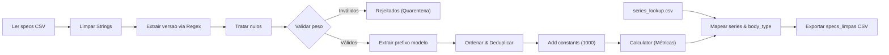
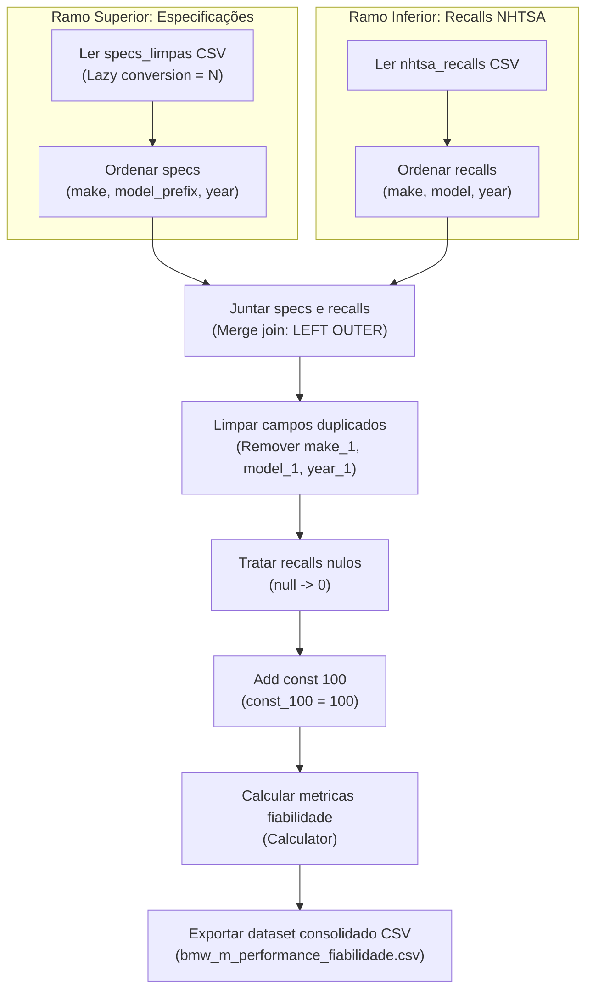
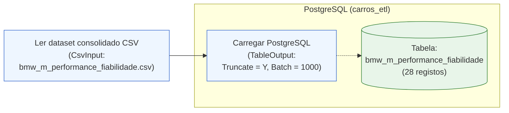

# ISI TP1 — Análise de Performance e Fiabilidade Automóvel

- **Unidade Curricular:** Integração de Sistemas de Informação (ISI)
- **Curso:** Licenciatura em Engenharia de Sistemas Informáticos (LESI) — IPCA / EST
- **Ano Letivo:** 2026/27
- **Tema:** Pipeline ETL para Análise Comparativa de Performance Mecânica e Fiabilidade Rodoviária (Gama BMW M)

---

## 1. Enquadramento e Objetivos

Este projeto implementa uma pipeline robusta de **Extract, Transform, Load (ETL)** desenvolvida no **Pentaho Data Integration (PDI / Kettle)**. O sistema recolhe, higieniza, valida e cruza dados heterogéneos de especificações técnicas automóveis com dados oficiais de segurança rodoviária obtidos via API REST externa, preparando os artefactos para persistência relacional em PostgreSQL e exportações analíticas multiformato.

O ciclo de vida dos dados cumpre as três fases obrigatórias do enunciado de ISI:
- **Fase 1 (Recolha e Ingestão — "E"):** Ingestão de datasets locais em formato CSV e consumo dinâmico de Web Services REST com respostas estruturadas em JSON.
- **Fase 2 (Processamento e Limpeza — "T"):** Normalização sintática, validação de regras de integridade, segregação de registos inválidos para quarentena (*Dead-Letter Queue*), aplicação de Expressões Regulares (ER) para extração semântica, imputação controlada de valores nulos, deduplicação determinística, junções (*Stream Lookups*) e computação de rácios mecânicos derivados.
- **Fase 3 (Persistência e Exportação — "L"):** Exportação em múltiplos formatos canónicos (CSV, JSON, SQL/relacional).

---

## 2. Estrutura do Repositório

```text
isi-tp1-performance-fiabilidade/
├── data/
│   ├── raw/                 # Dados originais em bruto (specs.csv, series_lookup.csv)
│   ├── staging/             # Quarentena e dados intermédios (rejeitados_specs.csv)
│   ├── processed/           # Datasets canónicos limpos e validados (specs_limpas.csv, nhtsa_recalls.csv, bmw_m_performance_fiabilidade.csv)
│   └── export/              # Exportações finais consolidadas (CSV, JSON, SQL)
├── kettle/
│   ├── transformations/     # Ficheiros de transformação Kettle (.ktr)
│   │   ├── T1_extract_specs.ktr
│   │   ├── T2_extract_nhtsa.ktr
│   │   ├── T3_consolidate_metrics.ktr
│   │   └── T4_load_postgres.ktr
│   └── jobs/                # Jobs de orquestração (.kjb)
├── docs/
│   ├── decisoes_etl.md      # Caderno formal de decisões técnicas e arquitetura
│   └── diagramas/           # Checklist e inventário de capturas para o relatório final
├── prints/                  # Capturas de ecrã consolidadas do Pentaho Spoon
├── sql/                     # Esquemas DDL, tabelas de dimensão/facto e views analíticas
│   └── 01_schema.sql        # DDL da tabela consolidada bmw_m_performance_fiabilidade
└── logs/                    # Ficheiros de registo e auditoria de execução ETL
```

---

## 4. Transformações Desenvolvidas (Secção 4 do Relatório)

### 4.1. Transformação T1: Extração e Limpeza de Especificações (`T1_extract_specs.ktr`)

A Transformação T1 é responsável pela leitura, validação, limpeza e enriquecimento das especificações mecânicas da gama desportiva BMW M.

#### Arquitetura do Fluxo
O pipeline processa 29 registos originais, isola 1 tuplo com dados omissos para quarentena e materializa 28 modelos enriquecidos em `data/processed/specs_limpas.csv`.



#### Fragmentos Técnicos e Regras de Negócio de T1

1. **Normalização de Strings (`Limpar Strings` — `String operations`):**
   - **Campos:** `make`, `model`
   - **Operações:** `Trim type = both`, `Lower/Upper = upper` para o campo `make`; `Trim type = both` para `model`.

2. **Expressões Regulares (`Regex evaluation`):**
   - **Extração de Edições/Versões de Alto Rendimento (`Extrair versao via Regex`):**
     - Campo avaliado: `model` $\rightarrow$ Campo de captura criado: `versao`
     ```regex
     .*?\b(Competition|CSL|GTS|CS|Touring)\b.*
     ```
   - **Normalização da Chave de Série (`Extrair prefixo modelo`):**
     - Campo avaliado: `model` $\rightarrow$ Campo de captura criado: `model_prefix` (ex.: `"M2"`, `"M3"`, `"M4"`, `"M5"`, `"M6"`, `"M8"`)
     ```regex
     ^(M\d)\b.*
     ```

3. **Imputação Semântica de Nulos (`Tratar nulos` — `If field value is null`):**
   - **Campo:** `versao`
   - **Valor de substituição:** `'Base'` (separa a extração léxica da regra de negócio, prevenindo nulos em dimensões relacionais).

4. **Controlo de Qualidade e Isolamento de Rejeitados (`Validar peso` — `Filter rows`):**
   - **Condição booleana:** `weight_kg IS NOT NULL`
   - **Saída TRUE (Válidos):** Segue para `Extrair prefixo modelo` (fluxo analítico principal).
   - **Saída FALSE (Inválidos):** Desvia para `Rejeitados` (`data/staging/rejeitados_specs.csv`) como *Dead-Letter Queue* (isolou o modelo `M3 E92 GTS`).

5. **Fórmulas de Engenharia Automóvel (`Calculator` via constante `const_1000 = 1000`):**
   - `peso_ton = weight_kg / const_1000` (Cálculo `A / B`)
   - `litros = engine_cc / const_1000` (Cálculo `A / B`)
   - `hp_por_tonelada = engine_hp / peso_ton` (Cálculo `A / B`)
   - `hp_por_litro = engine_hp / litros` (Cálculo `A / B`)

6. **Cruzamento em Memória (`Mapear series e body_type` — `Stream lookup`):**
   - **Chave de junção:** `model_prefix` = `model_prefix` (cruzamento com `data/raw/series_lookup.csv`)
   - **Campos recuperados:** `series` (ex.: `"Série 3 M"`), `body_type` (ex.: `"Sedan/Touring"`, `"Coupé"`).

#### Artefactos Visuais de T1 (em `prints/` e `docs/diagramas/`)
- `T1_pipeline_completo.png` — Canvas panorâmico no Spoon com vistos verdes em todos os 12 steps.
- `T1_metricas_execucao.png` — Painel Step Metrics (29 lidos $\rightarrow$ 1 rejeitado $\rightarrow$ 28 exportados).
- `T1_preview_dados_finais.png` — Grelha tabular do resultado limpo (`specs_limpas.csv`).
- `T1_config_string_operations.png` — Diálogo do step *Limpar Strings*.
- `T1_config_regex_versao.png` — Diálogo do step *Extrair versao via Regex*.
- `T1_config_tratar_nulos.png` — Diálogo do step *Tratar nulos*.
- `T1_config_filter_peso.png` — Diálogo do step *Validar peso*.
- `T1_config_regex_prefixo.png` — Diálogo do step *Extrair prefixo modelo*.
- `T1_config_calculator_metricas.png` — Diálogo do step *Calculator*.
- `T1_config_stream_lookup.png` — Diálogo do step *Mapear series e body_type*.

---

### 4.2. Transformação T2: Ingestão de Dados de Recalls via API NHTSA (`T2_extract_nhtsa.ktr`)

A Transformação T2 é responsável pela extração dinâmica de métricas de fiabilidade e segurança rodoviária através do consumo da API pública RESTful da **NHTSA** (*National Highway Traffic Safety Administration*).

#### Arquitetura do Pipeline ETL
O fluxo é composto por 9 etapas sequenciais:

```mermaid
flowchart LR
    A["Ler specs_limpas CSV"] --> B["Selecionar marca modelo ano"]
    B --> C["Ordenar por modelo e ano"]
    C --> D["Deduplicar para API"]
    D --> E["Construir URL NHTSA (JS)"]
    E --> F["Chamar API Recalls (REST GET)"]
    F --> G["Extrair recalls JSON (JSONPath)"]
    G --> H["Selecionar campos recalls"]
    H --> I["Exportar recalls CSV"]
```



1. **Leitura e Seleção:** Ingestão de `specs_limpas.csv` e isolamento dos atributos-chave de pesquisa (`make`, `model_prefix` renomeado para `model`, `year`).
2. **Ordenação e Deduplicação:** Ordenação composta (`Sort rows`) seguida de remoção de redundâncias (`Unique rows`), assegurando que apenas combinações estritamente únicas de gama/ano realizam pedidos HTTP, mitigando latência e respeitando *rate limits*.
3. **Construção Dinâmica do Endpoint:** Script JavaScript encarregue de codificar parâmetros e estruturar o URL REST.
4. **Consumo da API Externa:** Invocação HTTP GET via `REST client`.
5. **Parsing e Extração JSON:** Desserialização do payload JSON através de JSONPath (`$.Count`) no step `JSON input`.
6. **Projeção e Persistência:** Filtragem das variáveis auxiliares (`Select values`) e exportação do artefacto limpo `data/processed/nhtsa_recalls.csv`.

#### Fragmentos Técnicos e Regras de Negócio de T2

1. **Construção Dinâmica de URL (`Construir URL NHTSA` — `Modified Java Script Value`):**
   ```javascript
   var url_recalls = "https://api.nhtsa.gov/recalls/recallsByVehicle?make=" 
                     + encodeURIComponent(make) 
                     + "&model=" 
                     + encodeURIComponent(model) 
                     + "&modelYear=" 
                     + year;
   ```

2. **Invocação de Web Service REST (`Chamar API Recalls` — `REST client`):**
   - **Método HTTP:** `GET`
   - **Campo do URL:** `url_recalls`
   - **Campo de resposta:** `resposta_json`

3. **Parsing e Desserialização JSON (`Extrair recalls JSON` — `JSON input`):**
   - **Fonte:** Campo de stream `resposta_json`
   - **Expressão JSONPath:** `$.Count`
   - **Campo extraído:** `nhtsa_recalls_count` (`Integer`)

#### Artefactos Visuais de T2 (em `prints/` e `docs/diagramas/`)
- `T2_pipeline_completo.png` — Canvas do pipeline com os 9 steps e status de execução com sucesso.
- `T2_metricas_execucao.png` — Métricas de execução (28 tuplos processados, 0 erros, tempo de resposta ~5.3s).
- `T2_config_javascript_url.png` — Configuração do step de concatenação e encoding do URL.
- `T2_config_rest_client.png` — Configuração da chamada REST (HTTP GET dinâmico).
- `T2_config_json_input.png` — Configuração do separador Fields com a expressão JSONPath `$.Count`.
- `T2_preview_dados_finais.png` — Grelha de validação dos dados finais com os recalls extraídos (`nhtsa_recalls.csv`).

> [!NOTE] **Nota Metodológica sobre a Cobertura da NHTSA**
> A base da NHTSA reflete exclusivamente o mercado rodoviário dos EUA. Modelos ou variantes exclusivos do mercado europeu (como o **M3 E46 CSL** e a carrinha **M3 G81 Touring**) não foram comercializados nos EUA, justificando a inexistência de registos locais e a consequente imputação semântica de `0` recalls em T3.

---

### 4.3. Transformação T3: Consolidação e Métricas Finais (`T3_consolidate_metrics.ktr`)

A Transformação T3 consolida os dados de especificações técnicas (`specs_limpas.csv`) com o histórico de fiabilidade e segurança rodoviária da NHTSA (`nhtsa_recalls.csv`). Esta etapa calcula indicadores analíticos combinados e gera o artefacto tabular final do projeto.

#### Arquitetura do Pipeline ETL
O fluxo é composto por 10 steps organizados em 2 ramos concorrentes e um tronco de consolidação:



1. **Ramo Superior (Especificações):** Ingestão de `specs_limpas.csv` (`CSV file input` com *Lazy Conversion* desativada) seguido de ordenação multi-chave (`Sort rows` por `make ASC`, `model_prefix ASC`, `year ASC`).
2. **Ramo Inferior (Recalls NHTSA):** Ingestão de `nhtsa_recalls.csv` seguido de ordenação multi-chave (`Sort rows` por `make ASC`, `model ASC`, `year ASC`).
3. **Junção Ordenada (`Merge join`):** Realização de um `LEFT OUTER JOIN` garantindo a preservação integral dos registos mecânicos, utilizando a chave composta `(make, model_prefix, year) = (make, model, year)`.
4. **Limpeza de Metadados (`Select values`):** Remoção das colunas redundantes geradas na junção (`make_1`, `model_1`, `year_1`).
5. **Imputação de Valores Ausentes (`If field value is null`):** Substituição de valores nulos em `nhtsa_recalls_count` por `0`, refletindo ausência de registo de campanhas de recall.
6. **Cálculo de Indicadores de Fiabilidade:**
   - Injeção de constante (`Add constants`): `const_100 = 100` (Number).
   - Cálculos analíticos (`Calculator`):
     - Rácio base de recalls por unidade de potência: `recalls_por_hp = nhtsa_recalls_count / engine_hp`
     - Métrica normalizada de fiabilidade: `recalls_por_100hp = recalls_por_hp * const_100`
7. **Persistência Final (`Text file output`):** Exportação do dataset analítico consolidado para `data/processed/bmw_m_performance_fiabilidade.csv` (28 registos, formato delimitado por vírgula com cabeçalho UTF-8).

#### Fragmentos Técnicos e Regras de Negócio de T3

1. **Configuração da Junção Ordenada (`Merge join`):**
   - **Tipo de Junção:** `LEFT OUTER`
   - **Stream 1 (`Ordenar specs`):** `make`, `model_prefix`, `year`
   - **Stream 2 (`Ordenar recalls`):** `make`, `model`, `year`

2. **Limpeza de Metadados e Sufixos (`Select values`):**
   - **Campos removidos:** `make_1`, `model_1`, `year_1` (redundâncias geradas pelo step de merge).

3. **Imputação Semântica de Nulos (`If field value is null`):**
   - **Campo:** `nhtsa_recalls_count`
   - **Valor de substituição:** `0` (interpretação de inexistência de campanhas de recall).

4. **Fórmulas de Engenharia e Fiabilidade (`Calculator` com `const_100 = 100`):**
   - `recalls_por_hp = nhtsa_recalls_count / engine_hp` (Cálculo `A / B`)
   - `recalls_por_100hp = recalls_por_hp * const_100` (Cálculo `A * B`)

#### Artefactos Visuais de T3 (em `prints/` e `docs/diagramas/`)
- `T3_pipeline_completo.png` — Canvas global no Spoon com os dois ramos concorrentes, a junção central e visto verde em todos os 10 steps.
- `T3_metricas_execucao.png` — Painel Step Metrics comprovando a leitura das duas fontes, junção de 28 tuplos e gravação sem erros (~0.5s).
- `T3_config_merge_join.png` — Configuração do Merge Join exibindo a modalidade LEFT OUTER JOIN e as chaves de correspondência de ambos os passos.
- `T3_config_select_values.png` — Configuração da remoção das colunas duplicadas da stream da direita (`make_1`, `model_1`, `year_1`).
- `T3_config_calculator_metricas.png` — Configuração das operações de divisão e multiplicação no Calculator.
- `T3_preview_dados_finais.png` — Pré-visualização da grelha de dados consolidada com todos os atributos mecânicos, identificadores de série e rácios calculados.

---

### 4.4. Transformação T4: Carga Relacional em PostgreSQL (`T4_load_postgres.ktr`)

A Transformação T4 concretiza a **Fase 3 (Carregamento e Persistência)**, carregando os dados limpos e consolidados de performance mecânica e fiabilidade rodoviária na base de dados relacional **PostgreSQL** (`carros_etl`).

#### Arquitetura do Fluxo
O pipeline ingere o ficheiro consolidado `bmw_m_performance_fiabilidade.csv` de forma portável e persiste 28 tuplos na tabela `bmw_m_performance_fiabilidade`:



#### Fragmentos Técnicos e Decisões de T4

1. **Portabilidade e Higienização de Strings (`CsvInput`):**
   - **Caminho Relativo:** `${Internal.Entry.Current.Directory}/../../data/processed/bmw_m_performance_fiabilidade.csv`.
   - **Formatação de Strings:** `<length>-1</length>` e `<trim_type>both</trim_type>` para todos os atributos textuais, prevenindo padding e caracteres espúrios.
   - **Tipificação Numérica:** Campos inteiros lidos como `Integer` e rácios decimais com precisão estrita e ponto decimal `.`.

2. **Esquema Relacional DDL (`sql/01_schema.sql`):**
   - Estrutura física composta por 20 colunas (chave primária `id SERIAL`, 18 atributos analíticos mapeados e carimbo de auditoria `loaded_at TIMESTAMP DEFAULT CURRENT_TIMESTAMP`).
   - Restrição de integridade `CONSTRAINT uq_model_year UNIQUE (model, year)` impedindo duplicações semânticas.

3. **Idempotência Determinística via TRUNCATE (`TableOutput`):**
   - Ativação do parâmetro `<truncate>Y</truncate>` (Truncate table), que esvazia atomicamente a tabela de destino antes da inserção em lote (`commit = 1000`).
   - Garante que reexecuções parciais ou repetidas da pipeline ETL decorrem sem falhas por colisão de chaves únicas ou inconsistências de dados residuais.

4. **Mapeamento Explícito de 18 Atributos:**
   - Inserção estrita dos 18 atributos analíticos, delegando no PostgreSQL a atribuição do `id` sequencial e do timestamp `loaded_at`.

#### Artefactos Visuais de T4 (em `prints/` e `docs/diagramas/`)
- `T4_pipeline_completo.png` — Canvas panorâmico no Spoon com os passos *Ler dataset consolidado CSV* e *Carregar PostgreSQL* com visto verde.
- `T4_config_csv_input.png` — Diálogo do step `CsvInput` evidenciando o caminho relativo e a parametrização dos 18 campos.
- `T4_ddl_create_table.png` — Execução do script DDL de criação da tabela no pgAdmin / editor SQL.
- `T4_metricas_execucao.png` — Painel Step Metrics comprovando 28 linhas lidas e 28 linhas inseridas com 0 erros.
- `T4_dados_postgres.png` — Visualização dos 28 registos carregados na tabela PostgreSQL via pgAdmin.

---

## 5. Próximas Etapas

- [x] **T1 (`T1_extract_specs.ktr`):** Extração, limpeza e métricas mecânicas (Concluída).
- [x] **T2 (`T2_extract_nhtsa.ktr`):** Ingestão de recalls via API NHTSA (Concluída).
- [x] **T3 (`T3_consolidate_metrics.ktr`):** Junção analítica e cálculo de fiabilidade (Concluída).
- [x] **T4 (`T4_load_postgres.ktr`):** Carga relacional idempotente em PostgreSQL (Concluída).
- [ ] **T5 (`T5_exports.ktr`):** Exportação dos dados consolidados em múltiplos formatos heterogéneos (CSV, JSON, XML/SQL).
- [ ] **J_main (`J_main.kjb`):** Orquestração sequencial completa do pipeline com controlo de erros, logs e notificações por email.

