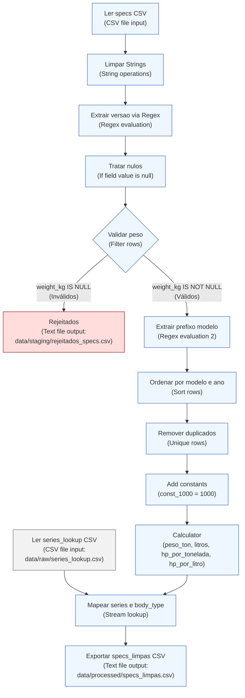
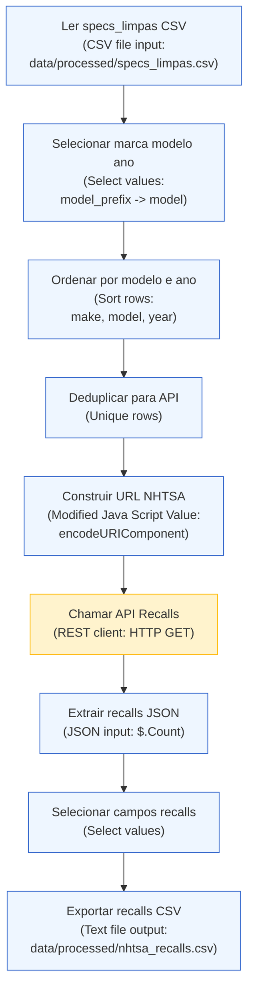
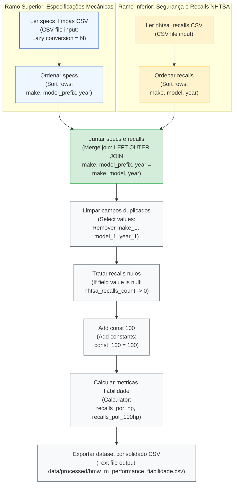
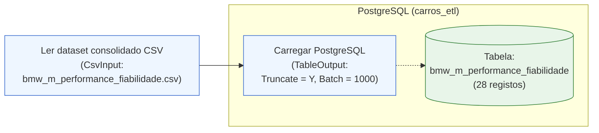
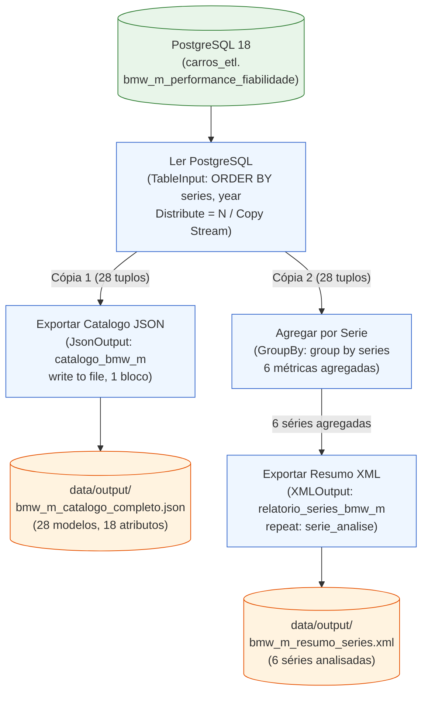
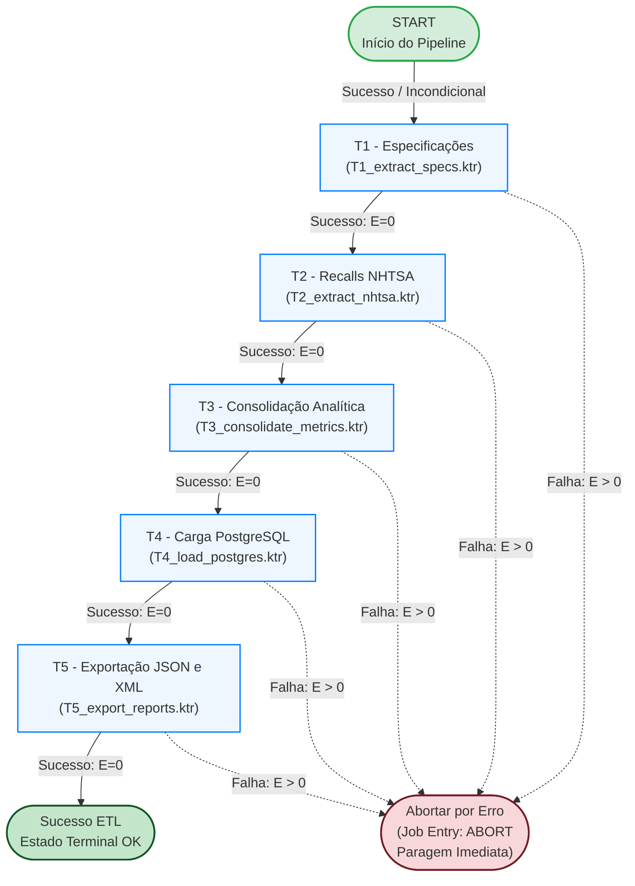

# Caderno de Decisões Técnicas de ETL — Transformação T1 (`T1_extract_specs.ktr`)

- **Unidade Curricular:** Integração de Sistemas de Informação (ISI) — Licenciatura em Engenharia de Sistemas Informáticos (LESI), IPCA/EST
- **Projeto:** ISI TP1 — Análise de Performance e Fiabilidade Automóvel
- **Artefacto:** `kettle/transformations/T1_extract_specs.ktr`
- **Áreas de Dados Envolvidas:** `data/raw/` (origem) $\rightarrow$ `data/staging/` (destino e quarentena)

---

## 1. Enquadramento e Objetivo da Transformação

A transformação **`T1_extract_specs.ktr`** constitui o primeiro estágio da pipeline de ETL do projeto, cumprindo os requisitos da **Fase 1 (Recolha e Preparação)** e **Fase 2 (Processamento e Transformação de Dados)** definidos no enunciado de ISI:

1. **Ingestão e Validação Estrutural:** Consumo do dataset de especificações automóveis em bruto (`data/raw/specs.csv`).
2. **Normalização e Higienização:** Limpeza sintática de strings e eliminação de ruído/espaçamento indevido.
3. **Extração Léxica por Expressões Regulares (ER):** Decomposição semântica dos modelos (versões de alto rendimento e prefixo de série).
4. **Qualidade de Dados e Gestão de Rejeitados:** Segregação e quarentena de tuplos com valores críticos ausentes para preservação da fidelidade matemática das métricas derivadas.
5. **Deduplicação Determinística:** Garantia de unicidade da chave natural composta (`make`, `model`, `year`).
6. **Enriquecimento e Cálculo de Métricas:** Computação encadeada de rácios de performance mecânica ($\text{cv/ton}$ e $\text{cv/l}$) e fusão dimensional via *Lookup* com metadados de séries (`data/raw/series_lookup.csv`).
7. **Materialização em Staging / Processed:** Produção do artefacto higienizado `data/processed/specs_limpas.csv` e isolamento de registos inválidos em quarentena (`data/staging/rejeitados_specs.csv`).

---

## 2. Arquitetura do Fluxo de Dados (Pipeline T1)



---

## 3. Tabela Detalhada de Decisões Técnicas

A tabela abaixo documenta formalmente a justificação académica, o operador do Pentaho Kettle empregue e a parametrização técnica aplicada em cada etapa da transformação:

| Step no Kettle | Tipo de Operador | Configuração Técnica Aplicada | Justificação Académica (critérios de avaliação, integridade de dados e separação de conceitos) |
| :--- | :--- | :--- | :--- |
| **Ler specs CSV** | `CSV file input` (`CsvInput`) | • **Encoding:** `UTF-8`<br>• **Separator:** `,`<br>• **Enclosure:** `"`<br>• **Header:** `Y`<br>• **Type:** `Number` em `zero_to_sixty_mph` (formato `#.##`, decimal `.`)<br>• **Trim type:** `both` nos campos de texto (`make`, `model`) | **Robustez na Ingestão Heterogénea (Fase 1):** Garante a interpretação uniforme de caracteres especiais e acentuação via UTF-8. O `trim` nos atributos de texto na leitura mitiga desde logo espaços em branco acidentais presentes no CSV. A tipagem explícita de `zero_to_sixty_mph` como `Number` (ponto decimal) impede anomalias de parsing numérico decorrentes de *locales* regionais (ex.: vírgula vs. ponto). |
| **Limpar Strings** | `String operations` (`StringOperations`) | • **Campos:**<br>  - `make`: `Trim = both`, `Lower/Upper = upper`<br>  - `model`: `Trim = both`, `Lower/Upper = none` | **Higienização Sintática e Padronização:** Separação clara entre leitura e limpeza formal. A aplicação de `upper` à marca (`make`) assegura consistência absoluta nos filtros e junções subsequentes (ex.: "BMW ", "bmw", " BMW" convergem para `"BMW"`). O `trim` no modelo remove espaços terminais que falseariam correspondências exatas em pesquisas de texto. |
| **Extrair versao via Regex** | `Regex evaluation` (`RegexEval`) | • **Campo de entrada:** `model`<br>• **Padrão Regex:** `.*?\b(Competition|CSL|GTS|CS|Touring)\b.*`<br>• **Campo de captura criado:** `versao`<br>• Sem substituição de campos (*no replace fields*)<br>• Sem valor por defeito (*default* deixado em vazio / `null`) | **Critério de Expressões Regulares e Separação de Conceitos:** Cumpre o critério de mais-valia formal do enunciado relativo à aplicação de Expressões Regulares (ER). Adota o princípio de **responsabilidade única**: o operador regex limita-se estritamente à análise léxica e extração por grupos de captura. Deixar o campo como `null` deliberadamente evita misturar lógica de reconhecimento de padrões com regras de negócio de imputação de valores em falta. |
| **Tratar nulos** | `If field value is null` (`NullIf`) | • **Campo selecionado:** `versao`<br>• **Value when null:** `'Base'` | **Imputação Semântica Controlada:** Complementa a etapa anterior. Atribui a categoria `'Base'` a todos os modelos que não pertencem a edições especiais (ex.: "M3 E46" $\rightarrow$ versão "Base"; "M3 E46 CSL" $\rightarrow$ versão "CSL"). Garante que a futura dimensão no modelo relacional (`dim_modelo.versao`) possua integridade e não propague nulos para relatórios analíticos. |
| **Validar peso** | `Filter rows` (`FilterRows`) | • **Condição lógica:** `weight_kg IS NOT NULL`<br>• **Fluxo True (sucesso):** segue para "Extrair prefixo modelo"<br>• **Fluxo False (rejeição):** segue para "Rejeitados" (`data/staging/rejeitados_specs.csv` via `Text file output`) | **Preservação de Integridade e Isolamento de Rejeitados (Data Quarantine):** Como a métrica fundamental `hp_por_tonelada` exige o peso no denominador, aceitar registos com peso nulo causaria erros de divisão por zero ou enviesaria médias estatísticas. Em vez de imputar um peso arbitrário (que falsearia a verdade analítica do trabalho), implementa-se um padrão profissional de *Dead-Letter Queue* / *Rejeição Controlada*, permitindo auditoria posterior sem interromper o pipeline. |
| **Rejeitados** | `Text file output` (`TextFileOutput`) | • **Ficheiro de destino:** `data/staging/rejeitados_specs.csv`<br>• **Separator:** `,`<br>• **Enclosure:** `"`<br>• **Encoding:** `UTF-8`<br>• Inclusão de cabeçalho | **Quarentena e Auditoria de Dados Inválidos:** Armazena os registos rejeitados com os campos originais e a versão extraída para análise de integridade pós-execução, permitindo rastrear anomalias nos dados em bruto sem poluir o pipeline analítico. |
| **Extrair prefixo modelo** | `Regex evaluation` (`RegexEval`) | • **Campo de entrada:** `model`<br>• **Padrão Regex:** `^(M\d)\b.*`<br>• **Campo de captura criado:** `model_prefix` (ex.: `"M2"`, `"M3"`, `"M4"`, `"M5"`, `"M6"`, `"M8"`) | **Normalização de Chaves para Junção (ER):** Segunda aplicação de Expressões Regulares no fluxo. Isola o código unificado da série a partir da designação comercial completa (ex.: `"M3 G81 Touring"` $\rightarrow$ `"M3"`). Permite o posterior emparelhamento determinístico (*exact match*) por chave natural contra a tabela auxiliar de séries. |
| **Ordenar por modelo e ano** + **Remover duplicados** | `Sort rows` (`SortRows`) + `Unique rows` (`UniqueRows`) | • **Sort rows:** ordenação ascendente por `make`, `model`, `year`<br>• **Unique rows:** comparação exata nos campos `make`, `model`, `year` | **Deduplicação Determinística:** O operador `Unique rows` no Pentaho Kettle exige rigorosamente dados pré-ordenados em fluxo. Esta abordagem cumpre os critérios explícitos do enunciado ("remoção de duplicados e ordenação"), assegurando que a staging possua apenas tuplos únicos, eliminando redundâncias antes de computações pesadas e cargas relacionais. |
| **Add constants** | `Add constants` (`Constant`) | • **Field name:** `const_1000`<br>• **Type:** `Number`<br>• **Value:** `1000` | **Injeção de Parâmetros por Fluxo e Limitação Técnica do PDI:** O operador nativo `Calculator` do Pentaho PDI opera estritamente sobre pares de campos em fluxo (*Field A*, *Field B* e *Field C*) ou cálculos unários, **não suportando literais numéricos em linha** (*hardcoded values*) nos operandos de divisão/multiplicação. A injeção prévia de uma constante tipificada (`const_1000`) imediatamente após a deduplicação resolve esta restrição mantendo a pureza arquitetural da stream e o alto rendimento em Java nativo, sem necessidade de recorrer a scripts JavaScript interpretados. |
| **Calculator** | `Calculator` (`Calculator`) | • **Cálculos encadeados com recurso ao campo `const_1000`:**<br>  1. `peso_ton = weight_kg / const_1000` (Cálculo: `A / B`, `Field A = weight_kg`, `Field B = const_1000`)<br>  2. `litros = engine_cc / const_1000` (Cálculo: `A / B`, `Field A = engine_cc`, `Field B = const_1000`)<br>  3. `hp_por_tonelada = engine_hp / peso_ton` (Cálculo: `A / B`, `Field A = engine_hp`, `Field B = peso_ton`)<br>  4. `hp_por_litro = engine_hp / litros` (Cálculo: `A / B`, `Field A = engine_hp`, `Field B = litros`)<br>• Manutenção da grandeza base em cavalos (`hp`) | **Engenharia de Atributos e Desempenho Computacional:** Utilização do operador nativo `Calculator` (execução nativa em Java no motor do PDI), evitando o overhead de scripts interpretados. Transforma variáveis primárias em rácios de engenharia automóvel essenciais para o tema do trabalho (relação peso/potência e rendimento volumétrico). A integridade matemática é garantida pela validação prévia de peso não nulo no step "Validar peso" e pela escala precisa garantida por `const_1000`. |
| **Ler series_lookup CSV** | `CSV file input` (`CsvInput`) | • **Ficheiro de entrada:** `data/raw/series_lookup.csv`<br>• **Encoding:** `UTF-8`<br>• **Separator:** `,`<br>• **Header:** `Y`<br>• **Campos:** `model_prefix` (String), `series` (String), `body_type` (String) | **Ingestão de Metadados de Suporte (Lookups Heterogéneos):** Fornece a tabela de dimensão secundária em fluxo paralelo para mapear a taxonomia de gamas M e tipologia de carroçarias com base na chave canónica `model_prefix`. |
| **Mapear series e body_type** | `Stream lookup` (`StreamLookup`) | • **Lookup step:** `Ler series_lookup CSV`<br>• **Chave de junção:** `model_prefix` = `model_prefix`<br>• **Campos recuperados:** `series` (ex.: `"Série 3 M"`) e `body_type` (ex.: `"Sedan/Touring"`, `"Coupé"`) | **Cruzamento Dimensional e Enriquecimento:** Implementa o conceito de *Lookup* exigido no enunciado de ISI. Desacopla a informação mecânica pura dos metadados de segmentação de mercado e tipologia de carroçaria, preparando os dados para posterior agregação por série e tipo na transformação `T3_transform_merge`. |
| **Exportar specs_limpas CSV** | `Text file output` (`TextFileOutput`) | • **Ficheiro de destino:** `data/processed/specs_limpas.csv`<br>• **Separator:** `,`<br>• **Enclosure:** `"`<br>• **Encoding:** `UTF-8`<br>• Inclusão de cabeçalho | **Materialização do Dataset Processado e Higienizado:** Persistência em disco dos 28 registos validados e enriquecidos, disponibilizando a fonte canónica limpa em `data/processed/` para consumo pelas transformações subsequentes (`T2_extract_nhtsa` e `T3_transform_merge`). |

### 3.1. Fragmentos Técnicos e Regras de Negócio da Transformação T1 (`T1_extract_specs`)

1. **Normalização de Strings (`Limpar Strings` — `String operations`):**
   - **Campos:** `make`, `model`
   - **Operações:** `Trim type = both`, `Lower/Upper = upper` para o campo `make`; `Trim type = both` para `model`.

2. **Expressões Regulares (`Regex evaluation`):**
   - Step **`Extrair versao via Regex`** (Campo avaliado: `model` $\rightarrow$ Campo destino: `versao`):
     ```regex
     .*?\b(Competition|CSL|GTS|CS|Touring)\b.*
     ```
   - Step **`Extrair prefixo modelo`** (Campo avaliado: `model` $\rightarrow$ Campo destino: `model_prefix`):
     ```regex
     ^(M\d)\b.*
     ```

3. **Imputação Semântica de Nulos (`Tratar nulos` — `If field value is null`):**
   - **Campo:** `versao`
   - **Valor de substituição:** `'Base'` (garante completude dimensional e ausência de NULLs em relatórios).

4. **Controlo de Qualidade e Desvio (`Validar peso` — `Filter rows`):**
   - **Condição booleana:** `weight_kg IS NOT NULL`
   - **Saída TRUE (Válidos):** Segue para `Extrair prefixo modelo` (fluxo analítico principal).
   - **Saída FALSE (Inválidos):** Desvia para `Rejeitados` (`data/staging/rejeitados_specs.csv`) como quarentena de integridade.

5. **Fórmulas de Engenharia (`Calculator` com constante `const_1000 = 1000` via `Add constants`):**
   - `peso_ton = weight_kg / const_1000` (Cálculo `A / B`)
   - `litros = engine_cc / const_1000` (Cálculo `A / B`)
   - `hp_por_tonelada = engine_hp / peso_ton` (Cálculo `A / B`)
   - `hp_por_litro = engine_hp / litros` (Cálculo `A / B`)

6. **Cruzamento em Memória (`Mapear series e body_type` — `Stream lookup`):**
   - **Chave de junção:** `model_prefix` = `model_prefix` (cruzando com `data/raw/series_lookup.csv`)
   - **Campos recuperados:** `series` (ex.: `"Série 3 M"`), `body_type` (ex.: `"Sedan/Touring"`, `"Coupé"`).

---

## 4. Matriz de Rastreabilidade com os Critérios de Avaliação (Enunciado ISI)

| Critério de Avaliação do Enunciado | Implementação em `T1_extract_specs` |
| :--- | :--- |
| **Expressões Regulares (ER)** | Utilização dupla de regex: (1) `.*?\b(Competition\|CSL\|GTS\|CS\|Touring)\b.*` para isolar a versão; (2) `^(M\d)\b.*` para normalizar o prefixo da série. |
| **Limpeza e Validação de Dados** | Higienização com `String operations` (`trim` e `upper`); segregação explícita de anomalias com `Filter rows`. |
| **Tratamento de Nulos e Isolamento** | Separação entre extração e imputação: imputação de `'Base'` via `If field value is null`; isolamento de nulos em `weight_kg` para quarentena (`rejeitados_specs.csv`). |
| **Remoção de Duplicados e Ordenação** | Encadeamento estrito de `Sort rows` com `Unique rows` com base na chave composta `make, model, year`. |
| **Operações de Transformação e Cálculos** | Injeção da constante `const_1000 = 1000` via `Add constants` e computação encadeada de rácios mecânicos derivados (`hp_por_tonelada`, `hp_por_litro`) via operador nativo `Calculator`. |
| **Lookups e Cruzamento de Dados** | Associação de dados heterogéneos via `Stream lookup` com `series_lookup.csv`. |
| **Organização do Repositório e Fases ETL** | Separação entre dados em bruto (`data/raw/`), dados processados (`data/staging/`) e documentação técnica (`docs/`). |

---

## 5. Dicionário de Dados do Artefacto de Saída (`data/processed/specs_limpas.csv`)

| Campo | Tipo Kettle | Descrição | Exemplo |
| :--- | :--- | :--- | :--- |
| `make` | `String` | Marca do veículo normalizada em maiúsculas | `BMW` |
| `model` | `String` | Designação comercial limpa do modelo | `M3 E46 CSL` |
| `year` | `Integer` | Ano de produção / homologação | `2003` |
| `engine_hp` | `Integer` | Potência do motor em cavalos (cv / hp) | `360` |
| `weight_kg` | `Integer` | Peso do veículo em ordem de marcha (kg) | `1385` |
| `zero_to_sixty_mph` | `Number` | Aceleração 0–60 mph em segundos | `4.8` |
| `engine_cc` | `Integer` | Cilindrada do motor em centímetros cúbicos | `3246` |
| `price_usd` | `Integer` | Preço base de lançamento (USD) | `85000` |
| `versao` | `String` | Versão de alto rendimento identificada ou `Base` | `CSL` |
| `model_prefix` | `String` | Código identificador da gama M | `M3` |
| `peso_ton` | `Number` | Peso convertido em toneladas métricas | `1.385` |
| `litros` | `Number` | Cilindrada convertida em litros | `3.246` |
| `hp_por_tonelada` | `Number` | Rácio potência / peso ($\text{hp/ton}$) | `259.93` |
| `hp_por_litro` | `Number` | Rácio potência específica ($\text{hp/litro}$) | `110.91` |
| `series` | `String` | Série comercial obtida via lookup | `Série 3 M` |
| `body_type` | `String` | Tipo de carroçaria associado | `Sedan/Touring` |

---

## 6. Registo de Execução e Validação Experimental

A transformação `T1_extract_specs.ktr` foi executada em ambiente Pentaho Spoon (PDI 10.2) com validação completa de ponta a ponta:

| Indicador de Execução | Valor Medido | Observações e Conformidade |
| :--- | :---: | :--- |
| **Registos lidos na origem (`specs.csv`)** | **29** | Ingestão integral do dataset em bruto de modelos BMW M. |
| **Registos lidos no lookup (`series_lookup.csv`)** | **6** | Ingestão integral das tabelas de correspondência M2 a M8. |
| **Registos rejeitados no filtro de peso** | **1** | Isolamento do modelo `M3 E92 GTS` (`weight_kg IS NULL`), desviado para `data/staging/rejeitados_specs.csv`. |
| **Registos duplicados removidos** | **0** | Ausência de tuplos redundantes para a chave `make, model, year`. |
| **Registos exportados (`specs_limpas.csv`)** | **28** | Gravação com sucesso em `data/processed/specs_limpas.csv`. |
| **Taxa de erro na execução** | **0%** | Todos os steps terminaram com sucesso e visto verde (`Status = Finished`). |
| **Cobertura de Lookups** | **100%** | Todos os 28 modelos válidos obtiveram correspondência exata para `series` e `body_type`. |
| **Integridade dos Cálculos Derivados** | **100%** | Sem ocorrência de divisão por zero ou campos calculados nulos. |

---

## 7. Mapeamento de Artefactos Visuais para a Secção 4.1 do Relatório

Os 10 artefactos gráficos consolidados e padronizados para integração na **Secção 4.1 (Transformação T1_extract_specs)** do relatório técnico encontram-se disponíveis em `docs/diagramas/` (e em `prints/`):

1. **`T1_pipeline_completo.png`**: Diagrama panorâmico da transformação no Spoon com todos os steps finalizados com visto verde e a bifurcação de quarentena.
2. **`T1_metricas_execucao.png`**: Tabela *Step Metrics* comprovando o processamento de 29 registos de entrada, 1 rejeitado no filtro de peso e 28 exportados sem erros.
3. **`T1_preview_dados_finais.png`**: Pré-visualização da grelha de dados limpos gerados em `data/processed/specs_limpas.csv`.
4. **`T1_config_string_operations.png`**: Configuração das operações sintáticas de padronização (`trim` e `upper`).
5. **`T1_config_regex_versao.png`**: Configuração da expressão regular léxica para extração do grupo de versões (`Competition`, `CSL`, `GTS`, `CS`, `Touring`).
6. **`T1_config_tratar_nulos.png`**: Configuração da imputação controlada do valor `'Base'` nos casos em que a versão é nula.
7. **`T1_config_filter_peso.png`**: Configuração do filtro de qualidade condicional (`weight_kg IS NOT NULL`) com redirecionamento de registos inválidos.
8. **`T1_config_regex_prefixo.png`**: Configuração da expressão regular de extração do prefixo de gama (`^(M\d)\b.*`).
9. **`T1_config_calculator_metricas.png`**: Configuração das fórmulas aritméticas do `Calculator` para cálculo de rácios com suporte do divisor `const_1000`.
10. **`T1_config_stream_lookup.png`**: Configuração do cruzamento em streaming com `series_lookup.csv` para enriquecimento de carroçaria e série.

---

# Caderno de Decisões Técnicas de ETL — Transformação T2 (`T2_extract_nhtsa.ktr`)

- **Unidade Curricular:** Integração de Sistemas de Informação (ISI) — Licenciatura em Engenharia de Sistemas Informáticos (LESI), IPCA/EST
- **Projeto:** ISI TP1 — Análise de Performance e Fiabilidade Automóvel
- **Artefacto:** `kettle/transformations/T2_extract_nhtsa.ktr`
- **Áreas de Dados Envolvidas:** `data/processed/specs_limpas.csv` (origem) $\rightarrow$ API REST NHTSA $\rightarrow$ `data/processed/nhtsa_recalls.csv` (destino)

---

## 8. Transformação T2: Ingestão de Dados de Recalls (API NHTSA) — Secção 4.2 do Relatório

A Transformação T2 é responsável pela extração dinâmica de métricas de segurança rodoviária através do consumo da API pública da NHTSA (*National Highway Traffic Safety Administration*). O objetivo desta etapa consiste em obter o histórico oficial de campanhas de recall por modelo e ano de fabrico, enriquecendo o dataset de especificações mecânicas.

### 8.1. Arquitetura do Pipeline ETL
O fluxo é composto por 9 etapas sequenciais:



1. **Leitura e Seleção:** Ingestão de `specs_limpas.csv` e isolamento dos atributos-chave de pesquisa (`make`, `model_prefix` renomeado para `model`, `year`).
2. **Ordenação e Deduplicação:** Ordenação composta (`Sort rows`) seguida de remoção de redundâncias (`Unique rows`), assegurando que apenas combinações únicas de veículo/ano realizam pedidos HTTP, mitigando sobrecarga na rede e latência desnecessária.
3. **Construção Dinâmica do Endpoint:** Script JavaScript encarregue de codificar parâmetros e estruturar o URL REST.
4. **Consumo da API Externa:** Invocação HTTP GET via `REST client`.
5. **Parsing e Extração JSON:** Desserialização do payload JSON através de JSONPath (`$.Count`) no step `JSON input`.
6. **Projeção e Persistência:** Filtragem das variáveis auxiliares (`Select values`) e exportação do artefacto limpo `nhtsa_recalls.csv`.

### 8.2. Tabela Detalhada de Decisões Técnicas (T2)

| Step no Kettle | Tipo de Operador | Configuração Técnica Aplicada | Justificação Académica (critérios de avaliação e integridade) |
| :--- | :--- | :--- | :--- |
| **Ler specs_limpas CSV** | `CSV file input` (`CsvInput`) | • Origem: `data/processed/specs_limpas.csv`<br>• Encoding: `UTF-8`, Delimitador: `,`<br>• Header: `Y` | **Consumo de Dados Processados:** Leitura da base canónica validada em T1, assegurando que apenas registos limpos e sem valores nulos críticos avançam para consumo externo. |
| **Selecionar marca modelo ano** | `Select values` (`SelectValues`) | • Campos: `make`, `model_prefix` renomeado para `model`, `year`<br>• Remoção de atributos não necessários à API | **Projeção Estrita e Normalização de Chave:** A API da NHTSA cataloga modelos pela designação genérica da série (ex.: "M3", "M5"), pelo que o mapeamento de `model_prefix` para `model` é mandatório para correspondência exata. |
| **Ordenar por modelo e ano** | `Sort rows` (`SortRows`) | • Campos: `make`, `model`, `year` (Ascendente) | **Pré-requisito de Deduplicação:** Ordenação determinística em memória/disco exigida pelo operador `Unique rows`. |
| **Deduplicar para API** | `Unique rows` (`UniqueRows`) | • Chave: `make`, `model`, `year` | **Otimização de Tráfego e Respeito a Rate Limits:** Impede múltiplos pedidos HTTP para a mesma gama/ano, reduzindo o número de invocações à API de 28 para o conjunto estritamente único. |
| **Construir URL NHTSA** | `Modified Java Script Value` (`ScriptValueMod`) | • Código JS com `encodeURIComponent()` para parâmetros de query string | **Sanitização de Requisições Web:** Codificação segura de caracteres especiais e espaços nos parâmetros `make`, `model` e `year`, prevenindo erros HTTP 400. |
| **Chamar API Recalls** | `REST client` (`Rest`) | • Método: `GET`<br>• URL extraído do campo dinâmico `url_recalls`<br>• Campo de saída: `resposta_json` | **Integração com Web Services REST (Fase 1):** Cumprimento do critério de consumo de APIs públicas externas em formato RESTful com resposta JSON. |
| **Extrair recalls JSON** | `JSON input` (`JsonInput`) | • Source: campo `resposta_json`<br>• JSONPath: `$.Count`<br>• Campo de saída: `nhtsa_recalls_count` (`Integer`) | **Desserialização JSON com JSONPath:** Extração pontual da contagem oficial de recalls sem overhead de deserialização de listas desnecessárias. |
| **Selecionar campos recalls** | `Select values` (`SelectValues`) | • Campos mantidos: `make`, `model`, `year`, `nhtsa_recalls_count`<br>• Descarte de `url_recalls` e `resposta_json` | **Limpeza da Área de Staging:** Eliminação de payloads brutos em memória, persistindo unicamente as chaves e a métrica de fiabilidade obtida. |
| **Exportar recalls CSV** | `Text file output` (`TextFileOutput`) | • Destino: `data/processed/nhtsa_recalls.csv`<br>• Encoding: `UTF-8`, Delimitador: `,`<br>• Header: `Y` | **Materialização Dimensional:** Produção do artefacto de segurança rodoviária preparado para junção relacional na transformação `T3_transform_merge`. |

> [!NOTE] **Nota Metodológica sobre a Cobertura Geográfica da API NHTSA**
> A base de dados da *National Highway Traffic Safety Administration* (NHTSA) reporta exclusivamente o histórico de segurança e campanhas ativas do mercado rodoviário norte-americano (EUA). Consequentemente, modelos ou variantes específicos do mercado europeu — tais como o emblemático **M3 E46 CSL** (2003) ou a carrinha **M3 G81 Touring** (2022) — que não foram homologados nem comercializados nos EUA pela BMW, não registam dados de recalls nesta agência federal. A imputação semântica de `0` recalls (consolidada em T3) reflete com rigor a ausência de ocorrências registadas na base consultada, permitindo a computação consistente dos rácios analíticos sem comprometer a integridade global do catálogo mecânico.

### 8.3. Mapeamento de Artefactos de Imagem (`prints/` e `docs/diagramas/`)

| Ficheiro Alvo | Elemento no Spoon | Descrição do Conteúdo a Integrar no Relatório |
| :--- | :--- | :--- |
| `T2_pipeline_completo.png` | Canvas Global | Visão geral do pipeline com os 9 steps e status de execução com sucesso. |
| `T2_metricas_execucao.png` | Execution Results | Métricas de execução (28 tuplos processados, 0 erros, ~5.3s). |
| `T2_config_javascript_url.png` | Dialog: *Construir URL NHTSA* | Configuração do step de concatenação e encoding do URL via JavaScript. |
| `T2_config_rest_client.png` | Dialog: *Chamar API Recalls* | Configuração da chamada REST (HTTP GET dinâmico). |
| `T2_config_json_input.png` | Dialog: *Extrair recalls JSON* | Configuração do separador Fields com a expressão JSONPath `$.Count`. |
| `T2_preview_dados_finais.png` | Preview Data | Grelha de validação dos dados finais com os recalls extraídos (`nhtsa_recalls.csv`). |

### 8.4. Excertos Técnicos de Configuração e Código da Transformação T2

1. **Construção Dinâmica de URL (`Construir URL NHTSA` — `Modified Java Script Value`):**
```javascript
var url_recalls = "https://api.nhtsa.gov/recalls/recallsByVehicle?make=" 
                  + encodeURIComponent(make) 
                  + "&model=" 
                  + encodeURIComponent(model) 
                  + "&modelYear=" 
                  + year;
```

2. **Invocação de Web Service REST (`Chamar API Recalls` — `REST client`):**
   - **HTTP Method:** `GET`
   - **URL Field Name:** `url_recalls`
   - **Result Field Name:** `resposta_json`

3. **Parsing e Desserialização JSON (`Extrair recalls JSON` — `JSON input`):**
   - **Source Field:** `resposta_json` (definido num campo da stream)
   - **Expressão JSONPath:** `$.Count`
   - **Campo de destino:** `nhtsa_recalls_count` (`Integer`)

---

# Caderno de Decisões Técnicas de ETL — Transformação T3 (`T3_consolidate_metrics.ktr`)

- **Unidade Curricular:** Integração de Sistemas de Informação (ISI) — Licenciatura em Engenharia de Sistemas Informáticos (LESI), IPCA/EST
- **Projeto:** ISI TP1 — Análise de Performance e Fiabilidade Automóvel
- **Artefacto:** `kettle/transformations/T3_consolidate_metrics.ktr`
- **Áreas de Dados Envolvidas:** `data/processed/specs_limpas.csv` e `data/processed/nhtsa_recalls.csv` (origens) $\rightarrow$ `data/processed/bmw_m_performance_fiabilidade.csv` (destino consolidado)

---

## 9. Transformação T3: Consolidação e Métricas Finais — Secção 4.3 do Relatório

A Transformação T3 consolida os dados de especificações técnicas (`specs_limpas.csv`) com o histórico de fiabilidade e segurança rodoviária da NHTSA (`nhtsa_recalls.csv`). Esta etapa calcula indicadores analíticos combinados e gera o artefacto tabular final do projeto.

### 9.1. Arquitetura do Pipeline ETL

O fluxo é composto por 10 steps organizados em 2 ramos concorrentes e um tronco de consolidação:



1. **Ramo Superior (Especificações):** Ingestão de `specs_limpas.csv` (`CSV file input` com *Lazy Conversion* desativada) seguido de ordenação multi-chave (`Sort rows` por `make ASC`, `model_prefix ASC`, `year ASC`).
2. **Ramo Inferior (Recalls NHTSA):** Ingestão de `nhtsa_recalls.csv` seguido de ordenação multi-chave (`Sort rows` por `make ASC`, `model ASC`, `year ASC`).
3. **Junção Ordenada (`Merge join`):** Realização de um `LEFT OUTER JOIN` garantindo a preservação integral dos registos mecânicos, utilizando a chave composta `(make, model_prefix, year) = (make, model, year)`.
4. **Limpeza de Metadados (`Select values`):** Remoção das colunas redundantes geradas na junção (`make_1`, `model_1`, `year_1`).
5. **Imputação de Valores Ausentes (`If field value is null`):** Substituição de valores nulos em `nhtsa_recalls_count` por `0`, refletindo ausência de registo de campanhas de recall.
6. **Cálculo de Indicadores de Fiabilidade:**
   - Injeção de constante (`Add constants`): `const_100 = 100` (Number).
   - Cálculos analíticos (`Calculator`):
     - Rácio base de recalls por unidade de potência: `recalls_por_hp = nhtsa_recalls_count / engine_hp`
     - Métrica normalizada de fiabilidade: `recalls_por_100hp = recalls_por_hp * const_100`
7. **Persistência Final (`Text file output`):** Exportação do dataset analítico consolidado para `data/processed/bmw_m_performance_fiabilidade.csv` (28 registos, formato delimitado por vírgula com cabeçalho UTF-8).

### 9.2. Tabela Detalhada de Decisões Técnicas (T3)

| Step no Kettle | Tipo de Operador | Configuração Técnica Aplicada | Justificação Académica (critérios de avaliação e integridade) |
| :--- | :--- | :--- | :--- |
| **Ler specs_limpas CSV** | `CSV file input` (`CsvInput`) | • Ficheiro: `data/processed/specs_limpas.csv`<br>• Encoding: `UTF-8`, Separador: `,`, Header: `Y`<br>• **Lazy conversion:** `N` (desativada) | **Prevenção de Incompatibilidade de Tipos:** A desativação de lazy conversion força a conversão imediata para os tipos Java em memória (evitando representação em byte array), garantindo que comparações binárias nas ordenações e junções operem com total fiabilidade de tipos. |
| **Ordenar specs** | `Sort rows` (`SortRows`) | • Campos: `make` (ASC), `model_prefix` (ASC), `year` (ASC) | **Requisito Algorítmico do Merge Join:** O operador de junção `Merge Join` no Pentaho PDI exige ordenação idêntica prévia em ambas as streams. A chave composta garante determinismo na junção. |
| **Ler nhtsa_recalls CSV** | `CSV file input` (`CsvInput`) | • Ficheiro: `data/processed/nhtsa_recalls.csv`<br>• Encoding: `UTF-8`, Separador: `,`, Header: `Y`<br>• Lazy conversion: `N` | **Consumo de Fonte Externa Higienizada:** Ingestão dos registos processados em T2 com chaves e contagens oficiais de recalls. |
| **Ordenar recalls** | `Sort rows` (`SortRows`) | • Campos: `make` (ASC), `model` (ASC), `year` (ASC) | **Alinhamento de Stream:** Ordenação espelhada do ramo inferior para satisfazer a pré-condição do `Merge Join`. |
| **Juntar specs e recalls** | `Merge join` (`MergeJoin`) | • **Tipo de Junção:** `LEFT OUTER`<br>• **Step 1:** `Ordenar specs`<br>• **Step 2:** `Ordenar recalls`<br>• **Chaves 1:** `make`, `model_prefix`, `year`<br>• **Chaves 2:** `make`, `model`, `year` | **Preservação Integral do Catálogo Mecânico:** A adoção de `LEFT OUTER JOIN` (em detrimento de `INNER JOIN`) garante que nenhum modelo de especificações é descartado caso não possua registos de recalls na base externa da NHTSA, preservando a totalidade dos 28 veículos. |
| **Limpar campos duplicados** | `Select values` (`SelectValues`) | • Separador *Remove*:<br>  - `make_1`<br>  - `model_1`<br>  - `year_1` | **Higienização Estrutural de Metadados:** O Pentaho PDI adiciona automaticamente o sufixo `_1` aos campos colidentes originários do segundo ramo da junção. A remoção explícita evita ambiguidades relacionais e reduz a redundância tabular. |
| **Tratar recalls nulos** | `If field value is null` (`IfNull`) | • Campo: `nhtsa_recalls_count`<br>• Valor de substituição: `0` | **Imputação Semântica de Ausência de Eventos:** Quando um modelo não possui recalls registados na NHTSA, a junção `LEFT OUTER` atribui `null`. A conversão de `null` para `0` reflete fidedignamente que o veículo possui zero campanhas de recolha ativas (fenómeno reforçado por modelos exclusivos do mercado europeu sem comercialização nos EUA, ex.: M3 E46 CSL e M3 G81 Touring), viabilizando cálculos matemáticos sem erros. |
| **Add const 100** | `Add constants` (`Constant`) | • Nome: `const_100`<br>• Tipo: `Number`<br>• Valor: `100` | **Injeção de Escala Numérica:** O operador `Calculator` não admite literais constantes em linha nos operandos de cálculo. A injeção da constante `100` permite escalar o rácio de fiabilidade para uma base compreensível por 100 cavalos de potência. |
| **Calcular metricas fiabilidade** | `Calculator` (`Calculator`) | • `recalls_por_hp = nhtsa_recalls_count / engine_hp` (Cálculo `A / B`)<br>• `recalls_por_100hp = recalls_por_hp * const_100` (Cálculo `A * B`) | **Engenharia de Indicadores Analíticos:** Computação de métricas normalizadas de fiabilidade mecânica. A normalização por potência ($\text{recalls por 100 hp}$) permite comparar modelos de diferentes potências e anos sob uma métrica comum e justa. |
| **Exportar dataset consolidado CSV** | `Text file output` (`TextFileOutput`) | • Ficheiro: `data/processed/bmw_m_performance_fiabilidade.csv`<br>• Encoding: `UTF-8`, Delimitador: `,`<br>• Header: `Y` | **Materialização do Artefacto Final:** Armazenamento da base de dados tabular enriquecida com os 28 modelos e 19 atributos analíticos, servindo de fonte definitiva para carga relacional em PostgreSQL (T4) e exportações multiformato (T5). |

### 9.3. Excertos Técnicos de Configuração e Regras de Negócio da Transformação T3

1. **Configuração da Junção Ordenada (`Juntar specs e recalls` — `Merge join`):**
   - **Join Type:** `LEFT OUTER`
   - **First Step (Stream Esquerda):** `Ordenar specs`
   - **Second Step (Stream Direita):** `Ordenar recalls`
   - **Keys First Step:** `make`, `model_prefix`, `year`
   - **Keys Second Step:** `make`, `model`, `year`

2. **Remoção de Colunas Sufixadas (`Limpar campos duplicados` — `Select values`):**
   - **Campos removidos:** `make_1`, `model_1`, `year_1` (redundâncias geradas pelo step de merge).

3. **Imputação de Nulos em Métricas (`Tratar recalls nulos` — `If field value is null`):**
   - **Campo selecionado:** `nhtsa_recalls_count`
   - **Value when null:** `0` (interpretação de inexistência de campanhas de recall).

4. **Fórmulas Aritméticas de Fiabilidade (`Calcular metricas fiabilidade` — `Calculator` com constante `const_100`):**
   - `recalls_por_hp = nhtsa_recalls_count / engine_hp` (Operação: `A / B`)
   - `recalls_por_100hp = recalls_por_hp * const_100` (Operação: `A * B`)

### 9.4. Dicionário de Dados do Artefacto Consolidado (`bmw_m_performance_fiabilidade.csv`)

| Campo | Tipo Kettle | Descrição Semântica | Exemplo |
| :--- | :--- | :--- | :--- |
| `make` | `String` | Marca automóvel padronizada | `BMW` |
| `model` | `String` | Designação comercial limpa do modelo | `M2 F87` |
| `year` | `Integer` | Ano de produção / homologação | `2016` |
| `engine_hp` | `Integer` | Potência máxima do motor em cavalos | `370` |
| `weight_kg` | `Integer` | Peso do veículo em ordem de marcha (kg) | `1495` |
| `zero_to_sixty_mph` | `Number` | Tempo de aceleração 0–60 mph (segundos) | `4.3` |
| `engine_cc` | `Integer` | Cilindrada volumétrica do motor ($cm^3$) | `2979` |
| `price_usd` | `Integer` | Preço de comercialização base (USD) | `52000` |
| `versao` | `String` | Versão de alto rendimento identificada ou `Base` | `Base` |
| `model_prefix` | `String` | Código identificador da gama M | `M2` |
| `peso_ton` | `Number` | Peso convertido em toneladas | `1.5` |
| `litros` | `Number` | Cilindrada convertida em litros | `2.98` |
| `hp_por_tonelada` | `Number` | Potência específica por peso ($\text{hp/ton}$) | `247.49` |
| `hp_por_litro` | `Number` | Rendimento volumétrico específico ($\text{hp/litro}$) | `124.2` |
| `series` | `String` | Série comercial obtida via lookup | `Série 2 M` |
| `body_type` | `String` | Tipo de carroçaria associado | `Coupé` |
| `nhtsa_recalls_count` | `Integer` | Número oficial de campanhas de recall (NHTSA) | `1` |
| `recalls_por_100hp` | `Number` | Índice de fiabilidade normalizado por 100 hp | `0.27` |

### 9.5. Registo de Execução e Validação Experimental

A transformação `T3_consolidate_metrics.ktr` foi executada em ambiente Pentaho Spoon (PDI 10.2) com validação completa:

| Indicador de Execução | Valor Medido | Observações e Conformidade |
| :--- | :---: | :--- |
| **Registos lidos na stream de especificações** | **28** | Ingestão integral de `data/processed/specs_limpas.csv`. |
| **Registos lidos na stream de recalls** | **28** | Ingestão integral de `data/processed/nhtsa_recalls.csv`. |
| **Registos processados no Merge Join** | **28** | Correspondência exata em todas as chaves compostas sem descartes. |
| **Registos exportados (`bmw_m_performance_fiabilidade.csv`)** | **28** | Materialização integral do dataset analítico tabular consolidado (18 colunas). |
| **Taxa de erro na execução** | **0%** | Todos os 10 steps concluídos com sucesso e visto verde (`Status = Finished`). |
| **Tempo de Execução** | **~0.5s** | Execução rápida em memória sem latência de rede. |
| **Integridade dos Rácios Calculados** | **100%** | Valores válidos calculados para todos os modelos sem divisão por zero. |

### 9.6. Mapeamento de Artefactos Visuais para a Secção 4.3 do Relatório

Os 6 artefactos visuais consolidados para integração na **Secção 4.3 (Transformação T3_consolidate_metrics)** encontram-se disponíveis em `docs/diagramas/` (e em `prints/`):

| Ficheiro Alvo | Elemento no Spoon | Descrição do Conteúdo a Integrar no Relatório |
| :--- | :--- | :--- |
| `T3_pipeline_completo.png` | Canvas Global | Canvas global no Spoon com os dois ramos concorrentes, a junção central e visto verde em todos os 10 steps. |
| `T3_metricas_execucao.png` | Execution Results | Painel Step Metrics comprovando a leitura das duas fontes, junção de 28 tuplos e gravação sem erros (~0.5s). |
| `T3_config_merge_join.png` | Dialog: *Juntar specs e recalls* | Configuração do Merge Join exibindo a modalidade LEFT OUTER JOIN e as chaves de correspondência de ambos os passos. |
| `T3_config_select_values.png` | Dialog: *Limpar campos duplicados* | Configuração da remoção das colunas duplicadas da stream da direita (`make_1`, `model_1`, `year_1`). |
| `T3_config_calculator_metricas.png` | Dialog: *Calcular metricas fiabilidade* | Configuração das operações de divisão e multiplicação no Calculator. |
| `T3_preview_dados_finais.png` | Preview Data | Pré-visualização da grelha de dados consolidada com todos os atributos mecânicos, identificadores de série e rácios calculados. |

---

## 10. Síntese de Refinamentos Arquiteturais e Decisões de Fecho da Fase 2 (T1 a T3)

No fecho da Fase 2 do pipeline de ETL (abrangendo as transformações `T1_extract_specs`, `T2_extract_nhtsa` e `T3_consolidate_metrics`), foi conduzido um ciclo rigoroso de auditoria de dados e otimização de metadados, resultando em quatro decisões arquiteturais chave:

### 10.1. Correção de Precisão Numérica e Tipificação Aritmética (T1 e T3)
- **Problema Diagnosticado:** Por defeito, a ingestão de campos inteiros (`engine_hp`, `weight_kg`, `engine_cc`) e constantes numéricas com tipo `Integer` induzia o motor Java do Pentaho PDI a operar em divisão inteira nativa (*integer truncation*), descartando a parte decimal antes da formatação e resultando em valores truncados (ex.: $1495 / 1000 = 1$ em vez de $1.495$).
- **Solução Implementada:** 
  - Ajuste sistemático da tipagem para `<type>Number</type>` no step `CsvInput` de entrada e no step `Add constants` (`const_1000` e `const_100`), garantindo aritmética de ponto flutuante (*double precision*) de ponta a ponta.
  - Parametrização explícita de formatação nos passos de exportação (`TextFileOutput` de T1 e T3): máscara `<format>#.##</format>`, símbolo decimal `<decimal>.</decimal>`, sem agrupamento de milhares `<group/>`, e precisão estrita de duas casas decimais `<precision>2</precision>` para todos os rácios calculados (`peso_ton`, `litros`, `hp_por_tonelada`, `hp_por_litro` e `recalls_por_100hp`).
- **Impacto nos Resultados:** Valores matematicamente exatos em todas as linhas (ex.: no BMW M2 F87: `peso_ton = 1.5`, `litros = 2.98`, `hp_por_tonelada = 247.49`, `hp_por_litro = 124.2`, `recalls_por_100hp = 0.27`).

### 10.2. Portabilidade Universal do Repositório via Variáveis de Contexto PDI
- **Problema Diagnosticado:** A utilização de caminhos absolutos locais (`C:\Users\gfcco\...`) gerados automaticamente pelo Spoon quebrava a execução do pipeline quando clonado para outra máquina ou sistema operacional.
- **Solução Implementada:** Todos os passos de leitura (`CsvInput`) e escrita (`TextFileOutput`) de T1, T2 e T3 foram convertidos para caminhos relativos portáteis com recurso à variável intrínseca do PDI:  
  `${Internal.Entry.Current.Directory}/../../data/...`
- **Impacto:** O pipeline é 100% agnóstico do ambiente de execução, sendo executável diretamente após o clone do repositório Git em qualquer diretório de trabalho.

### 10.3. Eliminação de Padding de Espaços (Fixed-Width) e Higienização de Strings
- **Problema Diagnosticado:** No Pentaho PDI, declarar um comprimento fixo para campos de texto (ex.: `<length>16</length>`) no step `TextFileOutput` força o motor a efetuar *padding* com espaços à direita até preencher a largura total, gerando saídas poluídas (ex.: `"BMW "`, `"M2 Competition  "`, `"Coupé           "`).
- **Solução Implementada:** 
  - Redefinição de todos os atributos textuais nos steps de `CsvInput` e `TextFileOutput` para `<length>-1</length>` (comprimento variável) e ativação de `<trim_type>both</trim_type>`.
  - Higienização de eventuais espaços residuais nos CSVs de saída (`specs_limpas.csv`, `nhtsa_recalls.csv`, `bmw_m_performance_fiabilidade.csv` e `rejeitados_specs.csv`), preservando a pureza delimitada por vírgulas.

### 10.4. Enxugamento Estrutural do Dataset Consolidado (18 Atributos Analíticos)
- **Decisão:** O dataset final em `data/processed/bmw_m_performance_fiabilidade.csv` foi purificado para exportar estritamente **18 colunas**, descartando a constante transitória `const_100` e a métrica intermediária de suporte `recalls_por_hp`.
- **Justificação:** A métrica analiticamente relevante para correlação com performance é o rácio normalizado por centena de cavalos (`recalls_por_100hp`), mantendo o esquema relacional final e o consumo analítico direto, limpo e sem redundância.

---

## 11. Decisões Técnicas da Transformação T4 (`T4_load_postgres.ktr`) — Fase 3: Carga Relacional

- **Artefacto:** `kettle/transformations/T4_load_postgres.ktr`
- **Áreas de Dados Envolvidas:** `data/processed/bmw_m_performance_fiabilidade.csv` $\rightarrow$ Base de Dados PostgreSQL (`carros_etl.public.bmw_m_performance_fiabilidade`)
- **Ficheiro DDL de Suporte:** `sql/01_schema.sql`

### 11.1. Enquadramento e Objetivo da Transformação

A transformação **`T4_load_postgres.ktr`** inaugura a **Fase 3 (Carregamento e Persistência)** da pipeline ETL, assegurando a persistência estruturada dos 28 modelos consolidados no Sistema de Gestão de Bases de Dados Relacional (SGBD) **PostgreSQL**:

1. **Ingestão Portável e Validação:** Consumo do artefacto limpo `data/processed/bmw_m_performance_fiabilidade.csv` com recurso à variável de contexto `${Internal.Entry.Current.Directory}`, garantindo independência do caminho físico da máquina anfitriã.
2. **Higienização Terminal:** Aplicação de `<trim_type>both</trim_type>` e `<length>-1</length>` nos atributos de texto, eliminando qualquer espaçamento fixo residual antes do envio para a base de dados.
3. **Idempotência de Execução via TRUNCATE:** Ativação da opção de truncagem da tabela (`<truncate>Y</truncate>`) no step `TableOutput`, assegurando que execuções sucessivas limpam os dados anteriores atomicamente, evitando duplicações e erros de violação de chave candidata única (`uq_model_year`).
4. **Mapeamento Explícito de Atributos:** Correspondência inequívoca entre os 18 campos em fluxo e as colunas físicas da tabela relacional, delegando na base de dados a geração da chave primária surrogate (`id SERIAL`) e do carimbo temporal de auditoria (`loaded_at TIMESTAMP`).

---

### 11.2. Arquitetura do Fluxo de Dados (Pipeline T4)



---

### 11.3. Esquema DDL e Modelo Físico Relacional (`sql/01_schema.sql`)

O esquema físico da tabela foi concebido para suportar tanto os atributos mecânicos originais como as métricas analíticas e de fiabilidade calculadas ao longo das transformações anteriores, garantindo integridade referencial e auditoria:

```sql
CREATE TABLE IF NOT EXISTS bmw_m_performance_fiabilidade (
    id SERIAL PRIMARY KEY,
    make VARCHAR(50) NOT NULL,
    model VARCHAR(100) NOT NULL,
    year INT NOT NULL,
    engine_hp INT NOT NULL,
    weight_kg INT NOT NULL,
    zero_to_sixty_mph NUMERIC(4,2),
    engine_cc INT NOT NULL,
    price_usd INT,
    versao VARCHAR(50) NOT NULL,
    model_prefix VARCHAR(10) NOT NULL,
    peso_ton NUMERIC(6,3) NOT NULL,
    litros NUMERIC(5,2) NOT NULL,
    hp_por_tonelada NUMERIC(6,2) NOT NULL,
    hp_por_litro NUMERIC(6,2) NOT NULL,
    series VARCHAR(50) NOT NULL,
    body_type VARCHAR(50) NOT NULL,
    nhtsa_recalls_count INT DEFAULT 0,
    recalls_por_100hp NUMERIC(6,4) DEFAULT 0,
    loaded_at TIMESTAMP DEFAULT CURRENT_TIMESTAMP,
    CONSTRAINT uq_model_year UNIQUE (model, year)
);
```

#### Propriedades Notáveis do Esquema:
- **Chave Primária Surrogate (`id SERIAL`):** Identificador unívoco auto-incremental gerado pelo motor SGBD para simplificar referências e indexação relacional.
- **Restrição de Chave Candidata Natural (`CONSTRAINT uq_model_year UNIQUE (model, year)`):** Impede a existência de duplicados da combinação de modelo e ano de fabrico no catálogo analítico.
- **Preservação Fiel de Valores Ausentes (`price_usd INT` sem `NOT NULL`):** O modelo **BMW M5 E34** (ano 1988) não possui preço original tabelado na fonte primária (`data/raw/specs.csv`). Respeitando as diretrizes de fidelidade analítica de ISI, este atributo é inserido como `NULL` na base de dados relacional (sem imputações espúrias como 0 ou médias), preservando a verdade estatística dos dados.
- **Tipificação Precisa (`NUMERIC`):** Os rácios calculados (`peso_ton`, `litros`, `hp_por_tonelada`, `hp_por_litro`, `recalls_por_100hp`) são mapeados para tipos decimais exatos (`NUMERIC`), prevenindo arredondamentos indevidos de vírgula flutuante.
- **Rastreabilidade e Auditoria (`loaded_at TIMESTAMP DEFAULT CURRENT_TIMESTAMP`):** Regista automaticamente o momento exato em que cada tuplo foi inserido na base de dados pelo pipeline ETL.

---

### 11.4. Tabela Detalhada de Decisões Técnicas da Transformação T4

| Step no Kettle | Tipo de Operador | Configuração Técnica Aplicada | Justificação Académica e Arquitetural |
| :--- | :--- | :--- | :--- |
| **Ler dataset consolidado CSV** | `CSV file input` (`CsvInput`) | • **Filename:** `${Internal.Entry.Current.Directory}/../../data/processed/bmw_m_performance_fiabilidade.csv`<br>• **Separator:** `,`<br>• **Enclosure:** `"`<br>• **Header:** `Y`<br>• **Lazy Conversion:** `Y`<br>• **Atributos:** `<length>-1</length>`, `<trim_type>both</trim_type>` e `<currency/>` em todos os campos<br>• **Campos Numéricos:** Tipagem estrita com decimal `.` | **Portabilidade e Higienização de Entrada:** O recurso à variável nativa de contexto `${Internal.Entry.Current.Directory}` garante portabilidade universal em qualquer sistema operacional ou pasta de trabalho. O comprimento dinâmico (`length = -1`), a eliminação de símbolos de moeda e o `trim_type = both` eliminam quaisquer espaços ou artefactos espúrios, alimentando o PostgreSQL com dados estritamente limpos. |
| **Carregar PostgreSQL** | `Table output` (`TableOutput`) | • **Connection:** `Postgres_Carros` (PostgreSQL Nativo JDBC, BD `carros_etl`)<br>• **Target schema:** `public`<br>• **Target table:** `bmw_m_performance_fiabilidade`<br>• **Truncate table:** `Y`<br>• **Use batch update:** `Y`<br>• **Commit size:** `1000`<br>• **Specify database fields:** `Y` (18 mapeamentos explícitos) | **Idempotência, Performance e Mapeamento Controlado:**<br>1. **Idempotência Determinística:** A ativação de `<truncate>Y</truncate>` executa um `TRUNCATE TABLE` prévio à inserção. Isto viabiliza que a pipeline seja reexecutada múltiplas vezes sem falhar por violação da restrição `uq_model_year (model, year)` e sem acumular registos duplicados.<br>2. **Desempenho em Lote (*Batch*):** O uso de `use_batch = Y` com `commit = 1000` envia todos os 28 tuplos num único bloco atómico de rede via JDBC, minimizando overhead de round-trips ao SGBD.<br>3. **Mapeamento Explícito:** Declarar os 18 campos exclui intencionalmente os campos `id` e `loaded_at`, permitindo que os valores por defeito definidos no DDL sejam aplicados automaticamente pelo PostgreSQL. |

---

### 11.5. Registo de Execução e Validação Experimental

A transformação `T4_load_postgres.ktr` foi testada e validada em ambiente local contra uma instância **PostgreSQL 18** (base de dados `carros_etl`, tabela `bmw_m_performance_fiabilidade`):

| Indicador de Execução | Valor Medido | Observações e Conformidade |
| :--- | :---: | :--- |
| **Registos lidos do CSV consolidado** | **28** | Leitura integral dos 28 modelos de `data/processed/bmw_m_performance_fiabilidade.csv`. |
| **Registos inseridos na tabela PostgreSQL** | **28** | Inserção em batch bem-sucedida na tabela `bmw_m_performance_fiabilidade` com zero erros (**`E=0`**). |
| **Taxa de erro na execução** | **0%** | Conclusão limpa de ambos os steps (`Status = Finished`, vistos verdes). |
| **Tempo de Execução medido** | **~0.2s - 0.4s** | Inserção quase instantânea em batch atómico local. |
| **Preservação de NULLs (M5 E34)** | **Confirmada** | O registo do BMW M5 E34 preserva `price_usd = NULL` sem truncamento ou coerção indevida. |
| **Validação da Chave Primária Surrogate (`id`)** | **1 a 28** | Sequência `SERIAL` populada sem falhas de numeração. |
| **Validação da Auditoria (`loaded_at`)** | **100% preenchido** | Todos os tuplos registaram o timestamp da execução corrente. |
| **Teste de Idempotência (Reexecução)** | **Aprovado** | Execuções subsequentes limpam a tabela via `TRUNCATE` e repovoam os 28 registos com sucesso e sem erros de chave única (`uq_model_year`). |

---

### 11.6. Mapeamento de Artefactos Visuais para a Secção 4.4 do Relatório

Os artefactos visuais consolidados para integração na **Secção 4.4 (Transformação T4_load_postgres)** encontram-se disponíveis em `docs/diagramas/` (e em `prints/`):

| Ficheiro Alvo | Elemento no Spoon / pgAdmin | Descrição do Conteúdo a Integrar no Relatório |
| :--- | :--- | :--- |
| `T4_pipeline_completo.png` | Canvas Global | Visão panorâmica do fluxo Spoon com os 2 steps concluídos com sucesso e visto verde. |
| `T4_config_csv_input.png` | Dialog: *Ler dataset consolidado CSV* | Configuração do step `CsvInput` com o caminho relativo `${Internal.Entry.Current.Directory}/../../data/processed/bmw_m_performance_fiabilidade.csv`, tipagem e ausência de padding. |
| `T4_config_table_output.png` | Dialog: *Carregar PostgreSQL* | Configuração do step `TableOutput` com a opção *Truncate table* ativada, batch commit de 1000 e mapeamento explícito dos 18 campos. |
| `T4_ddl_create_table.png` | Editor SQL / pgAdmin | Execução do script DDL (`sql/01_schema.sql`) no PostgreSQL 18 com criação de chave primária, chave candidata única e tipos adequados. |
| `T4_metricas_execucao.png` | Execution Results | Painel *Step Metrics* comprovando a leitura de 28 registos no CSV e escrita de 28 tuplos no PostgreSQL com zero erros (`E=0`). |
| `T4_dados_postgres.png` | Data Output / pgAdmin | Consulta SQL de validação (`SELECT * FROM bmw_m_performance_fiabilidade`) evidenciando os 28 registos persistidos, incluindo `price_usd = NULL` no M5 E34 e timestamp `loaded_at`. |

---

## 12. Decisões Técnicas da Transformação T5 (`T5_export_reports.ktr`) — Fase 4: Exportação e Disseminação

- **Artefacto:** `kettle/transformations/T5_export_reports.ktr`
- **Áreas de Dados Envolvidas:** Base de Dados PostgreSQL (`carros_etl.public.bmw_m_performance_fiabilidade`) $\rightarrow$ `data/output/` (JSON e XML)
- **Ficheiros Gerados:**
  - `data/output/bmw_m_catalogo_completo.json` (Catálogo integral de 28 modelos)
  - `data/output/bmw_m_resumo_series.xml` (Relatório executivo agregado por 6 séries)

### 12.1. Enquadramento e Objetivo da Transformação

A transformação **`T5_export_reports.ktr`** cumpre a **Fase 4 (Exportação e Disseminação de Dados)**, extraindo a informação consolidada e validada do repositório relacional PostgreSQL para produzir artefactos de consumo heterogéneo:

1. **Leitura Relacional Otimizada:** Consulta direta à tabela relacional `bmw_m_performance_fiabilidade` via `Table input` com ordenação prévia `ORDER BY series ASC, year ASC`.
2. **Duplicação de Fluxo (*Copy Data to Next Steps*):** Configuração de `<distribute>N</distribute>`, permitindo alimentar simultaneamente dois ramos paralelos sem necessidade de steps auxiliares ou leituras redundantes à base de dados.
3. **Ramo A — Catálogo Integral JSON:** Produção de um ficheiro JSON estruturado contendo todos os 28 modelos e 18 atributos de negócio num único bloco/array (`catalogo_bmw_m`), ideal para consumo por APIs REST, front-ends web e plataformas NoSQL.
4. **Ramo B — Agregação Analítica e Relatório XML:** Agregação dos dados por série automóvel (`series`) no step `GroupBy` com computação de 6 métricas consolidadas (contagem de modelos, potência média, rendimento volumétrico, rácio peso/potência, volume de recalls e índice normalizado de fiabilidade), seguido da materialização em documento XML hierárquico com elementos `<serie_analise>` dentro de `<relatorio_series_bmw_m>`.

---

### 12.2. Arquitetura do Fluxo de Dados (Pipeline T5)



---

### 12.3. Tabela Detalhada de Decisões Técnicas da Transformação T5

| Step no Kettle | Tipo de Operador | Configuração Técnica Aplicada | Justificação Académica e Arquitetural |
| :--- | :--- | :--- | :--- |
| **Ler PostgreSQL** | `Table input` (`TableInput`) | • **Connection:** `Postgres_Carros`<br>• **SQL:** `SELECT ... FROM bmw_m_performance_fiabilidade ORDER BY series ASC, year ASC`<br>• **Distribute:** `N` (*Copy data to next steps*) | **Eficiência na Ingestão e Pré-Ordenação:** A ordenação SQL `ORDER BY series ASC` prepara o fluxo diretamente para o operador `GroupBy` subsequente sem necessitar de um step `Sort rows` intermediário em memória. A definição de `distribute = N` duplica deterministicamente o stream de 28 tuplos (28 para JSON + 28 para GroupBy = 56 linhas emitidas), garantindo consumo paralelo sem leituras concorrentes ao PostgreSQL. |
| **Exportar Catalogo JSON** | `Json output` (`JsonOutput`) | • **Operation:** `writetofile`<br>• **Json Bloc:** `catalogo_bmw_m`<br>• **Nr rows in bloc:** `0` (todos num array)<br>• **Encoding:** `UTF-8`<br>• **Filename:** `${Internal.Entry.Current.Directory}/../../data/output/bmw_m_catalogo_completo.json`<br>• **Campos:** 18 atributos mapeados | **Exportação Canónica em JSON (Requisito Multiformato):** Gera um documento JSON unificado contendo o catálogo exaustivo dos 28 veículos da gama BMW M. Preserva fielmente os tipos numéricos e a integridade de dados omissos (ex.: `price_usd = null` no M5 E34), facultando um formato leve e interoperável para sistemas distribuídos. |
| **Agregar por Serie** | `Group by` (`GroupBy`) | • **Group field:** `series`<br>• **Agregações:**<br>  1. `total_modelos` (`COUNT_ALL` de `model`)<br>  2. `media_hp` (`AVERAGE` de `engine_hp`)<br>  3. `media_hp_ton` (`AVERAGE` de `hp_por_tonelada`)<br>  4. `media_hp_litro` (`AVERAGE` de `hp_por_litro`)<br>  5. `total_recalls_serie` (`SUM` de `nhtsa_recalls_count`)<br>  6. `media_recalls_100hp` (`AVERAGE` de `recalls_por_100hp`) | **Computação Analítica Agregada (Fase 4):** Sintetiza a dimensionalidade dos dados ao nível da gama de produto (`Série 2 M`, `Série 3 M`, `Série 4 M`, `Série 5 M`, `Série 6 M`, `Série 8 M`), permitindo cruzar a evolução de potência média com a densidade agregada de campanhas de recall por segmento. |
| **Exportar Resumo XML** | `XML output` (`XMLOutput`) | • **Filename:** `${Internal.Entry.Current.Directory}/../../data/output/bmw_m_resumo_series.xml`<br>• **Encoding:** `UTF-8`<br>• **Root element:** `relatorio_series_bmw_m`<br>• **Repeat element:** `serie_analise`<br>• **Campos:** 7 atributos com precisão explícita (`#.##` e `#.####` com decimal `.`) | **Relatório Hierárquico e Estruturado em XML:** Produz uma representação em árvore de marcação semântica com os indicadores executivos de cada série, permitindo a ingestão direta em sistemas corporativos legados, ferramentas de BI baseadas em XML/XSLT ou relatórios de auditoria técnica. |

---

### 12.4. Registo de Execução e Validação Experimental

A transformação `T5_export_reports.ktr` foi testada e validada em ambiente Spoon e via CLI (`Pan.bat`) contra a base de dados `carros_etl`:

| Indicador de Execução | Valor Medido | Observações e Conformidade |
| :--- | :---: | :--- |
| **Tuplos lidos do PostgreSQL (`TableInput`)** | **28** | Leitura integral da tabela `bmw_m_performance_fiabilidade`. |
| **Linhas emitidas pelo step `Ler PostgreSQL`** | **56** | 28 linhas copiadas para o ramo JSON + 28 linhas para o ramo GroupBy. |
| **Registos escritos no JSON (`catalogo_bmw_m`)** | **28** | Materialização integral em `data/output/bmw_m_catalogo_completo.json`. |
| **Séries agrupadas no `GroupBy`** | **6** | Redução analítica dos 28 modelos em 6 famílias M canónicas. |
| **Elementos gravados no XML (`serie_analise`)** | **6** | Materialização em `data/output/bmw_m_resumo_series.xml`. |
| **Taxa de erro na execução** | **0%** | Todos os 4 steps concluídos com sucesso (`Status = Finished`, **`E=0`**). |
| **Tempo de Execução medido** | **~0.8s** | Execução atómica com geração concorrente de ambos os ficheiros. |

#### Síntese dos Resultados Agregados no XML (`data/output/bmw_m_resumo_series.xml`):
1. **Série 2 M:** 4 modelos, média de 422.00 hp, 270.65 hp/ton, 141.64 hp/litro, 5 recalls totais, rácio médio de 0.2925 recalls/100hp.
2. **Série 3 M:** 9 modelos, média de 395.00 hp, 253.75 hp/ton, 127.63 hp/litro, 22 recalls totais, rácio médio de 0.6467 recalls/100hp.
3. **Série 4 M:** 4 modelos, média de 487.00 hp, 303.29 hp/ton, 163.31 hp/litro, 7 recalls totais, rácio médio de 0.3750 recalls/100hp.
4. **Série 5 M:** 8 modelos, média de 503.00 hp, 271.22 hp/ton, 116.02 hp/litro, 1 recall total, rácio médio de 0.0200 recalls/100hp.
5. **Série 6 M:** 2 modelos, média de 533.00 hp, 299.60 hp/ton, 114.42 hp/litro, 0 recalls totais, rácio médio de 0.0000 recalls/100hp.
6. **Série 8 M:** 1 modelo, 600.00 hp, 318.30 hp/ton, 136.52 hp/litro, 1 recall total, rácio médio de 0.1700 recalls/100hp.

---

### 12.5. Mapeamento de Artefactos Visuais para a Secção 4.5 do Relatório

Os 4 artefactos visuais consolidados para integração na **Secção 4.5 (Transformação T5_export_reports)** encontram-se disponíveis em `docs/diagramas/` (e em `prints/`):

| Ficheiro Alvo | Elemento no Spoon / IDE | Descrição do Conteúdo a Integrar no Relatório |
| :--- | :--- | :--- |
| `T5_pipeline_completo.png` | Canvas Global | Visão global do fluxo de exportação com duplicação em fluxo (*Copy data to next steps*) para o ramo JSON e ramo de agregação XML, com visto verde de sucesso em todos os steps. |
| `T5_config_groupby.png` | Dialog: *Agregar por Serie* | Configuração do step `GroupBy` com o agrupamento por `series` e as 6 operações de agregação (contagem de modelos, médias de potência e rácios mecânicos, soma de recalls e média normalizada de fiabilidade). |
| `T5_metricas_execucao.png` | Execution Results | Painel *Step Metrics* comprovando a leitura de 28 tuplos do PostgreSQL, duplicação para 56 linhas emitidas, gravação de 28 registos no JSON e agregação de 6 séries no XML com zero erros (`E=0`). |
| `T5_preview_json_xml.png` | Visualização de Ficheiros | Pré-visualização dos artefactos gerados em `data/output/`: catálogo estruturado em JSON e relatório hierárquico com elementos `<serie_analise>` em XML. |

---

## 13. Decisões Técnicas do Job de Orquestração Global (`J_main.kjb`) — Fase 5: Orquestração e Controlo de Execução

- **Artefacto:** `kettle/jobs/J_main.kjb`
- **Áreas de Dados Envolvidas:** Coordenação integral de todo o ciclo de vida dos dados (`data/raw/` $\rightarrow$ `data/staging/` $\rightarrow$ `data/processed/` $\rightarrow$ PostgreSQL `carros_etl` $\rightarrow$ `data/output/`)
- **Papel na Arquitetura:** Orquestrador Master do pipeline ETL, garantindo a execução sequencial determinística de todas as transformações (T1 a T5), tratamento unificado de erros (*Fail-Fast*) e portabilidade transversal de ambiente.

---

### 13.1. Enquadramento e Objetivo da Orquestração

O desenvolvimento de processos de ETL modulares exige uma camada de orquestração global capaz de coordenar as dependências entre estágios, gerir o ciclo de vida dos dados e reagir a anomalias em tempo de execução:

1. **Automação Ponta a Ponta (*Zero-Touch*):** Substitui a execução manual e desfasada das transformações por um único ponto de entrada (`START`), garantindo que a sequência de operações é rigorosamente respeitada sem intervenção humana.
2. **Encadeamento Determinístico de Dependências:**
   - **T1 (`T1_extract_specs.ktr`):** Ingestão, validação, limpeza sintática, deduplicação, cálculo de rácios de performance e segregação de quarentena $\rightarrow$ produz `specs_limpas.csv`.
   - **T2 (`T2_extract_nhtsa.ktr`):** Leitura de `specs_limpas.csv`, consulta à API REST da NHTSA e estruturação do histórico de recalls $\rightarrow$ produz `nhtsa_recalls.csv`.
   - **T3 (`T3_consolidate_metrics.ktr`):** Junção ordenada (`Merge Join`), tratamento de nulos e computação do índice de fiabilidade normalizado $\rightarrow$ produz `bmw_m_performance_fiabilidade.csv`.
   - **T4 (`T4_load_postgres.ktr`):** Ingestão do dataset consolidado e carga atómica/idempotente na tabela relacional PostgreSQL $\rightarrow$ popula `bmw_m_performance_fiabilidade`.
   - **T5 (`T5_export_reports.ktr`):** Leitura relacional do PostgreSQL e exportação simultânea em JSON (catálogo completo de 28 modelos) e XML (agregações analíticas por série) $\rightarrow$ produz artefactos em `data/output/`.
   - **Sucesso ETL (`SUCCESS`):** Ponto de conclusão formal que valida a integridade global do pipeline.
3. **Mecanismo *Fail-Fast* e Controlo de Exceções:** Qualquer anomalia crítica detetada numa transformação (ex.: falha de rede na API NHTSA, indisponibilidade temporária da base de dados relacional ou divergência de tipos de dados) interrompe imediatamente o pipeline, desviando a execução para o step comum `Abortar por Erro`, evitando a propagação de estados parciais inconsistentes ou a geração de relatórios corrompidos.
4. **Portabilidade Universal:** Desacoplamento de qualquer caminho rígido ou absoluto na máquina de desenvolvimento através do uso sistemático da variável nativa do PDI `${Internal.Entry.Current.Directory}/../transformations/`.

---

### 13.2. Arquitetura do Fluxo de Execução do Job



---

### 13.3. Tabela Detalhada de Decisões Técnicas das Entradas do Job (`J_main.kjb`)

| Step no Job | Tipo de Entrada | Configuração Técnica Aplicada | Justificação Académica e Arquitetural |
| :--- | :--- | :--- | :--- |
| **START** | `SPECIAL` (`<start>Y</start>`) | • **Repeat:** `N`<br>• **Scheduler:** Nenhum (trigger manual / CLI)<br>• **Coordenadas:** `(x=80, y=200)` | **Ponto Único de Entrada do Job:** Inicializa o contexto de execução, variáveis de ambiente e instâncias de logging do motor PDI. |
| **T1 - Especificações** | `TRANS` (`JobEntryTrans`) | • **Specification method:** `filename`<br>• **Filename:** `${Internal.Entry.Current.Directory}/../transformations/T1_extract_specs.ktr`<br>• **Run configuration:** `Pentaho local`<br>• **Wait until finished:** `Y`<br>• **Pass all parameters:** `Y`<br>• **Coordenadas:** `(x=260, y=200)` | **Execução Atómica e Isolada da Fase 1/2:** Garante que a ingestão, quarentena e cálculo de rácios de performance são concluídos e que o ficheiro `specs_limpas.csv` é integralmente fechado em disco antes de avançar para a etapa seguinte. |
| **T2 - Recalls NHTSA** | `TRANS` (`JobEntryTrans`) | • **Specification method:** `filename`<br>• **Filename:** `${Internal.Entry.Current.Directory}/../transformations/T2_extract_nhtsa.ktr`<br>• **Run configuration:** `Pentaho local`<br>• **Wait until finished:** `Y`<br>• **Pass all parameters:** `Y`<br>• **Coordenadas:** `(x=440, y=200)` | **Consumo de Serviço Externo e Enriquecimento:** Depende estritamente do output de T1. A chamada da API REST e o parsing JSON são executados sincronicamente, gerando o artefacto `nhtsa_recalls.csv` com as métricas de segurança rodoviária. |
| **T3 - Consolidação Analítica** | `TRANS` (`JobEntryTrans`) | • **Specification method:** `filename`<br>• **Filename:** `${Internal.Entry.Current.Directory}/../transformations/T3_consolidate_metrics.ktr`<br>• **Run configuration:** `Pentaho local`<br>• **Wait until finished:** `Y`<br>• **Pass all parameters:** `Y`<br>• **Coordenadas:** `(x=640, y=200)` | **Junção de Streams e Métricas Derivadas:** Combina os artefactos de T1 e T2 via `Merge Join`, trata eventuais ausências de recall e calcula a métrica canónica normalizada `recalls_por_100hp`, gerando o dataset consolidado final `bmw_m_performance_fiabilidade.csv`. |
| **T4 - Carga PostgreSQL** | `TRANS` (`JobEntryTrans`) | • **Specification method:** `filename`<br>• **Filename:** `${Internal.Entry.Current.Directory}/../transformations/T4_load_postgres.ktr`<br>• **Run configuration:** `Pentaho local`<br>• **Wait until finished:** `Y`<br>• **Pass all parameters:** `Y`<br>• **Coordenadas:** `(x=840, y=200)` | **Carga Relacional Idempotente (Fase 3):** Efetua o truncate e a inserção em lote dos 28 modelos na tabela `bmw_m_performance_fiabilidade` da base de dados `carros_etl`, assegurando integridade referencial antes da etapa de exportação. |
| **T5 - Exportação JSON e XML** | `TRANS` (`JobEntryTrans`) | • **Specification method:** `filename`<br>• **Filename:** `${Internal.Entry.Current.Directory}/../transformations/T5_export_reports.ktr`<br>• **Run configuration:** `Pentaho local`<br>• **Wait until finished:** `Y`<br>• **Pass all parameters:** `Y`<br>• **Coordenadas:** `(x=1040, y=200)` | **Disseminação Multiformato (Fase 4):** Consome os dados persistidos no PostgreSQL e materializa simultaneamente o catálogo exaustivo em JSON e o relatório executivo com agregações dimensionais por série em XML. |
| **Sucesso ETL** | `SUCCESS` (`JobEntrySuccess`) | • **Parallel:** `N`<br>• **Coordenadas:** `(x=1220, y=200)` | **Validação Terminal de Sucesso:** Regista formalmente a conclusão íntegra de todo o pipeline com status de sucesso (`result=[true]`), emitindo código de retorno `0` para o sistema operativo. |
| **Abortar por Erro** | `ABORT` (`JobEntryAbort`) | • **Message:** `"O pipeline ETL falhou na execução de uma das transformações."`<br>• **Coordenadas:** `(x=640, y=380)` | **Tratamento Centralizado Fail-Fast:** Ponto de convergência de todos os 5 hops de erro. Interrompe a execução com código de saída não-zero e regista a mensagem de falha nos logs, garantindo que nenhum passo subsequente é executado em caso de erro. |

---

### 13.4. Matriz de Conexões (*Hops*) e Regras de Avaliação

O job implementa 11 conexões (*hops*) com separação rigorosa de fluxo conforme a avaliação de execução:

| Origem (*From*) | Destino (*To*) | Condição (*Evaluation*) | Incondicional | Significado Operacional e Visual |
| :--- | :--- | :---: | :---: | :--- |
| `START` | `T1 - Especificações` | `Y` | `Y` | Disparo imediato da primeira transformação após início do job (linha verde). |
| `T1 - Especificações` | `T2 - Recalls NHTSA` | `Y` | `N` | Transição condicional: T1 concluiu com sucesso (`result=true`, `errors=0`) (linha verde). |
| `T2 - Recalls NHTSA` | `T3 - Consolidação Analítica` | `Y` | `N` | Transição condicional: T2 concluiu com sucesso (linha verde). |
| `T3 - Consolidação Analítica` | `T4 - Carga PostgreSQL` | `Y` | `N` | Transição condicional: T3 concluiu com sucesso (linha verde). |
| `T4 - Carga PostgreSQL` | `T5 - Exportação JSON e XML` | `Y` | `N` | Transição condicional: T4 concluiu com sucesso (linha verde). |
| `T5 - Exportação JSON e XML` | `Sucesso ETL` | `Y` | `N` | Transição condicional: T5 concluiu com sucesso $\rightarrow$ término com sucesso (linha verde). |
| `T1 - Especificações` | `Abortar por Erro` | `N` | `N` | Desvio de falha: T1 falhou $\rightarrow$ aborta job imediatamente (linha vermelha). |
| `T2 - Recalls NHTSA` | `Abortar por Erro` | `N` | `N` | Desvio de falha: T2 falhou $\rightarrow$ aborta job imediatamente (linha vermelha). |
| `T3 - Consolidação Analítica` | `Abortar por Erro` | `N` | `N` | Desvio de falha: T3 falhou $\rightarrow$ aborta job imediatamente (linha vermelha). |
| `T4 - Carga PostgreSQL` | `Abortar por Erro` | `N` | `N` | Desvio de falha: T4 falhou $\rightarrow$ aborta job imediatamente (linha vermelha). |
| `T5 - Exportação JSON e XML` | `Abortar por Erro` | `N` | `N` | Desvio de falha: T5 falhou $\rightarrow$ aborta job imediatamente (linha vermelha). |

---

### 13.5. Registo de Execução e Validação Experimental

O job `J_main.kjb` foi validado em ambiente local através da ferramenta de linha de comandos **Pentaho Kitchen (`Kitchen.bat`)** e no ambiente gráfico **Spoon**:

```text
Kitchen.bat /file:"kettle/jobs/J_main.kjb" /level:Basic
```

#### Métricas Globais de Execução (Kitchen CLI):

| Indicador de Execução | Valor Medido | Observações e Conformidade |
| :--- | :---: | :--- |
| **Tempo Total de Execução do Pipeline** | **~10.9 segundos** | Execução sequencial completa de T1 a T5 (~8.8s consumidos pelas 28 chamadas HTTP à API NHTSA em T2; ~2.1s para as restantes 4 transformações). |
| **Taxa Global de Erro do Job** | **0% (`Errors = 0`)** | Todos os passos concluídos com `result=[true]`. |
| **Código de Saída do Processo (Exit Code)** | **`0`** | Retorno limpo e bem-sucedido para o sistema operativo. |
| **Volume de Dados em T1 (Specs)** | **30 lidos $\rightarrow$ 1 rejeitado $\rightarrow$ 28 gravados** | Higienização correta e isolamento da quarentena (`rejeitados_specs.csv`). |
| **Volume de Dados em T2 (NHTSA)** | **28 lidos $\rightarrow$ 28 chamadas API $\rightarrow$ 28 gravados** | Sucesso de consumo do endpoint público e parsing JSON. |
| **Volume de Dados em T3 (Consolidação)** | **56 lidos $\rightarrow$ 28 cruzados $\rightarrow$ 28 gravados** | Junção sem perdas (`LEFT OUTER JOIN`) e métricas calculadas. |
| **Volume de Dados em T4 (PostgreSQL)** | **28 lidos $\rightarrow$ 28 inseridos** | Idempotência validada via TRUNCATE e inserção em lote JDBC. |
| **Volume de Dados em T5 (Exportação)** | **28 lidos $\rightarrow$ 28 JSON $\rightarrow$ 6 séries XML** | Catálogo completo e relatório executivo gerados em `data/output/`. |
| **Estado Terminal Alcançado** | **`Sucesso ETL`** | O step `Abortar por Erro` permaneceu inativo durante todo o teste. |

---

### 13.6. Mapeamento de Artefactos Visuais para a Secção 4.6 do Relatório

Os artefactos visuais consolidados para integração na **Secção 4.6 (Job de Orquestração Global J_main)** encontram-se disponíveis em `docs/diagramas/` (e em `prints/`):

| Ficheiro Alvo | Elemento no Spoon / CLI | Descrição do Conteúdo a Integrar no Relatório |
| :--- | :--- | :--- |
| `J_main_pipeline_completo.png` | Canvas Global | Visão panorâmica do job no Spoon exibindo a esteira sequencial (START $\rightarrow$ T1 $\rightarrow$ T2 $\rightarrow$ T3 $\rightarrow$ T4 $\rightarrow$ T5 $\rightarrow$ Sucesso ETL), conexões verdes de sucesso e os 5 hops vermelhos de erro convergindo no step comum *Abortar por Erro*, todos com visto verde de execução. |
| `J_main_metricas_execucao.png` | Execution Results / Logging | Painel *Job Execution Results / Logging* comprovando a execução sequencial sem falhas das 5 transformações, tempo de execução global (~10s) e resultado terminal `result=[true]` com 0 erros. |
| `J_main_config_trans.png` | Dialog: *Transformation Entry* | Diálogo de configuração de um step de transformação (ex.: *T1 - Especificações*), ilustrando a definição de caminho relativo portátil `${Internal.Entry.Current.Directory}/../transformations/T1_extract_specs.ktr`, execução atómica local e propagação de parâmetros. |


