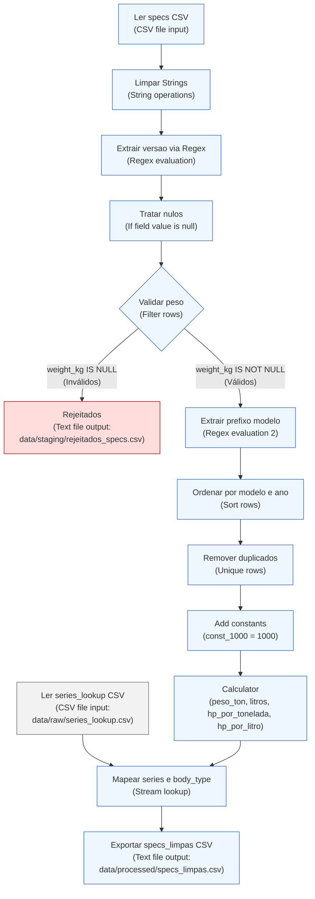
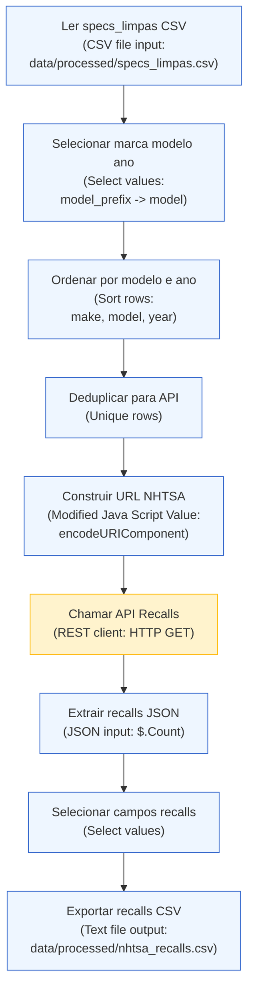
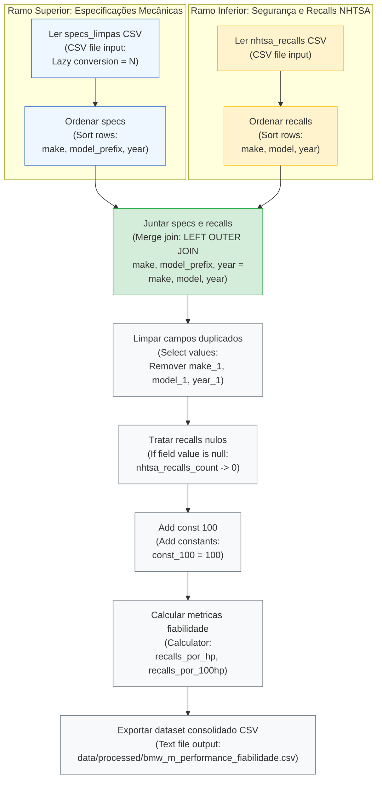

# Caderno de Decisões Técnicas de ETL — Transformação T1 (`T1_extract_specs.ktr`)

- **Unidade Curricular:** Integração de Sistemas de Informação (ISI) — Licenciatura em Engenharia de Sistemas Informáticos (LESI), IPCA/EST
- **Projeto:** ISI TP1 — Análise de Performance e Fiabilidade Automóvel
- **Artefacto:** `kettle/transformations/T1_extract_specs.ktr`
- **Áreas de Dados Envolvidas:** `data/raw/` (origem) $\rightarrow$ `data/staging/` (destino e quarentena)

---

## 1. Enquadramento e Objetivo da Transformação

A transformação **`T1_extract_specs.ktr`** constitui o primeiro estágio da pipeline de ETL do projeto, cumprindo os requisitos da **Fase 1 (Recolha e Preparação)** e **Fase 2 (Processamento e Transformação de Dados)** definidos no enunciado de ISI:

1. **Ingestão e Validação Estrutural:** Consumo do dataset de especificações automóveis em bruto (`data/raw/specs.csv`).
2. **Normalização e Higienização:** Limpeza sintática de strings e eliminação de ruído/espaçamento indevido.
3. **Extração Léxica por Expressões Regulares (ER):** Decomposição semântica dos modelos (versões de alto rendimento e prefixo de série).
4. **Qualidade de Dados e Gestão de Rejeitados:** Segregação e quarentena de tuplos com valores críticos ausentes para preservação da fidelidade matemática das métricas derivadas.
5. **Deduplicação Determinística:** Garantia de unicidade da chave natural composta (`make`, `model`, `year`).
6. **Enriquecimento e Cálculo de Métricas:** Computação encadeada de rácios de performance mecânica ($\text{cv/ton}$ e $\text{cv/l}$) e fusão dimensional via *Lookup* com metadados de séries (`data/raw/series_lookup.csv`).
7. **Materialização em Staging / Processed:** Produção do artefacto higienizado `data/processed/specs_limpas.csv` e isolamento de registos inválidos em quarentena (`data/staging/rejeitados_specs.csv`).

---

## 2. Arquitetura do Fluxo de Dados (Pipeline T1)



---

## 3. Tabela Detalhada de Decisões Técnicas

A tabela abaixo documenta formalmente a justificação académica, o operador do Pentaho Kettle empregue e a parametrização técnica aplicada em cada etapa da transformação:

| Step no Kettle | Tipo de Operador | Configuração Técnica Aplicada | Justificação Académica (critérios de avaliação, integridade de dados e separação de conceitos) |
| :--- | :--- | :--- | :--- |
| **Ler specs CSV** | `CSV file input` (`CsvInput`) | • **Encoding:** `UTF-8`<br>• **Separator:** `,`<br>• **Enclosure:** `"`<br>• **Header:** `Y`<br>• **Type:** `Number` em `zero_to_sixty_mph` (formato `#.##`, decimal `.`)<br>• **Trim type:** `both` nos campos de texto (`make`, `model`) | **Robustez na Ingestão Heterogénea (Fase 1):** Garante a interpretação uniforme de caracteres especiais e acentuação via UTF-8. O `trim` nos atributos de texto na leitura mitiga desde logo espaços em branco acidentais presentes no CSV. A tipagem explícita de `zero_to_sixty_mph` como `Number` (ponto decimal) impede anomalias de parsing numérico decorrentes de *locales* regionais (ex.: vírgula vs. ponto). |
| **Limpar Strings** | `String operations` (`StringOperations`) | • **Campos:**<br>  - `make`: `Trim = both`, `Lower/Upper = upper`<br>  - `model`: `Trim = both`, `Lower/Upper = none` | **Higienização Sintática e Padronização:** Separação clara entre leitura e limpeza formal. A aplicação de `upper` à marca (`make`) assegura consistência absoluta nos filtros e junções subsequentes (ex.: "BMW ", "bmw", " BMW" convergem para `"BMW"`). O `trim` no modelo remove espaços terminais que falseariam correspondências exatas em pesquisas de texto. |
| **Extrair versao via Regex** | `Regex evaluation` (`RegexEval`) | • **Campo de entrada:** `model`<br>• **Padrão Regex:** `.*?\b(Competition|CSL|GTS|CS|Touring)\b.*`<br>• **Campo de captura criado:** `versao`<br>• Sem substituição de campos (*no replace fields*)<br>• Sem valor por defeito (*default* deixado em vazio / `null`) | **Critério de Expressões Regulares e Separação de Conceitos:** Cumpre o critério de mais-valia formal do enunciado relativo à aplicação de Expressões Regulares (ER). Adota o princípio de **responsabilidade única**: o operador regex limita-se estritamente à análise léxica e extração por grupos de captura. Deixar o campo como `null` deliberadamente evita misturar lógica de reconhecimento de padrões com regras de negócio de imputação de valores em falta. |
| **Tratar nulos** | `If field value is null` (`NullIf`) | • **Campo selecionado:** `versao`<br>• **Value when null:** `'Base'` | **Imputação Semântica Controlada:** Complementa a etapa anterior. Atribui a categoria `'Base'` a todos os modelos que não pertencem a edições especiais (ex.: "M3 E46" $\rightarrow$ versão "Base"; "M3 E46 CSL" $\rightarrow$ versão "CSL"). Garante que a futura dimensão no modelo relacional (`dim_modelo.versao`) possua integridade e não propague nulos para relatórios analíticos. |
| **Validar peso** | `Filter rows` (`FilterRows`) | • **Condição lógica:** `weight_kg IS NOT NULL`<br>• **Fluxo True (sucesso):** segue para "Extrair prefixo modelo"<br>• **Fluxo False (rejeição):** segue para "Rejeitados" (`data/staging/rejeitados_specs.csv` via `Text file output`) | **Preservação de Integridade e Isolamento de Rejeitados (Data Quarantine):** Como a métrica fundamental `hp_por_tonelada` exige o peso no denominador, aceitar registos com peso nulo causaria erros de divisão por zero ou enviesaria médias estatísticas. Em vez de imputar um peso arbitrário (que falsearia a verdade analítica do trabalho), implementa-se um padrão profissional de *Dead-Letter Queue* / *Rejeição Controlada*, permitindo auditoria posterior sem interromper o pipeline. |
| **Rejeitados** | `Text file output` (`TextFileOutput`) | • **Ficheiro de destino:** `data/staging/rejeitados_specs.csv`<br>• **Separator:** `,`<br>• **Enclosure:** `"`<br>• **Encoding:** `UTF-8`<br>• Inclusão de cabeçalho | **Quarentena e Auditoria de Dados Inválidos:** Armazena os registos rejeitados com os campos originais e a versão extraída para análise de integridade pós-execução, permitindo rastrear anomalias nos dados em bruto sem poluir o pipeline analítico. |
| **Extrair prefixo modelo** | `Regex evaluation` (`RegexEval`) | • **Campo de entrada:** `model`<br>• **Padrão Regex:** `^(M\d)\b.*`<br>• **Campo de captura criado:** `model_prefix` (ex.: `"M2"`, `"M3"`, `"M4"`, `"M5"`, `"M6"`, `"M8"`) | **Normalização de Chaves para Junção (ER):** Segunda aplicação de Expressões Regulares no fluxo. Isola o código unificado da série a partir da designação comercial completa (ex.: `"M3 G81 Touring"` $\rightarrow$ `"M3"`). Permite o posterior emparelhamento determinístico (*exact match*) por chave natural contra a tabela auxiliar de séries. |
| **Ordenar por modelo e ano** + **Remover duplicados** | `Sort rows` (`SortRows`) + `Unique rows` (`UniqueRows`) | • **Sort rows:** ordenação ascendente por `make`, `model`, `year`<br>• **Unique rows:** comparação exata nos campos `make`, `model`, `year` | **Deduplicação Determinística:** O operador `Unique rows` no Pentaho Kettle exige rigorosamente dados pré-ordenados em fluxo. Esta abordagem cumpre os critérios explícitos do enunciado ("remoção de duplicados e ordenação"), assegurando que a staging possua apenas tuplos únicos, eliminando redundâncias antes de computações pesadas e cargas relacionais. |
| **Add constants** | `Add constants` (`Constant`) | • **Field name:** `const_1000`<br>• **Type:** `Number`<br>• **Value:** `1000` | **Injeção de Parâmetros por Fluxo e Limitação Técnica do PDI:** O operador nativo `Calculator` do Pentaho PDI opera estritamente sobre pares de campos em fluxo (*Field A*, *Field B* e *Field C*) ou cálculos unários, **não suportando literais numéricos em linha** (*hardcoded values*) nos operandos de divisão/multiplicação. A injeção prévia de uma constante tipificada (`const_1000`) imediatamente após a deduplicação resolve esta restrição mantendo a pureza arquitetural da stream e o alto rendimento em Java nativo, sem necessidade de recorrer a scripts JavaScript interpretados. |
| **Calculator** | `Calculator` (`Calculator`) | • **Cálculos encadeados com recurso ao campo `const_1000`:**<br>  1. `peso_ton = weight_kg / const_1000` (Cálculo: `A / B`, `Field A = weight_kg`, `Field B = const_1000`)<br>  2. `litros = engine_cc / const_1000` (Cálculo: `A / B`, `Field A = engine_cc`, `Field B = const_1000`)<br>  3. `hp_por_tonelada = engine_hp / peso_ton` (Cálculo: `A / B`, `Field A = engine_hp`, `Field B = peso_ton`)<br>  4. `hp_por_litro = engine_hp / litros` (Cálculo: `A / B`, `Field A = engine_hp`, `Field B = litros`)<br>• Manutenção da grandeza base em cavalos (`hp`) | **Engenharia de Atributos e Desempenho Computacional:** Utilização do operador nativo `Calculator` (execução nativa em Java no motor do PDI), evitando o overhead de scripts interpretados. Transforma variáveis primárias em rácios de engenharia automóvel essenciais para o tema do trabalho (relação peso/potência e rendimento volumétrico). A integridade matemática é garantida pela validação prévia de peso não nulo no step "Validar peso" e pela escala precisa garantida por `const_1000`. |
| **Ler series_lookup CSV** | `CSV file input` (`CsvInput`) | • **Ficheiro de entrada:** `data/raw/series_lookup.csv`<br>• **Encoding:** `UTF-8`<br>• **Separator:** `,`<br>• **Header:** `Y`<br>• **Campos:** `model_prefix` (String), `series` (String), `body_type` (String) | **Ingestão de Metadados de Suporte (Lookups Heterogéneos):** Fornece a tabela de dimensão secundária em fluxo paralelo para mapear a taxonomia de gamas M e tipologia de carroçarias com base na chave canónica `model_prefix`. |
| **Mapear series e body_type** | `Stream lookup` (`StreamLookup`) | • **Lookup step:** `Ler series_lookup CSV`<br>• **Chave de junção:** `model_prefix` = `model_prefix`<br>• **Campos recuperados:** `series` (ex.: `"Série 3 M"`) e `body_type` (ex.: `"Sedan/Touring"`, `"Coupé"`) | **Cruzamento Dimensional e Enriquecimento:** Implementa o conceito de *Lookup* exigido no enunciado de ISI. Desacopla a informação mecânica pura dos metadados de segmentação de mercado e tipologia de carroçaria, preparando os dados para posterior agregação por série e tipo na transformação `T3_transform_merge`. |
| **Exportar specs_limpas CSV** | `Text file output` (`TextFileOutput`) | • **Ficheiro de destino:** `data/processed/specs_limpas.csv`<br>• **Separator:** `,`<br>• **Enclosure:** `"`<br>• **Encoding:** `UTF-8`<br>• Inclusão de cabeçalho | **Materialização do Dataset Processado e Higienizado:** Persistência em disco dos 28 registos validados e enriquecidos, disponibilizando a fonte canónica limpa em `data/processed/` para consumo pelas transformações subsequentes (`T2_extract_nhtsa` e `T3_transform_merge`). |

### 3.1. Fragmentos Técnicos e Regras de Negócio da Transformação T1 (`T1_extract_specs`)

1. **Normalização de Strings (`Limpar Strings` — `String operations`):**
   - **Campos:** `make`, `model`
   - **Operações:** `Trim type = both`, `Lower/Upper = upper` para o campo `make`; `Trim type = both` para `model`.

2. **Expressões Regulares (`Regex evaluation`):**
   - Step **`Extrair versao via Regex`** (Campo avaliado: `model` $\rightarrow$ Campo destino: `versao`):
     ```regex
     .*?\b(Competition|CSL|GTS|CS|Touring)\b.*
     ```
   - Step **`Extrair prefixo modelo`** (Campo avaliado: `model` $\rightarrow$ Campo destino: `model_prefix`):
     ```regex
     ^(M\d)\b.*
     ```

3. **Imputação Semântica de Nulos (`Tratar nulos` — `If field value is null`):**
   - **Campo:** `versao`
   - **Valor de substituição:** `'Base'` (garante completude dimensional e ausência de NULLs em relatórios).

4. **Controlo de Qualidade e Desvio (`Validar peso` — `Filter rows`):**
   - **Condição booleana:** `weight_kg IS NOT NULL`
   - **Saída TRUE (Válidos):** Segue para `Extrair prefixo modelo` (fluxo analítico principal).
   - **Saída FALSE (Inválidos):** Desvia para `Rejeitados` (`data/staging/rejeitados_specs.csv`) como quarentena de integridade.

5. **Fórmulas de Engenharia (`Calculator` com constante `const_1000 = 1000` via `Add constants`):**
   - `peso_ton = weight_kg / const_1000` (Cálculo `A / B`)
   - `litros = engine_cc / const_1000` (Cálculo `A / B`)
   - `hp_por_tonelada = engine_hp / peso_ton` (Cálculo `A / B`)
   - `hp_por_litro = engine_hp / litros` (Cálculo `A / B`)

6. **Cruzamento em Memória (`Mapear series e body_type` — `Stream lookup`):**
   - **Chave de junção:** `model_prefix` = `model_prefix` (cruzando com `data/raw/series_lookup.csv`)
   - **Campos recuperados:** `series` (ex.: `"Série 3 M"`), `body_type` (ex.: `"Sedan/Touring"`, `"Coupé"`).

---

## 4. Matriz de Rastreabilidade com os Critérios de Avaliação (Enunciado ISI)

| Critério de Avaliação do Enunciado | Implementação em `T1_extract_specs` |
| :--- | :--- |
| **Expressões Regulares (ER)** | Utilização dupla de regex: (1) `.*?\b(Competition\|CSL\|GTS\|CS\|Touring)\b.*` para isolar a versão; (2) `^(M\d)\b.*` para normalizar o prefixo da série. |
| **Limpeza e Validação de Dados** | Higienização com `String operations` (`trim` e `upper`); segregação explícita de anomalias com `Filter rows`. |
| **Tratamento de Nulos e Isolamento** | Separação entre extração e imputação: imputação de `'Base'` via `If field value is null`; isolamento de nulos em `weight_kg` para quarentena (`rejeitados_specs.csv`). |
| **Remoção de Duplicados e Ordenação** | Encadeamento estrito de `Sort rows` com `Unique rows` com base na chave composta `make, model, year`. |
| **Operações de Transformação e Cálculos** | Injeção da constante `const_1000 = 1000` via `Add constants` e computação encadeada de rácios mecânicos derivados (`hp_por_tonelada`, `hp_por_litro`) via operador nativo `Calculator`. |
| **Lookups e Cruzamento de Dados** | Associação de dados heterogéneos via `Stream lookup` com `series_lookup.csv`. |
| **Organização do Repositório e Fases ETL** | Separação entre dados em bruto (`data/raw/`), dados processados (`data/staging/`) e documentação técnica (`docs/`). |

---

## 5. Dicionário de Dados do Artefacto de Saída (`data/processed/specs_limpas.csv`)

| Campo | Tipo Kettle | Descrição | Exemplo |
| :--- | :--- | :--- | :--- |
| `make` | `String` | Marca do veículo normalizada em maiúsculas | `BMW` |
| `model` | `String` | Designação comercial limpa do modelo | `M3 E46 CSL` |
| `year` | `Integer` | Ano de produção / homologação | `2003` |
| `engine_hp` | `Integer` | Potência do motor em cavalos (cv / hp) | `360` |
| `weight_kg` | `Integer` | Peso do veículo em ordem de marcha (kg) | `1385` |
| `zero_to_sixty_mph` | `Number` | Aceleração 0–60 mph em segundos | `4.8` |
| `engine_cc` | `Integer` | Cilindrada do motor em centímetros cúbicos | `3246` |
| `price_usd` | `Integer` | Preço base de lançamento (USD) | `85000` |
| `versao` | `String` | Versão de alto rendimento identificada ou `Base` | `CSL` |
| `model_prefix` | `String` | Código identificador da gama M | `M3` |
| `peso_ton` | `Number` | Peso convertido em toneladas métricas | `1.385` |
| `litros` | `Number` | Cilindrada convertida em litros | `3.246` |
| `hp_por_tonelada` | `Number` | Rácio potência / peso ($\text{hp/ton}$) | `259.93` |
| `hp_por_litro` | `Number` | Rácio potência específica ($\text{hp/litro}$) | `110.91` |
| `series` | `String` | Série comercial obtida via lookup | `Série 3 M` |
| `body_type` | `String` | Tipo de carroçaria associado | `Sedan/Touring` |

---

## 6. Registo de Execução e Validação Experimental

A transformação `T1_extract_specs.ktr` foi executada em ambiente Pentaho Spoon (PDI 10.2) com validação completa de ponta a ponta:

| Indicador de Execução | Valor Medido | Observações e Conformidade |
| :--- | :---: | :--- |
| **Registos lidos na origem (`specs.csv`)** | **29** | Ingestão integral do dataset em bruto de modelos BMW M. |
| **Registos lidos no lookup (`series_lookup.csv`)** | **6** | Ingestão integral das tabelas de correspondência M2 a M8. |
| **Registos rejeitados no filtro de peso** | **1** | Isolamento do modelo `M3 E92 GTS` (`weight_kg IS NULL`), desviado para `data/staging/rejeitados_specs.csv`. |
| **Registos duplicados removidos** | **0** | Ausência de tuplos redundantes para a chave `make, model, year`. |
| **Registos exportados (`specs_limpas.csv`)** | **28** | Gravação com sucesso em `data/processed/specs_limpas.csv`. |
| **Taxa de erro na execução** | **0%** | Todos os steps terminaram com sucesso e visto verde (`Status = Finished`). |
| **Cobertura de Lookups** | **100%** | Todos os 28 modelos válidos obtiveram correspondência exata para `series` e `body_type`. |
| **Integridade dos Cálculos Derivados** | **100%** | Sem ocorrência de divisão por zero ou campos calculados nulos. |

---

## 7. Mapeamento de Artefactos Visuais para a Secção 4.1 do Relatório

Os 10 artefactos gráficos consolidados e padronizados para integração na **Secção 4.1 (Transformação T1_extract_specs)** do relatório técnico encontram-se disponíveis em `docs/diagramas/` (e em `prints/`):

1. **`T1_pipeline_completo.png`**: Diagrama panorâmico da transformação no Spoon com todos os steps finalizados com visto verde e a bifurcação de quarentena.
2. **`T1_metricas_execucao.png`**: Tabela *Step Metrics* comprovando o processamento de 29 registos de entrada, 1 rejeitado no filtro de peso e 28 exportados sem erros.
3. **`T1_preview_dados_finais.png`**: Pré-visualização da grelha de dados limpos gerados em `data/processed/specs_limpas.csv`.
4. **`T1_config_string_operations.png`**: Configuração das operações sintáticas de padronização (`trim` e `upper`).
5. **`T1_config_regex_versao.png`**: Configuração da expressão regular léxica para extração do grupo de versões (`Competition`, `CSL`, `GTS`, `CS`, `Touring`).
6. **`T1_config_tratar_nulos.png`**: Configuração da imputação controlada do valor `'Base'` nos casos em que a versão é nula.
7. **`T1_config_filter_peso.png`**: Configuração do filtro de qualidade condicional (`weight_kg IS NOT NULL`) com redirecionamento de registos inválidos.
8. **`T1_config_regex_prefixo.png`**: Configuração da expressão regular de extração do prefixo de gama (`^(M\d)\b.*`).
9. **`T1_config_calculator_metricas.png`**: Configuração das fórmulas aritméticas do `Calculator` para cálculo de rácios com suporte do divisor `const_1000`.
10. **`T1_config_stream_lookup.png`**: Configuração do cruzamento em streaming com `series_lookup.csv` para enriquecimento de carroçaria e série.

---

# Caderno de Decisões Técnicas de ETL — Transformação T2 (`T2_extract_nhtsa.ktr`)

- **Unidade Curricular:** Integração de Sistemas de Informação (ISI) — Licenciatura em Engenharia de Sistemas Informáticos (LESI), IPCA/EST
- **Projeto:** ISI TP1 — Análise de Performance e Fiabilidade Automóvel
- **Artefacto:** `kettle/transformations/T2_extract_nhtsa.ktr`
- **Áreas de Dados Envolvidas:** `data/processed/specs_limpas.csv` (origem) $\rightarrow$ API REST NHTSA $\rightarrow$ `data/processed/nhtsa_recalls.csv` (destino)

---

## 8. Transformação T2: Ingestão de Dados de Recalls (API NHTSA) — Secção 4.2 do Relatório

A Transformação T2 é responsável pela extração dinâmica de métricas de segurança rodoviária através do consumo da API pública da NHTSA (*National Highway Traffic Safety Administration*). O objetivo desta etapa consiste em obter o histórico oficial de campanhas de recall por modelo e ano de fabrico, enriquecendo o dataset de especificações mecânicas.

### 8.1. Arquitetura do Pipeline ETL
O fluxo é composto por 9 etapas sequenciais:



1. **Leitura e Seleção:** Ingestão de `specs_limpas.csv` e isolamento dos atributos-chave de pesquisa (`make`, `model_prefix` renomeado para `model`, `year`).
2. **Ordenação e Deduplicação:** Ordenação composta (`Sort rows`) seguida de remoção de redundâncias (`Unique rows`), assegurando que apenas combinações únicas de veículo/ano realizam pedidos HTTP, mitigando sobrecarga na rede e latência desnecessária.
3. **Construção Dinâmica do Endpoint:** Script JavaScript encarregue de codificar parâmetros e estruturar o URL REST.
4. **Consumo da API Externa:** Invocação HTTP GET via `REST client`.
5. **Parsing e Extração JSON:** Desserialização do payload JSON através de JSONPath (`$.Count`) no step `JSON input`.
6. **Projeção e Persistência:** Filtragem das variáveis auxiliares (`Select values`) e exportação do artefacto limpo `nhtsa_recalls.csv`.

### 8.2. Tabela Detalhada de Decisões Técnicas (T2)

| Step no Kettle | Tipo de Operador | Configuração Técnica Aplicada | Justificação Académica (critérios de avaliação e integridade) |
| :--- | :--- | :--- | :--- |
| **Ler specs_limpas CSV** | `CSV file input` (`CsvInput`) | • Origem: `data/processed/specs_limpas.csv`<br>• Encoding: `UTF-8`, Delimitador: `,`<br>• Header: `Y` | **Consumo de Dados Processados:** Leitura da base canónica validada em T1, assegurando que apenas registos limpos e sem valores nulos críticos avançam para consumo externo. |
| **Selecionar marca modelo ano** | `Select values` (`SelectValues`) | • Campos: `make`, `model_prefix` renomeado para `model`, `year`<br>• Remoção de atributos não necessários à API | **Projeção Estrita e Normalização de Chave:** A API da NHTSA cataloga modelos pela designação genérica da série (ex.: "M3", "M5"), pelo que o mapeamento de `model_prefix` para `model` é mandatório para correspondência exata. |
| **Ordenar por modelo e ano** | `Sort rows` (`SortRows`) | • Campos: `make`, `model`, `year` (Ascendente) | **Pré-requisito de Deduplicação:** Ordenação determinística em memória/disco exigida pelo operador `Unique rows`. |
| **Deduplicar para API** | `Unique rows` (`UniqueRows`) | • Chave: `make`, `model`, `year` | **Otimização de Tráfego e Respeito a Rate Limits:** Impede múltiplos pedidos HTTP para a mesma gama/ano, reduzindo o número de invocações à API de 28 para o conjunto estritamente único. |
| **Construir URL NHTSA** | `Modified Java Script Value` (`ScriptValueMod`) | • Código JS com `encodeURIComponent()` para parâmetros de query string | **Sanitização de Requisições Web:** Codificação segura de caracteres especiais e espaços nos parâmetros `make`, `model` e `year`, prevenindo erros HTTP 400. |
| **Chamar API Recalls** | `REST client` (`Rest`) | • Método: `GET`<br>• URL extraído do campo dinâmico `url_recalls`<br>• Campo de saída: `resposta_json` | **Integração com Web Services REST (Fase 1):** Cumprimento do critério de consumo de APIs públicas externas em formato RESTful com resposta JSON. |
| **Extrair recalls JSON** | `JSON input` (`JsonInput`) | • Source: campo `resposta_json`<br>• JSONPath: `$.Count`<br>• Campo de saída: `nhtsa_recalls_count` (`Integer`) | **Desserialização JSON com JSONPath:** Extração pontual da contagem oficial de recalls sem overhead de deserialização de listas desnecessárias. |
| **Selecionar campos recalls** | `Select values` (`SelectValues`) | • Campos mantidos: `make`, `model`, `year`, `nhtsa_recalls_count`<br>• Descarte de `url_recalls` e `resposta_json` | **Limpeza da Área de Staging:** Eliminação de payloads brutos em memória, persistindo unicamente as chaves e a métrica de fiabilidade obtida. |
| **Exportar recalls CSV** | `Text file output` (`TextFileOutput`) | • Destino: `data/processed/nhtsa_recalls.csv`<br>• Encoding: `UTF-8`, Delimitador: `,`<br>• Header: `Y` | **Materialização Dimensional:** Produção do artefacto de segurança rodoviária preparado para junção relacional na transformação `T3_transform_merge`. |

> [!NOTE] **Nota Metodológica sobre a Cobertura Geográfica da API NHTSA**
> A base de dados da *National Highway Traffic Safety Administration* (NHTSA) reporta exclusivamente o histórico de segurança e campanhas ativas do mercado rodoviário norte-americano (EUA). Consequentemente, modelos ou variantes específicos do mercado europeu — tais como o emblemático **M3 E46 CSL** (2003) ou a carrinha **M3 G81 Touring** (2022) — que não foram homologados nem comercializados nos EUA pela BMW, não registam dados de recalls nesta agência federal. A imputação semântica de `0` recalls (consolidada em T3) reflete com rigor a ausência de ocorrências registadas na base consultada, permitindo a computação consistente dos rácios analíticos sem comprometer a integridade global do catálogo mecânico.

### 8.3. Mapeamento de Artefactos de Imagem (`prints/` e `docs/diagramas/`)

| Ficheiro Alvo | Elemento no Spoon | Descrição do Conteúdo a Integrar no Relatório |
| :--- | :--- | :--- |
| `T2_pipeline_completo.png` | Canvas Global | Visão geral do pipeline com os 9 steps e status de execução com sucesso. |
| `T2_metricas_execucao.png` | Execution Results | Métricas de execução (28 tuplos processados, 0 erros, ~5.3s). |
| `T2_config_javascript_url.png` | Dialog: *Construir URL NHTSA* | Configuração do step de concatenação e encoding do URL via JavaScript. |
| `T2_config_rest_client.png` | Dialog: *Chamar API Recalls* | Configuração da chamada REST (HTTP GET dinâmico). |
| `T2_config_json_input.png` | Dialog: *Extrair recalls JSON* | Configuração do separador Fields com a expressão JSONPath `$.Count`. |
| `T2_preview_dados_finais.png` | Preview Data | Grelha de validação dos dados finais com os recalls extraídos (`nhtsa_recalls.csv`). |

### 8.4. Excertos Técnicos de Configuração e Código da Transformação T2

1. **Construção Dinâmica de URL (`Construir URL NHTSA` — `Modified Java Script Value`):**
```javascript
var url_recalls = "https://api.nhtsa.gov/recalls/recallsByVehicle?make=" 
                  + encodeURIComponent(make) 
                  + "&model=" 
                  + encodeURIComponent(model) 
                  + "&modelYear=" 
                  + year;
```

2. **Invocação de Web Service REST (`Chamar API Recalls` — `REST client`):**
   - **HTTP Method:** `GET`
   - **URL Field Name:** `url_recalls`
   - **Result Field Name:** `resposta_json`

3. **Parsing e Desserialização JSON (`Extrair recalls JSON` — `JSON input`):**
   - **Source Field:** `resposta_json` (definido num campo da stream)
   - **Expressão JSONPath:** `$.Count`
   - **Campo de destino:** `nhtsa_recalls_count` (`Integer`)

---

# Caderno de Decisões Técnicas de ETL — Transformação T3 (`T3_consolidate_metrics.ktr`)

- **Unidade Curricular:** Integração de Sistemas de Informação (ISI) — Licenciatura em Engenharia de Sistemas Informáticos (LESI), IPCA/EST
- **Projeto:** ISI TP1 — Análise de Performance e Fiabilidade Automóvel
- **Artefacto:** `kettle/transformations/T3_consolidate_metrics.ktr`
- **Áreas de Dados Envolvidas:** `data/processed/specs_limpas.csv` e `data/processed/nhtsa_recalls.csv` (origens) $\rightarrow$ `data/processed/bmw_m_performance_fiabilidade.csv` (destino consolidado)

---

## 9. Transformação T3: Consolidação e Métricas Finais — Secção 4.3 do Relatório

A Transformação T3 consolida os dados de especificações técnicas (`specs_limpas.csv`) com o histórico de fiabilidade e segurança rodoviária da NHTSA (`nhtsa_recalls.csv`). Esta etapa calcula indicadores analíticos combinados e gera o artefacto tabular final do projeto.

### 9.1. Arquitetura do Pipeline ETL

O fluxo é composto por 10 steps organizados em 2 ramos concorrentes e um tronco de consolidação:



1. **Ramo Superior (Especificações):** Ingestão de `specs_limpas.csv` (`CSV file input` com *Lazy Conversion* desativada) seguido de ordenação multi-chave (`Sort rows` por `make ASC`, `model_prefix ASC`, `year ASC`).
2. **Ramo Inferior (Recalls NHTSA):** Ingestão de `nhtsa_recalls.csv` seguido de ordenação multi-chave (`Sort rows` por `make ASC`, `model ASC`, `year ASC`).
3. **Junção Ordenada (`Merge join`):** Realização de um `LEFT OUTER JOIN` garantindo a preservação integral dos registos mecânicos, utilizando a chave composta `(make, model_prefix, year) = (make, model, year)`.
4. **Limpeza de Metadados (`Select values`):** Remoção das colunas redundantes geradas na junção (`make_1`, `model_1`, `year_1`).
5. **Imputação de Valores Ausentes (`If field value is null`):** Substituição de valores nulos em `nhtsa_recalls_count` por `0`, refletindo ausência de registo de campanhas de recall.
6. **Cálculo de Indicadores de Fiabilidade:**
   - Injeção de constante (`Add constants`): `const_100 = 100` (Number).
   - Cálculos analíticos (`Calculator`):
     - Rácio base de recalls por unidade de potência: `recalls_por_hp = nhtsa_recalls_count / engine_hp`
     - Métrica normalizada de fiabilidade: `recalls_por_100hp = recalls_por_hp * const_100`
7. **Persistência Final (`Text file output`):** Exportação do dataset analítico consolidado para `data/processed/bmw_m_performance_fiabilidade.csv` (28 registos, formato delimitado por vírgula com cabeçalho UTF-8).

### 9.2. Tabela Detalhada de Decisões Técnicas (T3)

| Step no Kettle | Tipo de Operador | Configuração Técnica Aplicada | Justificação Académica (critérios de avaliação e integridade) |
| :--- | :--- | :--- | :--- |
| **Ler specs_limpas CSV** | `CSV file input` (`CsvInput`) | • Ficheiro: `data/processed/specs_limpas.csv`<br>• Encoding: `UTF-8`, Separador: `,`, Header: `Y`<br>• **Lazy conversion:** `N` (desativada) | **Prevenção de Incompatibilidade de Tipos:** A desativação de lazy conversion força a conversão imediata para os tipos Java em memória (evitando representação em byte array), garantindo que comparações binárias nas ordenações e junções operem com total fiabilidade de tipos. |
| **Ordenar specs** | `Sort rows` (`SortRows`) | • Campos: `make` (ASC), `model_prefix` (ASC), `year` (ASC) | **Requisito Algorítmico do Merge Join:** O operador de junção `Merge Join` no Pentaho PDI exige ordenação idêntica prévia em ambas as streams. A chave composta garante determinismo na junção. |
| **Ler nhtsa_recalls CSV** | `CSV file input` (`CsvInput`) | • Ficheiro: `data/processed/nhtsa_recalls.csv`<br>• Encoding: `UTF-8`, Separador: `,`, Header: `Y`<br>• Lazy conversion: `N` | **Consumo de Fonte Externa Higienizada:** Ingestão dos registos processados em T2 com chaves e contagens oficiais de recalls. |
| **Ordenar recalls** | `Sort rows` (`SortRows`) | • Campos: `make` (ASC), `model` (ASC), `year` (ASC) | **Alinhamento de Stream:** Ordenação espelhada do ramo inferior para satisfazer a pré-condição do `Merge Join`. |
| **Juntar specs e recalls** | `Merge join` (`MergeJoin`) | • **Tipo de Junção:** `LEFT OUTER`<br>• **Step 1:** `Ordenar specs`<br>• **Step 2:** `Ordenar recalls`<br>• **Chaves 1:** `make`, `model_prefix`, `year`<br>• **Chaves 2:** `make`, `model`, `year` | **Preservação Integral do Catálogo Mecânico:** A adoção de `LEFT OUTER JOIN` (em detrimento de `INNER JOIN`) garante que nenhum modelo de especificações é descartado caso não possua registos de recalls na base externa da NHTSA, preservando a totalidade dos 28 veículos. |
| **Limpar campos duplicados** | `Select values` (`SelectValues`) | • Separador *Remove*:<br>  - `make_1`<br>  - `model_1`<br>  - `year_1` | **Higienização Estrutural de Metadados:** O Pentaho PDI adiciona automaticamente o sufixo `_1` aos campos colidentes originários do segundo ramo da junção. A remoção explícita evita ambiguidades relacionais e reduz a redundância tabular. |
| **Tratar recalls nulos** | `If field value is null` (`IfNull`) | • Campo: `nhtsa_recalls_count`<br>• Valor de substituição: `0` | **Imputação Semântica de Ausência de Eventos:** Quando um modelo não possui recalls registados na NHTSA, a junção `LEFT OUTER` atribui `null`. A conversão de `null` para `0` reflete fidedignamente que o veículo possui zero campanhas de recolha ativas (fenómeno reforçado por modelos exclusivos do mercado europeu sem comercialização nos EUA, ex.: M3 E46 CSL e M3 G81 Touring), viabilizando cálculos matemáticos sem erros. |
| **Add const 100** | `Add constants` (`Constant`) | • Nome: `const_100`<br>• Tipo: `Number`<br>• Valor: `100` | **Injeção de Escala Numérica:** O operador `Calculator` não admite literais constantes em linha nos operandos de cálculo. A injeção da constante `100` permite escalar o rácio de fiabilidade para uma base compreensível por 100 cavalos de potência. |
| **Calcular metricas fiabilidade** | `Calculator` (`Calculator`) | • `recalls_por_hp = nhtsa_recalls_count / engine_hp` (Cálculo `A / B`)<br>• `recalls_por_100hp = recalls_por_hp * const_100` (Cálculo `A * B`) | **Engenharia de Indicadores Analíticos:** Computação de métricas normalizadas de fiabilidade mecânica. A normalização por potência ($\text{recalls por 100 hp}$) permite comparar modelos de diferentes potências e anos sob uma métrica comum e justa. |
| **Exportar dataset consolidado CSV** | `Text file output` (`TextFileOutput`) | • Ficheiro: `data/processed/bmw_m_performance_fiabilidade.csv`<br>• Encoding: `UTF-8`, Delimitador: `,`<br>• Header: `Y` | **Materialização do Artefacto Final:** Armazenamento da base de dados tabular enriquecida com os 28 modelos e 19 atributos analíticos, servindo de fonte definitiva para carga relacional em PostgreSQL (T4) e exportações multiformato (T5). |

### 9.3. Excertos Técnicos de Configuração e Regras de Negócio da Transformação T3

1. **Configuração da Junção Ordenada (`Juntar specs e recalls` — `Merge join`):**
   - **Join Type:** `LEFT OUTER`
   - **First Step (Stream Esquerda):** `Ordenar specs`
   - **Second Step (Stream Direita):** `Ordenar recalls`
   - **Keys First Step:** `make`, `model_prefix`, `year`
   - **Keys Second Step:** `make`, `model`, `year`

2. **Remoção de Colunas Sufixadas (`Limpar campos duplicados` — `Select values`):**
   - **Campos removidos:** `make_1`, `model_1`, `year_1` (redundâncias geradas pelo step de merge).

3. **Imputação de Nulos em Métricas (`Tratar recalls nulos` — `If field value is null`):**
   - **Campo selecionado:** `nhtsa_recalls_count`
   - **Value when null:** `0` (interpretação de inexistência de campanhas de recall).

4. **Fórmulas Aritméticas de Fiabilidade (`Calcular metricas fiabilidade` — `Calculator` com constante `const_100`):**
   - `recalls_por_hp = nhtsa_recalls_count / engine_hp` (Operação: `A / B`)
   - `recalls_por_100hp = recalls_por_hp * const_100` (Operação: `A * B`)

### 9.4. Dicionário de Dados do Artefacto Consolidado (`bmw_m_performance_fiabilidade.csv`)

| Campo | Tipo Kettle | Descrição Semântica | Exemplo |
| :--- | :--- | :--- | :--- |
| `make` | `String` | Marca automóvel padronizada | `BMW` |
| `model` | `String` | Designação comercial limpa do modelo | `M2 F87` |
| `year` | `Integer` | Ano de produção / homologação | `2016` |
| `engine_hp` | `Integer` | Potência máxima do motor em cavalos | `370` |
| `weight_kg` | `Integer` | Peso do veículo em ordem de marcha (kg) | `1495` |
| `zero_to_sixty_mph` | `Number` | Tempo de aceleração 0–60 mph (segundos) | `4.3` |
| `engine_cc` | `Integer` | Cilindrada volumétrica do motor ($cm^3$) | `2979` |
| `price_usd` | `Integer` | Preço de comercialização base (USD) | `52000` |
| `versao` | `String` | Versão de alto rendimento identificada ou `Base` | `Base` |
| `model_prefix` | `String` | Código identificador da gama M | `M2` |
| `peso_ton` | `Number` | Peso convertido em toneladas | `1.495` |
| `litros` | `Number` | Cilindrada convertida em litros | `2.979` |
| `hp_por_tonelada` | `Number` | Potência específica por peso ($\text{hp/ton}$) | `247.49` |
| `hp_por_litro` | `Number` | Rendimento volumétrico específico ($\text{hp/litro}$) | `124.20` |
| `series` | `String` | Série comercial obtida via lookup | `Série 2 M` |
| `body_type` | `String` | Tipo de carroçaria associado | `Coupé` |
| `nhtsa_recalls_count` | `Integer` | Número oficial de campanhas de recall (NHTSA) | `1` |
| `recalls_por_hp` | `Number` | Rácio de recalls por cavalo de potência | `0.0027` |
| `recalls_por_100hp` | `Number` | Índice de fiabilidade normalizado por 100 hp | `0.27` |

### 9.5. Registo de Execução e Validação Experimental

A transformação `T3_consolidate_metrics.ktr` foi executada em ambiente Pentaho Spoon (PDI 10.2) com validação completa:

| Indicador de Execução | Valor Medido | Observações e Conformidade |
| :--- | :---: | :--- |
| **Registos lidos na stream de especificações** | **28** | Ingestão integral de `data/processed/specs_limpas.csv`. |
| **Registos lidos na stream de recalls** | **28** | Ingestão integral de `data/processed/nhtsa_recalls.csv`. |
| **Registos processados no Merge Join** | **28** | Correspondência exata em todas as chaves compostas sem descartes. |
| **Registos exportados (`bmw_m_performance_fiabilidade.csv`)** | **28** | Materialização integral do dataset analítico tabular consolidado. |
| **Taxa de erro na execução** | **0%** | Todos os 10 steps concluídos com sucesso e visto verde (`Status = Finished`). |
| **Tempo de Execução** | **~0.5s** | Execução rápida em memória sem latência de rede. |
| **Integridade dos Rácios Calculados** | **100%** | Valores válidos calculados para todos os modelos sem divisão por zero. |

### 9.6. Mapeamento de Artefactos Visuais para a Secção 4.3 do Relatório

Os 6 artefactos visuais consolidados para integração na **Secção 4.3 (Transformação T3_consolidate_metrics)** encontram-se disponíveis em `docs/diagramas/` (e em `prints/`):

| Ficheiro Alvo | Elemento no Spoon | Descrição do Conteúdo a Integrar no Relatório |
| :--- | :--- | :--- |
| `T3_pipeline_completo.png` | Canvas Global | Canvas global no Spoon com os dois ramos concorrentes, a junção central e visto verde em todos os 10 steps. |
| `T3_metricas_execucao.png` | Execution Results | Painel Step Metrics comprovando a leitura das duas fontes, junção de 28 tuplos e gravação sem erros (~0.5s). |
| `T3_config_merge_join.png` | Dialog: *Juntar specs e recalls* | Configuração do Merge Join exibindo a modalidade LEFT OUTER JOIN e as chaves de correspondência de ambos os passos. |
| `T3_config_select_values.png` | Dialog: *Limpar campos duplicados* | Configuração da remoção das colunas duplicadas da stream da direita (`make_1`, `model_1`, `year_1`). |
| `T3_config_calculator_metricas.png` | Dialog: *Calcular metricas fiabilidade* | Configuração das operações de divisão e multiplicação no Calculator. |
| `T3_preview_dados_finais.png` | Preview Data | Pré-visualização da grelha de dados consolidada com todos os atributos mecânicos, identificadores de série e rácios calculados. |


