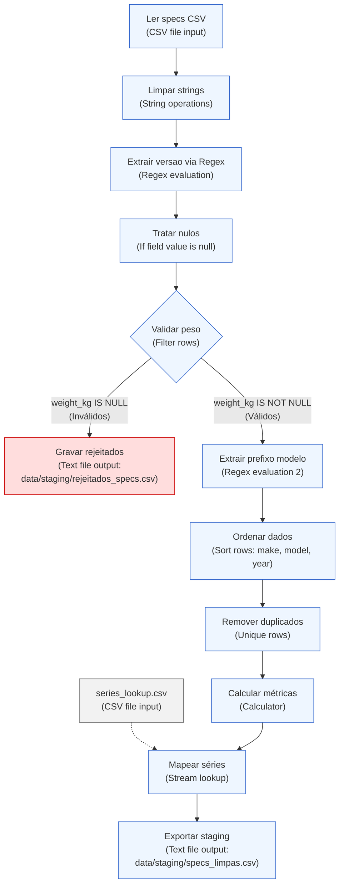

# Caderno de Decisões Técnicas de ETL — Transformação T1 (`T1_extract_specs.ktr`)

- **Unidade Curricular:** Integração de Sistemas de Informação (ISI) — Licenciatura em Engenharia de Sistemas Informáticos (LESI), IPCA/EST
- **Projeto:** ISI TP1 — Análise de Performance e Fiabilidade Automóvel
- **Artefacto:** `kettle/transformations/T1_extract_specs.ktr`
- **Áreas de Dados Envolvidas:** `data/raw/` (origem) $\rightarrow$ `data/staging/` (destino e quarentena)

---

## 1. Enquadramento e Objetivo da Transformação

A transformação **`T1_extract_specs.ktr`** constitui o primeiro estágio da pipeline de ETL do projeto, cumprindo os requisitos da **Fase 1 (Recolha e Preparação)** e **Fase 2 (Processamento e Transformação de Dados)** definidos no enunciado de ISI:

1. **Ingestão e Validação Estrutural:** Consumo do dataset de especificações automóveis em bruto (`data/raw/specs.csv`).
2. **Normalização e Higienização:** Limpeza sintática de strings e eliminação de ruído/espaçamento indevido.
3. **Extração Léxica por Expressões Regulares (ER):** Decomposição semântica dos modelos (versões de alto rendimento e prefixo de série).
4. **Qualidade de Dados e Gestão de Rejeitados:** Segregação e quarentena de tuplos com valores críticos ausentes para preservação da fidelidade matemática das métricas derivadas.
5. **Deduplicação Determinística:** Garantia de unicidade da chave natural composta (`make`, `model`, `year`).
6. **Enriquecimento e Cálculo de Métricas:** Computação encadeada de rácios de performance mecânica ($\text{cv/ton}$ e $\text{cv/l}$) e fusão dimensional via *Lookup* com metadados de séries (`data/raw/series_lookup.csv`).
7. **Materialização em Staging:** Produção do artefacto higienizado `data/staging/specs_limpas.csv`.

---

## 2. Arquitetura do Fluxo de Dados (Pipeline T1)

---

## 3. Tabela Detalhada de Decisões Técnicas

A tabela abaixo documenta formalmente a justificação académica, o operador do Pentaho Kettle empregue e a parametrização técnica aplicada em cada etapa da transformação:

| Step no Kettle | Tipo de Operador | Configuração Técnica Aplicada | Justificação Académica (critérios de avaliação, integridade de dados e separação de conceitos) |
| :--- | :--- | :--- | :--- |
| **Ler specs CSV** | `CSV file input` (`CsvInput`) | • **Encoding:** `UTF-8` • **Separator:** `,` • **Enclosure:** `"` • **Header:** `Y` • **Type:** `Number` em `zero_to_sixty_mph` (formato `#.##`, decimal `.`) • **Trim type:** `both` em todas as colunas | **Robustez na Ingestão Heterogénea (Fase 1):** Garante a interpretação uniforme de caracteres especiais e acentuação via UTF-8. O `trim` generalizado na leitura mitiga desde logo espaços em branco acidentais presentes no CSV. A tipagem explícita de `zero_to_sixty_mph` como `Number` (ponto decimal) impede anomalias de parsing numérico decorrentes de *locales* regionais (ex.: vírgula vs. ponto). |
| **Limpar strings** | `String operations` (`StringOperations`) | • **Campos:**   - `make`: `Trim = both`, `Lower/Upper = upper`   - `model`: `Trim = both`, `Lower/Upper = none` | **Higienização Sintática e Padronização:** Separação clara entre leitura e limpeza formal. A aplicação de `upper` à marca (`make`) assegura consistência absoluta nos filtros e junções subsequentes (ex.: "BMW ", "bmw", " BMW" convergem para `"BMW"`). O `trim` no modelo remove espaços terminais que falseariam correspondências exatas em pesquisas de texto. |
| **Extrair versao via Regex** | `Regex evaluation` (`RegexEval`) | • **Campo de entrada:** `model` • **Padrão Regex:** `.*?\b(Competition|CSL|GTS|CS|Touring)\b.*` • **Campo de captura criado:** `versao` • Sem substituição de campos (*no replace fields*) • Sem valor por defeito (*default* deixado em vazio / `null`) | **Critério de Expressões Regulares e Separação de Conceitos:** Cumpre o critério de mais-valia formal do enunciado relativo à aplicação de Expressões Regulares (ER). Adota o princípio de **responsabilidade única**: o operador regex limita-se estritamente à análise léxica e extração por grupos de captura. Deixar o campo como `null` deliberadamente evita misturar lógica de reconhecimento de padrões com regras de negócio de imputação de valores em falta. |
| **Tratar nulos** | `If field value is null` (`NullIf`) | • **Campo selecionado:** `versao` • **Value when null:** `'Base'` | **Imputação Semântica Controlada:** Complementa a etapa anterior. Atribui a categoria `'Base'` a todos os modelos que não pertencem a edições especiais (ex.: "M3 E46" $\rightarrow$ versão "Base"; "M3 E46 CSL" $\rightarrow$ versão "CSL"). Garante que a futura dimensão no modelo relacional (`dim_modelo.versao`) possua integridade e não propague nulos para relatórios analíticos. |
| **Validar peso** | `Filter rows` (`FilterRows`) | • **Condição lógica:** `weight_kg IS NOT NULL` • **Fluxo True (sucesso):** segue para "Extrair prefixo modelo" • **Fluxo False (rejeição):** segue para "Gravar rejeitados" (`data/staging/rejeitados_specs.csv` via `Text file output`) | **Preservação de Integridade e Isolamento de Rejeitados (Data Quarantine):** Como a métrica fundamental `hp_por_tonelada` exige o peso no denominador, aceitar registos com peso nulo causaria erros de divisão por zero ou enviesaria médias estatísticas. Em vez de imputar um peso arbitrário (que falsearia a verdade analítica do trabalho), implementa-se um padrão profissional de *Dead-Letter Queue* / *Rejeição Controlada*, permitindo auditoria posterior sem interromper o pipeline. |
| **Extrair prefixo modelo** | `Regex evaluation` (`RegexEval`) | • **Campo de entrada:** `model` • **Padrão Regex:** `^(M\d)\b.*` • **Campo de captura criado:** `model_prefix` (ex.: `"M2"`, `"M3"`, `"M4"`, `"M5"`, `"M6"`, `"M8"`) | **Normalização de Chaves para Junção (ER):** Segunda aplicação de Expressões Regulares no fluxo. Isola o código unificado da série a partir da designação comercial completa (ex.: `"M3 G81 Touring"` $\rightarrow$ `"M3"`). Permite o posterior emparelhamento determinístico (*exact match*) por chave natural contra a tabela auxiliar de séries. |
| **Remover duplicados** | `Sort rows` (`SortRows`) + `Unique rows` (`UniqueRows`) | • **Sort rows:** ordenação ascendente por `make`, `model`, `year` • **Unique rows:** comparação exata nos campos `make`, `model`, `year` | **Deduplicação Determinística:** O operador `Unique rows` no Pentaho Kettle exige rigorosamente dados pré-ordenados em fluxo. Esta abordagem cumpre os critérios explícitos do enunciado ("remoção de duplicados e ordenação"), assegurando que a staging possua apenas tuplos únicos, eliminando redundâncias antes de computações pesadas e cargas relacionais. |
| **Calcular métricas** | `Calculator` (`Calculator`) | • **Cálculos encadeados:**   1. `mil` = valor constante `1000`   2. `peso_ton = weight_kg / mil`   3. `litros = engine_cc / mil`   4. `hp_por_tonelada = engine_hp / peso_ton`   5. `hp_por_litro = engine_hp / litros` • Manutenção da grandeza base em cavalos (`hp`) | **Engenharia de Atributos e Desempenho Computacional:** Utilização do operador nativo `Calculator` (compilado em bytecode C/Java), evitando o overhead de scripts JavaScript interpretados. Transforma variáveis primárias em rácios de engenharia automóvel essenciais para o tema do trabalho (relação peso/potência e rendimento volumétrico). A integridade do denominador foi salvaguardada no step anterior ("Validar peso"). |
| **Mapear séries** | `Stream lookup` (`StreamLookup`) | • **Fonte secundária:** `data/raw/series_lookup.csv` • **Chave de junção:** `model_prefix` = `model_prefix` • **Campos recuperados:** `series` (ex.: `"Série 3 M"`) e `body_type` (ex.: `"Sedan/Touring"`, `"Coupé"`) | **Cruzamento Dimensional e Enriquecimento:** Implementa o conceito de *Lookup* exigido no enunciado. Desacopla a informação técnica pura (especificações mecânicas) dos metadados de segmentação de mercado e tipologia de carroçaria, preparando os dados para posterior agregação por série e tipo na transformação `T3_transform_merge`. |
| **Exportar staging** | `Text file output` (`TextFileOutput`) | • **Ficheiro de destino:** `data/staging/specs_limpas.csv` • **Separator:** `,` • **Enclosure:** `"` • **Encoding:** `UTF-8` • Inclusão de cabeçalho | **Materialização da Camada de Staging:** Cumpre a arquitetura clássica de Data Staging. O dataset limpo, tipificado, validado e enriquecido fica persistido em formato standard e acessível para auditoria intermédia, desacoplando o pipeline de extração de especificações da consulta assíncrona a APIs externas (`T2_extract_nhtsa`). |

---

## 4. Matriz de Rastreabilidade com os Critérios de Avaliação (Enunciado ISI)

| Critério de Avaliação do Enunciado | Implementação em `T1_extract_specs` |
| :--- | :--- |
| **Expressões Regulares (ER)** | Utilização dupla de regex: (1) `.*?\b(Competition\|CSL\|GTS\|CS\|Touring)\b.*` para isolar a versão; (2) `^(M\d)\b.*` para normalizar o prefixo da série. |
| **Limpeza e Validação de Dados** | Higienização com `String operations` (`trim` e `upper`); segregação explícita de anomalias com `Filter rows`. |
| **Tratamento de Nulos e Isolamento** | Separação entre extração e imputação: imputação de `'Base'` via `If field value is null`; isolamento de nulos em `weight_kg` para quarentena (`rejeitados_specs.csv`). |
| **Remoção de Duplicados e Ordenação** | Encadeamento estrito de `Sort rows` com `Unique rows` com base na chave composta `make, model, year`. |
| **Operações de Transformação e Cálculos** | Conversão de escalas e computação de rácios mecânicos derivados (`hp_por_tonelada`, `hp_por_litro`) via `Calculator`. |
| **Lookups e Cruzamento de Dados** | Associação de dados heterogéneos via `Stream lookup` com `series_lookup.csv`. |
| **Organização do Repositório e Fases ETL** | Separação entre dados em bruto (`data/raw/`), dados processados (`data/staging/`) e documentação técnica (`docs/`). |

---

## 5. Dicionário de Dados do Artefacto de Saída (`specs_limpas.csv`)

| Campo | Tipo Kettle | Descrição | Exemplo |
| :--- | :--- | :--- | :--- |
| `make` | `String` | Marca do veículo normalizada em maiúsculas | `BMW` |
| `model` | `String` | Designação comercial limpa do modelo | `M3 E46 CSL` |
| `year` | `Integer` | Ano de produção / homologação | `2003` |
| `engine_hp` | `Integer` | Potência do motor em cavalos (cv / hp) | `360` |
| `weight_kg` | `Integer` | Peso do veículo em ordem de marcha (kg) | `1385` |
| `zero_to_sixty_mph` | `Number` | Aceleração 0–60 mph em segundos | `4.8` |
| `engine_cc` | `Integer` | Cilindrada do motor em centímetros cúbicos | `3246` |
| `price_usd` | `Integer` | Preço base de lançamento (USD) | `85000` |
| `versao` | `String` | Versão de alto rendimento identificada ou `Base` | `CSL` |
| `model_prefix` | `String` | Código identificador da gama M | `M3` |
| `peso_ton` | `Number` | Peso convertido em toneladas métricas | `1.385` |
| `litros` | `Number` | Cilindrada convertida em litros | `3.246` |
| `hp_por_tonelada` | `Number` | Rácio potência / peso ($\text{hp/ton}$) | `259.93` |
| `hp_por_litro` | `Number` | Rácio potência específica ($\text{hp/litro}$) | `110.91` |
| `series` | `String` | Série comercial obtida via lookup | `Série 3 M` |
| `body_type` | `String` | Tipo de carroçaria associado | `Sedan/Touring` |
