# Trabalho Prático 1 — Pipeline ETL da gama BMW M

**Autor:** Gonçalo Correia, n.º 22840

**Unidade curricular:** Integração de Sistemas de Informação (ISI)

**Curso e instituição:** Licenciatura em Engenharia de Sistemas Informáticos, IPCA / Escola Superior de Tecnologia

**Ano letivo:** 2026/2027

**Data:** outubro de 2026

**Repositório:** [isi-tp1-performance-fiabilidade](https://github.com/goncaloalo/isi-tp1-performance-fiabilidade)

## 1. Introdução e problema

O trabalho integra especificações de veículos BMW M, fornecidas em CSV, com campanhas de segurança consultadas na API REST da NHTSA. O objetivo técnico é construir uma pipeline ETL completa: limpar, validar, cruzar e carregar os dados em PostgreSQL, exportando um catálogo JSON e um resumo XML.

Os dados permitem calcular indicadores de potência e o rácio `recalls_por_100hp`. Este rácio é **exploratório e não constitui uma medida científica de fiabilidade mecânica**. A contagem de campanhas de segurança não mede a probabilidade de avaria nem permite concluir que maior potência causa mais falhas.

### 1.1. Metodologia e proveniência

- `data/raw/specs.csv` contém 29 registos de veículos entre 1985 e 2024. Não existe documentação que associe cada especificação a uma fonte BMW ou publicação independente. São dados de entrada do exercício, não especificações oficialmente verificadas.
- `data/raw/series_lookup.csv` é uma tabela local que associa os prefixos M2, M3, M4, M5, M6 e M8 a séries e tipos agregados de carroçaria.
- A NHTSA é a fonte oficial das campanhas de segurança consultadas para o mercado dos EUA. T2 envia `make`, `model=model_prefix` e `modelYear=year`, com codificação dos valores por `encodeURIComponent`.

O endpoint utilizado é:

```text
GET https://api.nhtsa.gov/recalls/recallsByVehicle?make=<make>&model=<model_prefix>&modelYear=<year>
```

Por exemplo, BMW M3 E46 CSL (2003) é consultado como BMW M3 (2003). As campanhas devolvidas para essa combinação genérica não comprovam aplicabilidade à variante CSL ou a um VIN concreto.

A validação técnica combina inspeção dos KTR/KJB, testes locais e execução manual no Pentaho. A execução de 20/10/2026 foi confirmada pelo autor; as capturas existentes são tratadas separadamente para não lhes atribuir uma data ou configuração não verificada.

## 2. Arquitetura da pipeline

A arquitetura mantém cinco transformações e um job de orquestração:

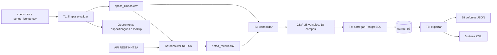

| Componente | Entrada | Saída |
|---|---|---|
| T1 | Especificações e lookup CSV | CSV limpo e dois caminhos de rejeitados |
| T2 | Modelos genéricos e anos de T1 | Contagens NHTSA e metadados HTTP |
| T3 | Especificações limpas e consultas NHTSA | CSV consolidado com 18 campos |
| T4 | CSV consolidado | Tabela PostgreSQL |
| T5 | Tabela PostgreSQL | Catálogo JSON e resumo XML |
| J_main | Execução manual ou Kitchen | Sequência T1 a T5 e encaminhamento de falhas |

Os caminhos Kettle usam `${Internal.Entry.Current.Directory}`. Esta opção reduz dependências da pasta do repositório, mas continua a exigir configuração local do PDI, JDBC e PostgreSQL.

## 3. Desenvolvimento e decisões técnicas

A descrição seguinte corresponde aos ficheiros KTR presentes neste merge. T4 usa `Insert/Update` e T2 mantém estados detalhados de validação.

**Capturas:** preservam-se as 34 imagens existentes e a [checklist de atualização](CHECKLIST_CAPTURAS.md). Algumas mostram versões anteriores. As legendas identificam essas diferenças; as imagens não são apresentadas como novas evidências da execução de 20/10/2026. As indicações históricas da checklist devem ser confrontadas com os KTR e com o [inventário revisto](diagramas/README.md).

### 3.1. T1 — extração, limpeza e enriquecimento

T1 normaliza marca e modelo, extrai versão e prefixo por regex e atribui `Base` quando não encontra uma versão especial. Valida peso preenchido e positivo, potência e cilindrada positivas e ano entre 1886 e 2100.

O BMW M3 E92 GTS (2010) mantém o peso omisso e segue para `data/staging/rejeitados_specs.csv`. Não foi inventado um peso. Depois do lookup, um segundo filtro valida `series` e `body_type`, encaminhando falhas para `rejeitados_lookup_series.csv`.

A fonte atual não tem duplicados na chave `(make, model, year)`. Os operadores `Sort Rows` e `Unique Rows` permanecem para demonstrar a regra, sem alegar que foi removido um duplicado BMW M3.

Os cálculos são:

```text
peso_ton = weight_kg / 1000
litros = engine_cc / 1000
hp_por_tonelada = engine_hp / peso_ton
hp_por_litro = engine_hp / litros
```

A saída contém 28 veículos válidos.

#### Capturas de T1


*Figura 1 — Captura existente do fluxo T1; atualizar para incluir as duas validações e os dois caminhos de rejeitados.*

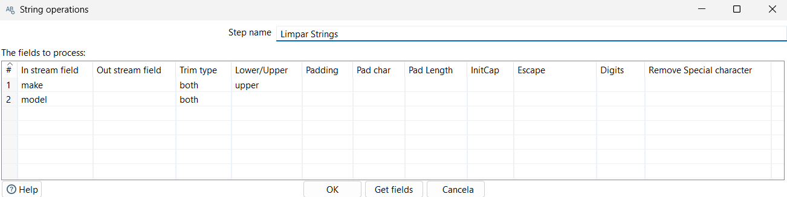

*Figura 2 — Normalização de texto com trim e conversão da marca para maiúsculas.*

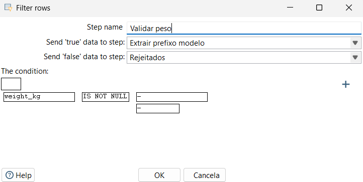

*Figura 3 — Filtro antigo de peso não nulo; a configuração atual valida também positividade, potência, cilindrada e ano.*

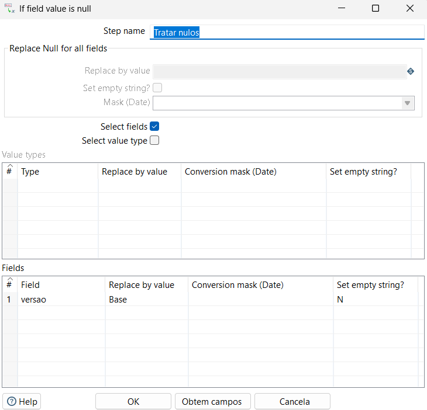

*Figura 4 — Preenchimento da versão Base quando não foi identificada uma edição especial.*

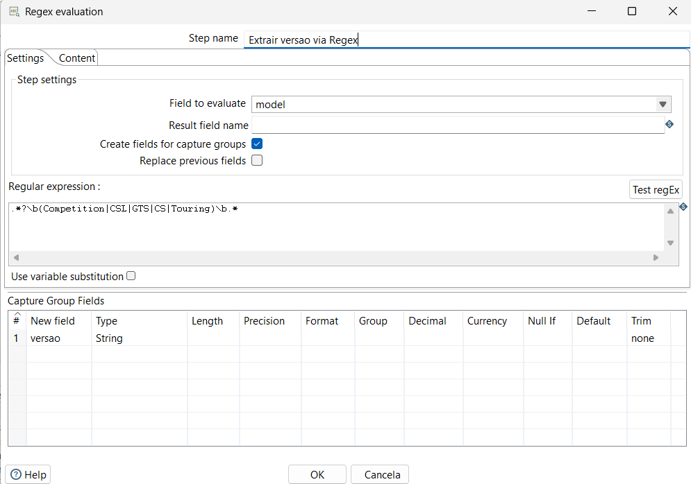

*Figura 5 — Expressão regular para identificar a versão no nome do modelo.*

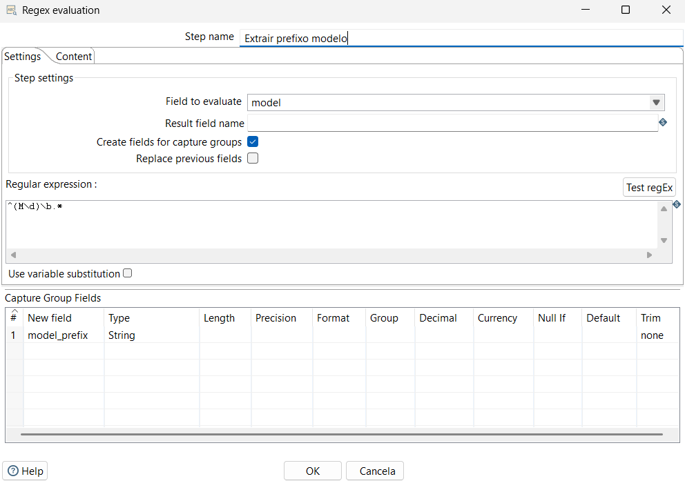

*Figura 6 — Expressão regular para obter o prefixo genérico do modelo.*

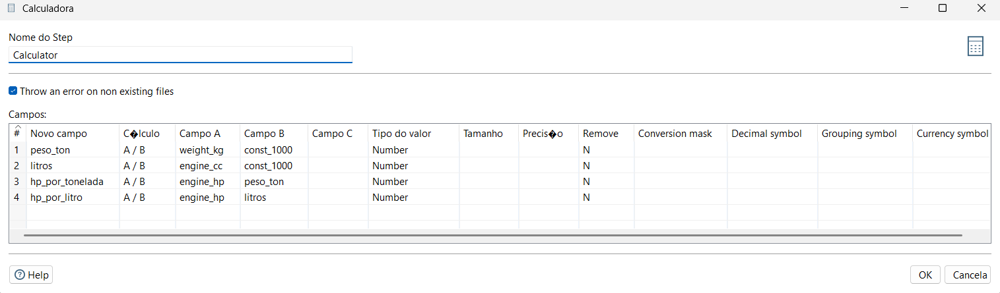

*Figura 7 — Cálculos mecânicos com a constante 1000.*

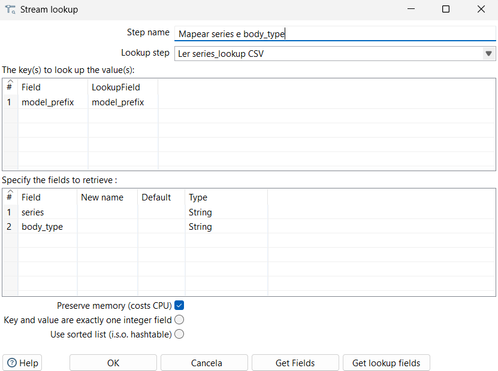

*Figura 8 — Lookup de série e carroçaria; a validação posterior deve constar de uma captura atualizada.*


*Figura 9 — Métricas de uma execução anterior de T1; não identificam por si só a execução manual de 20/10/2026.*

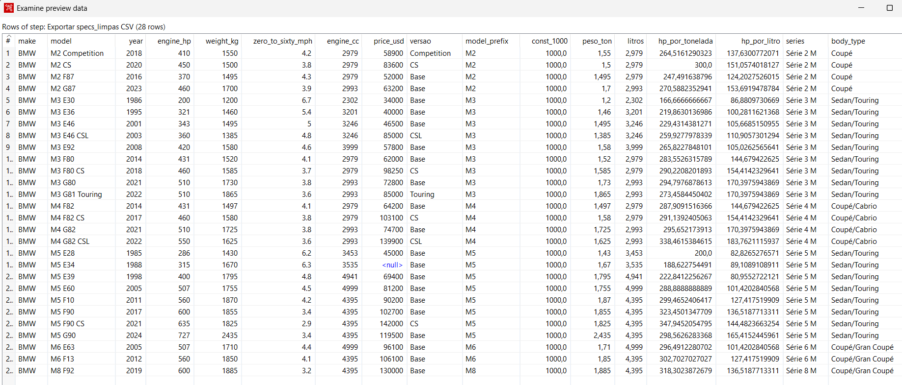

*Figura 10 — Pré-visualização existente de specs_limpas.csv.*

### 3.2. T2 — API NHTSA e validação de respostas

T2 seleciona combinações únicas de marca, prefixo de modelo e ano, constrói os URLs e executa pedidos GET no REST Client. O step `Validar resposta NHTSA` analisa `http_status` e o JSON.

Uma contagem só é aceite com HTTP 2xx, JSON válido e `Count` inteiro não negativo. O KTR atual distingue `OK`, `OK_ZERO`, `ERRO_HTTP_<código>`, `JSON_INVALIDO`, `COUNT_AUSENTE`, `COUNT_INVALIDO` e ausência de estado HTTP. Respostas inválidas são registadas no log e mantêm contagem nula. Timeout e falha de transporte no REST Client fazem a transformação falhar e seguem pelo caminho de erro do job.

O CSV intermédio mantém seis campos:

```text
make, model, year, nhtsa_recalls_count, nhtsa_query_status, nhtsa_http_status
```

Zero válido e ausência de informação válida têm significados diferentes. Uma resposta HTTP 400 com corpo `Count=0` não é aceite como zero campanhas.

#### Capturas de T2


*Figura 11 — Canvas anterior de T2; atualizar para mostrar a validação HTTP/JSON e o logging.*

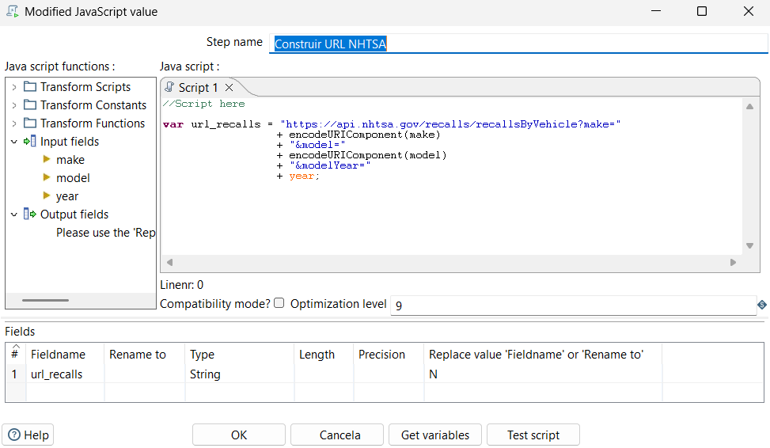

*Figura 12 — Construção do URL com parâmetros de marca, modelo genérico e ano.*


*Figura 13 — REST Client configurado para pedidos GET dinâmicos.*

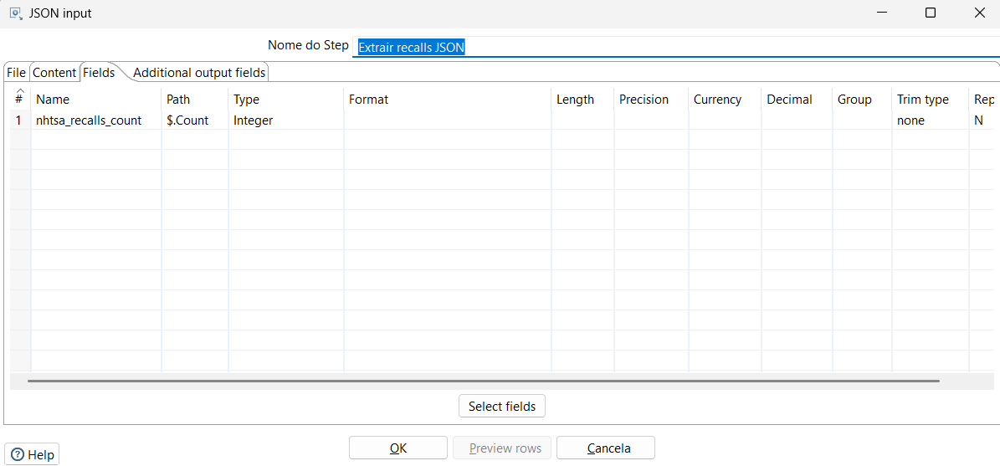

*Figura 14 — Parser JSON input histórico, substituído no KTR atual por Validar resposta NHTSA.*

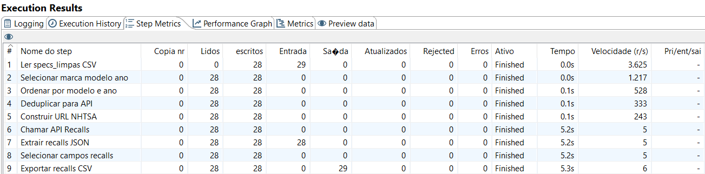

*Figura 15 — Métricas de uma execução anterior de T2; não confirmam a validade de todas as respostas HTTP.*


*Figura 16 — Preview anterior de nhtsa_recalls.csv; atualizar para mostrar estados HTTP e contagens nulas.*

### 3.3. T3 — consolidação e indicador exploratório

T3 ordena os fluxos e faz `LEFT OUTER JOIN` pela correspondência `(make, model_prefix, year) = (make, model, year)`. Preserva os veículos de T1, remove campos duplicados e os metadados técnicos HTTP da saída final.

As contagens ausentes continuam nulas. O `Calculator` aplica:

```text
recalls_por_100hp = nhtsa_recalls_count / engine_hp * 100
```

O rácio também fica nulo quando não existe contagem válida. O consolidado mantém 28 veículos e 18 campos. O preço do M5 E34 continua nulo.

#### Capturas de T3


*Figura 17 — Canvas anterior de T3; a configuração atual preserva contagens nulas sem imputação de zero.*


*Figura 18 — Merge Join com LEFT OUTER JOIN e chaves compostas.*

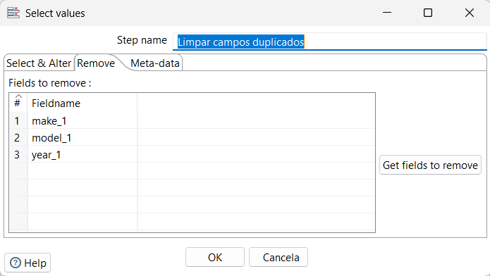

*Figura 19 — Seleção de campos anterior; a configuração atual remove também os metadados técnicos NHTSA.*

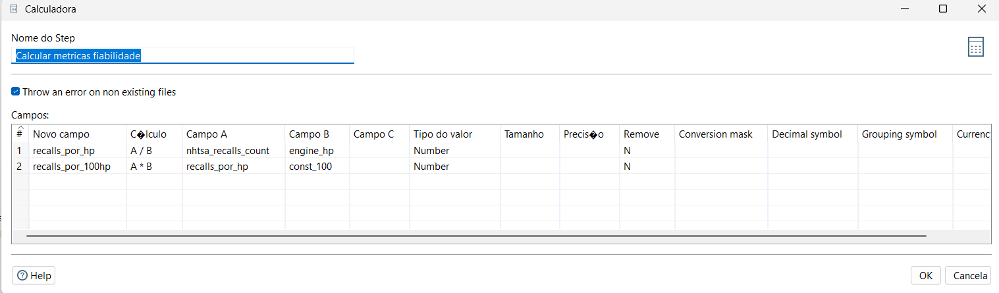

*Figura 20 — Cálculo de recalls_por_100hp, indicador exploratório.*

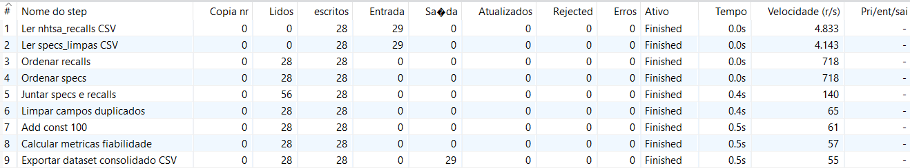

*Figura 21 — Métricas de uma execução anterior de T3.*

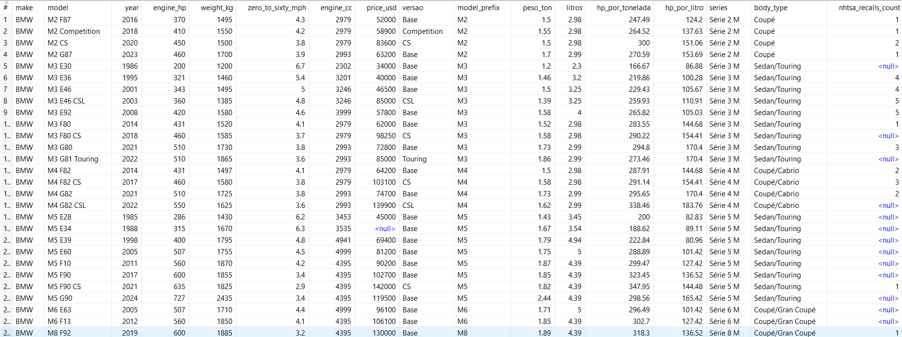

*Figura 22 — Preview anterior do consolidado; confirmar os nulos na captura atualizada.*

### 3.4. T4 — carga PostgreSQL

O esquema de referência é `sql/01_schema.sql`. Mantém os 18 campos de negócio, `id` e `loaded_at`, com chave única `(make, model, year)`. Impõe limites ao ano, valores mecânicos positivos e valores NHTSA não negativos quando presentes. Preço e campos NHTSA admitem `NULL`; as métricas usam tipos `NUMERIC`.

O KTR atual usa `Insert/Update` com a chave de marca, modelo e ano, atualizando os restantes campos. Não executa `TRUNCATE`. A reexecução não duplica as mesmas chaves, mas não elimina linhas removidas da fonte e pode deixar uma carga parcial se ocorrer uma falha. Não existe garantia de atomicidade para todo o dataset.

T4 e T5 resolvem a ligação `Postgres_Carros` através das propriedades Kettle `PGHOST`, `PGPORT`, `PGDATABASE`, `PGUSER` e `PGPASSWORD`. O exemplo sem segredos está em `config/kettle.properties.example`. A configuração local é descrita no README.

#### Capturas de T4


*Figura 23 — Preparação anterior do esquema; o DDL atual acrescenta restrições e a chave make, model, year.*


*Figura 24 — Canvas anterior de T4; a configuração atual usa Insert/Update.*

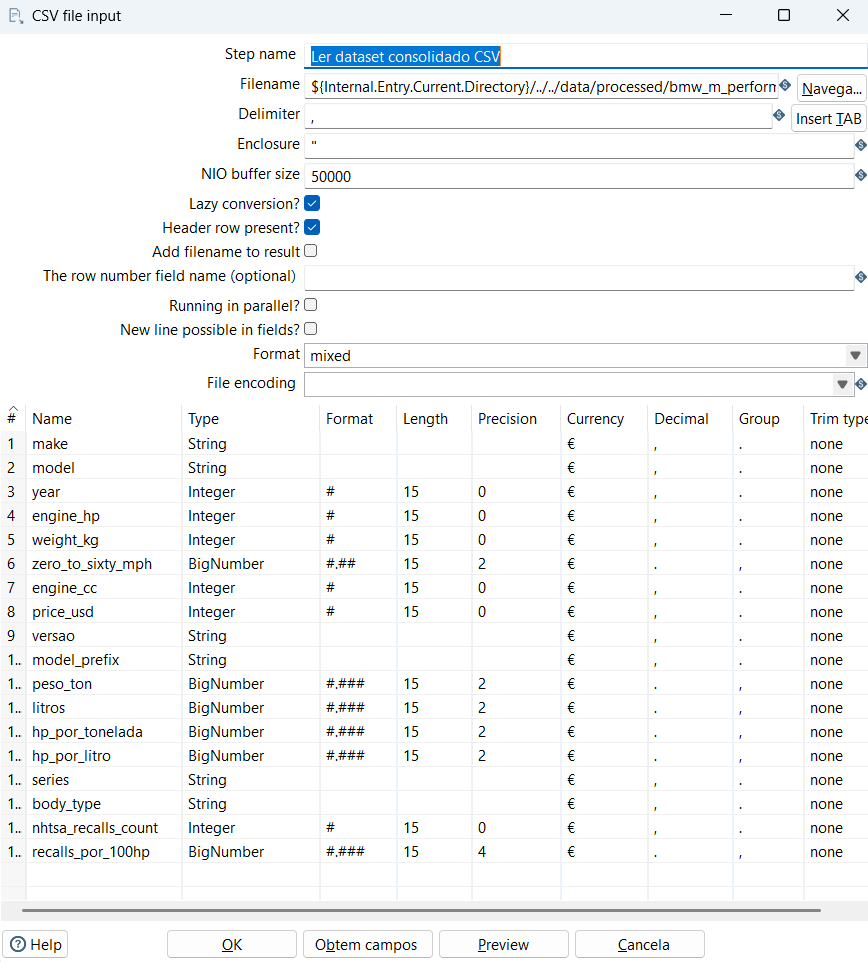

*Figura 25 — Leitura do CSV consolidado com caminho relativo e tipos numéricos.*

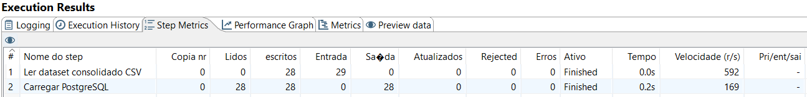

*Figura 26 — Métricas de uma carga anterior de T4.*

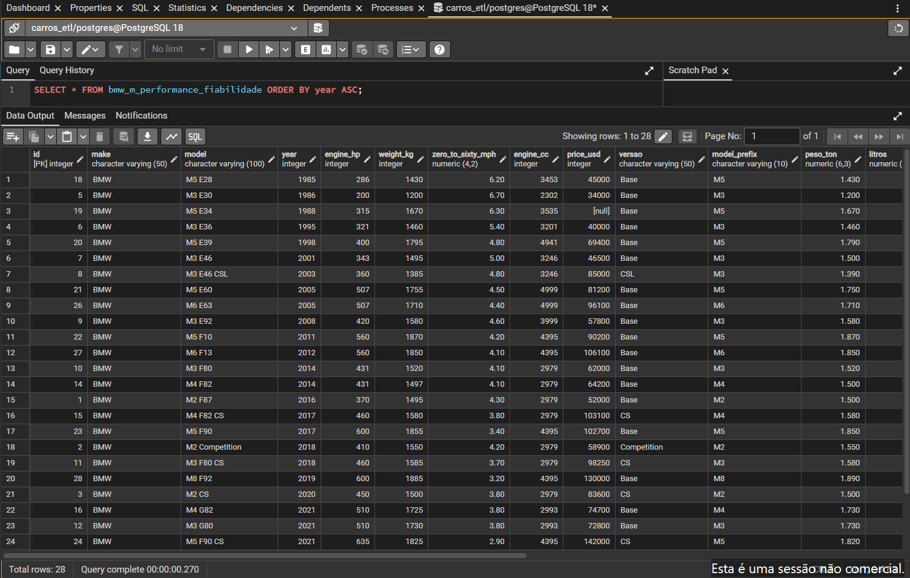

*Figura 27 — Consulta PostgreSQL de uma execução anterior; a confirmação manual de 28 linhas em 20/10/2026 é registada separadamente.*

### 3.5. T5 — catálogo JSON e resumo XML

T5 lê a tabela ordenada por série e ano. A opção `distribute=N` copia cada linha para dois ramos: catálogo JSON com 18 atributos por veículo e resumo XML agrupado por `series`.

A média de potência usa um campo auxiliar decimal:

```sql
CAST(engine_hp AS NUMERIC(10,2)) AS engine_hp_agregacao
```

O `GroupBy` aplica `AVERAGE(engine_hp_agregacao)`; o XML usa o formato `0.00`. O resumo contém contagem de modelos, médias de potência e rácios mecânicos, soma de campanhas, média do indicador exploratório e `modelos_com_resposta_nhtsa`.

Este último campo conta linhas com contagem NHTSA válida, sem provar cobertura da variante. As agregações NHTSA usam apenas valores não nulos; não se deve interpretar uma série sem respostas válidas como zero campanhas.

Os outputs atuais adiam a abertura dos ficheiros até receberem a primeira linha. Isso protege relatórios existentes se a leitura PostgreSQL falhar antes de produzir dados, mas não torna a escrita transacional.

#### Capturas de T5


*Figura 28 — Topologia de T5 com cópia do fluxo para os ramos JSON e XML.*

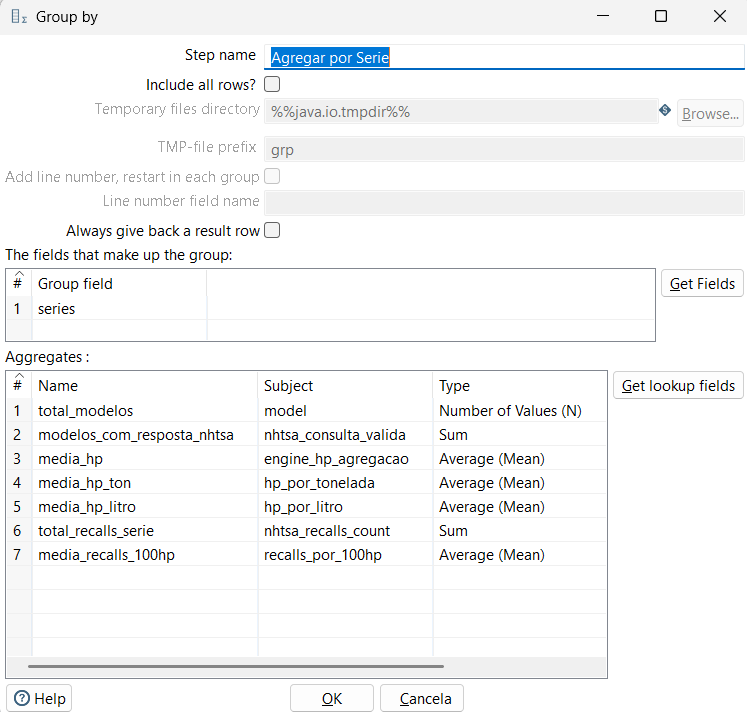

*Figura 29 — GroupBy anterior; atualizar para engine_hp_agregacao e modelos_com_resposta_nhtsa.*


*Figura 30 — Métricas de uma execução anterior de T5.*

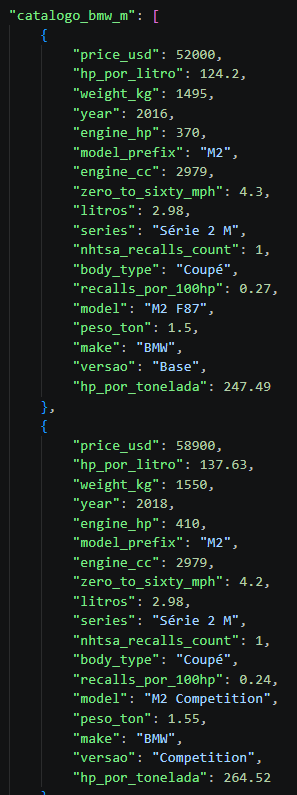

*Figura 31 — Preview anterior dos relatórios; atualizar para médias decimais e cobertura NHTSA.*

### 3.6. J_main — orquestração

O job executa T1, T2, T3, T4 e T5 por ordem. Cada transformação tem um hop de falha para `Abortar por Erro`. O mecanismo controla a sequência e interrompe o caminho normal perante falha; não cria uma transação distribuída entre API, ficheiros e PostgreSQL.

O autor confirmou uma execução manual completa no Pentaho em 20/10/2026, com `result=true` nas cinco transformações. Não foi fornecida uma duração confirmada para essa execução.

#### Capturas de J_main


*Figura 32 — Job J_main com execução sequencial e hops de erro.*

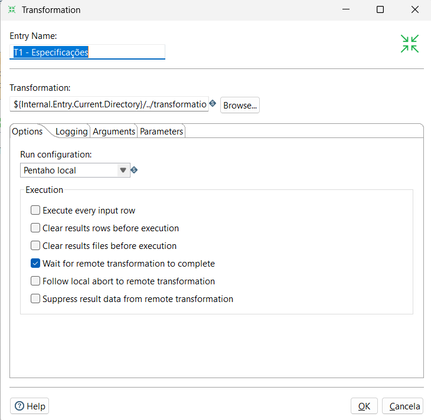

*Figura 33 — Entrada TRANS com caminho relativo.*


*Figura 34 — Painel de execução anterior de J_main; não é apresentado como nova captura de 20/10/2026.*

## 4. Resultados, validação e limitações

### 4.1. Execução manual confirmada

Em **20/10/2026**, o autor executou manualmente `J_main` no Pentaho e confirmou:

| Verificação | Resultado |
|---|---|
| T1, T2, T3, T4 e T5 | Todas terminaram com `result=true` |
| Registos carregados no PostgreSQL | 28 |
| Contagem confirmada na tabela PostgreSQL | 28 |
| Veículos exportados em JSON | 28 |
| Séries exportadas em XML | 6 |

Esta confirmação substitui a pendência anterior de execução de T4, T5 e do job completo. Não implica que todas as consultas NHTSA tenham uma resposta válida nem comprova testes de falha, rollback ou reexecução da carga.

A fonte mantém 29 registos únicos, dos quais um é rejeitado por peso omisso. Os 28 veículos válidos distribuem-se por seis séries.

### 4.2. Valores por série e interpretação

A revisão anterior registou os seguintes valores nos artefactos consolidados. As médias mecânicas preservam a precisão decimal corrigida:

| Série | Modelos | Potência média (hp) | Respostas NHTSA válidas na revisão anterior | Campanhas nessas respostas | Média exploratória de recalls/100 hp |
|---|---:|---:|---:|---:|---:|
| Série 2 M | 4 | 422.50 | 4 | 5 | 0.2925 |
| Série 3 M | 9 | 395.00 | 6 | 22 | 0.9700 |
| Série 4 M | 4 | 487.75 | 3 | 7 | 0.5000 |
| Série 5 M | 8 | 503.75 | 1 | 1 | 0.1600 |
| Série 6 M | 2 | 533.50 | 0 | n/d | n/d |
| Série 8 M | 1 | 600.00 | 1 | 1 | 0.1700 |

A revisão técnica anterior obteve 15 respostas HTTP 200 válidas e 13 HTTP 400. A distribuição HTTP da execução manual agora confirmada não foi fornecida; não se assume que repetiu esses valores. Estados e contagens da API podem mudar.

As médias NHTSA usam apenas respostas válidas, com cobertura desigual. Um total por série pode contar a mesma campanha em consultas de anos distintos; não representa necessariamente campanhas únicas. A Série 6 sem respostas válidas na revisão anterior não demonstra ausência de campanhas.

Os resultados não sustentam conclusões causais sobre motores turbo, qualidade de construção ou fiabilidade geral. Não foi verificado quais os componentes envolvidos em cada campanha; não se atribuem campanhas a airbags, cablagens ou motores sem análise específica.

### 4.3. Testes locais

A suite `unittest`, sem dependências externas, registou 23 testes aprovados na revisão técnica. Verifica CSV, 28 modelos válidos, quarentena, duplicados, campos obrigatórios, fórmulas, preço nulo do M5 E34, coerência CSV/JSON, agregações XML, médias decimais e estrutura Kettle.

As fixtures locais cobrem zero válido, erro HTTP, timeout, JSON inválido e `Count` ausente/inválido. São testes de regras e artefactos, distintos da execução manual agora confirmada.

Na revisão, Pan devolveu código de processo 0 mesmo com erro de ligação no log. Por isso, o código do processo isolado não basta como prova de sucesso: é necessário rever o log e o resultado Kettle.

### 4.4. Limitações

- Falta de fonte externa documentada por especificação do CSV.
- Cobertura NHTSA centrada nos EUA e consulta por modelo genérico, sem confirmação por VIN ou variante.
- Variação temporal da API e distinção obrigatória entre zero válido e falta de informação.
- Ausência de controlo por parque circulante, produção, quilometragem, gravidade ou tempo de exposição.
- `recalls_por_100hp` exploratório, sem validação como medida científica de fiabilidade mecânica.
- Carga e exportações sem garantia transacional global.
- Capturas anteriores às correções, a atualizar segundo a checklist e os KTR atuais.
- Vídeo, publicação e QR Code ainda pendentes.

## 5. Demonstração em vídeo e QR Code

O [guião](GUIAO_VIDEO.md) organiza uma demonstração de 3 a 5 minutos: problema, fontes, T1 e quarentena, T2 e REST, T3 e junção, T4 e PostgreSQL, T5 e relatórios, job e limitações.

**Estado:** o vídeo ainda não foi produzido nem publicado. Não existe URL final ou QR Code confirmado.

Após a gravação, publicar o vídeo, testar o acesso numa janela privada e só depois gerar o QR Code. Inserir o URL e a imagem nesta secção e atualizar o PDF. Preservam-se a [checklist das capturas](CHECKLIST_CAPTURAS.md) e a [checklist da demonstração](CHECKLIST_DEMONSTRACAO.md).

## 6. Conclusão e trabalhos futuros

A execução manual confirmada demonstra o funcionamento integrado de T1 a T5: limpeza, quarentena, integração REST, consolidação, carga de 28 registos e exportações de 28 veículos JSON e seis séries XML. Os nulos e as médias decimais fazem parte das regras de qualidade descritas.

A análise é técnica e exploratória. Não prova uma relação entre potência e avarias nem uma classificação de fiabilidade das séries. Para concluir a entrega académica, falta atualizar as capturas afetadas, gravar e publicar o vídeo, criar o QR Code real e atualizar o PDF.

Como trabalhos futuros propõem-se documentar fontes primárias por especificação, registar data e URL de cada consulta, estudar campanhas individualmente e testar uma carga transacional numa base descartável. Comparações entre marcas ou preços de outros mercados só deverão avançar com fontes documentadas.

## 7. Referências bibliográficas

1. National Highway Traffic Safety Administration. “NHTSA Datasets and APIs — Recalls”. <https://www.nhtsa.gov/nhtsa-datasets-and-apis>. Consultado na revisão de 20/10/2026.
2. National Highway Traffic Safety Administration. “Resources Related to Investigations and Recalls”. <https://www.nhtsa.gov/resources-investigations-recalls>. Consultado na revisão de 20/10/2026.
3. Hitachi Vantara. “Pentaho Data Integration 10.2”. <https://docs.pentaho.com/pdia-data-integration/10.2-data-integration>. Consultado na revisão de 20/10/2026.
4. Hitachi Vantara. “REST Client — General tab”. <https://docs.pentaho.com/pdia-data-integration/10.2-data-integration/pdi-transformation-steps-reference-overview/rest-client-step/options-rest-client/general-tab>. Consultado na revisão de 20/10/2026.
5. Hitachi Vantara. “Group By”. <https://docs.pentaho.com/pdia-data-integration/10.2-data-integration/pdi-transformation-steps-reference-overview/group-by-landing-page-article>. Consultado na revisão de 20/10/2026.
6. Hitachi Vantara. “Use Command Line Tools to Run Transformations and Jobs”. <https://docs.pentaho.com/pdia-data-integration/10.2-data-integration/advanced-topics-pentaho-data-integration-overview/use-command-line-tools-to-run-transformations-and-jobs>. Consultado na revisão de 20/10/2026.
7. PostgreSQL Global Development Group. “PostgreSQL 18 — CREATE TABLE”. <https://www.postgresql.org/docs/18/sql-createtable.html>.
