# BMW M: Performance e Fiabilidade

Relatório final do Trabalho Prático 1

**Autor:** Gonçalo Correia, n.º 22840  
**Unidade curricular:** Integração de Sistemas de Informação  
**Curso:** Licenciatura em Engenharia de Sistemas Informáticos  
**Instituição:** Instituto Politécnico do Cávado e do Ave — Escola Superior de Tecnologia  
**Ano letivo:** 2026/2027  
**Docente:** Óscar Ribeiro  
**Data:** 22 de outubro de 2026

<!-- PAGE -->

## Resumo

Este projeto utiliza o Pentaho Data Integration para integrar especificações de veículos BMW M, guardadas em CSV, com respostas JSON da API de campanhas de segurança da NHTSA. O processo limpa e valida os dados, cruza as fontes, calcula indicadores, carrega PostgreSQL e produz exportações JSON e XML. Um job coordena seis transformações, prepara um resumo por email e disponibiliza os resultados a uma dashboard local.

Os artefactos verificados contêm 28 veículos, 15 respostas NHTSA válidas, 13 registos sem dados NHTSA válidos e 6 séries. A principal realização é a pipeline ETL completa. As campanhas de segurança não constituem uma medida comprovada de fiabilidade mecânica; o rácio recalls_por_100hp não tem justificação técnica forte para esse fim. Por isso, os dados não permitem indicar quais os BMW M mais fiáveis.

**Palavras-chave:** ETL, Pentaho, PostgreSQL, API REST, qualidade dos dados, BMW M.

**Repositório:** [isi-tp1-performance-fiabilidade](https://github.com/goncaloalo/isi-tp1-performance-fiabilidade)

<!-- PAGE -->

## Índice

- [1 Enquadramento](#1-enquadramento)
- [2 Problema e objetivos](#2-problema-e-objetivos)
- [3 Estratégia e metodologia](#3-estratégia-e-metodologia)
- [4 Transformações](#4-transformações)
- [5 Job e demonstração dos resultados](#5-job-e-demonstração-dos-resultados)
- [6 Vídeo de demonstração](#6-vídeo-de-demonstração)
- [7 Conclusão e trabalhos futuros](#7-conclusão-e-trabalhos-futuros)
- [8 Referências bibliográficas](#8-referências-bibliográficas)

## 1 Enquadramento

O trabalho foi desenvolvido individualmente no âmbito de Integração de Sistemas de Informação. Segue o enunciado do TP1 de 2026/2027, que propõe a aplicação de processos de extração, transformação e carga de dados e exige três fases: recolha e preparação, processamento e transformação, e persistência e exportação [1].

Foi escolhido o Pentaho Data Integration, utilizando o Spoon para construir e executar as transformações e o job. O PostgreSQL assegura a persistência. O HTML, CSS e JavaScript permitem consultar os resultados numa dashboard local. A versão PDI 10.2.0.0-222 e Java 21.0.12.1 constam do registo técnico do projeto; não foram reinstalados para a revisão documental.

## 2 Problema e objetivos

O tema «BMW M: Performance e Fiabilidade» parte do interesse em reunir características de desempenho e informação sobre campanhas de segurança. As fontes apresentam formatos e níveis de detalhe diferentes: o CSV identifica modelos e versões, enquanto a API é consultada por marca, modelo genérico e ano.

O objetivo demonstrável é integrar essas fontes de forma consistente. Pretende-se validar entradas, preservar informação em falta, executar cruzamentos e cálculos, guardar resultados e torná-los consultáveis. O projeto não estima taxas de avaria nem valida uma classificação de fiabilidade. O título descreve a motivação inicial; a conclusão explicita os limites do que os dados permitem responder.

<!-- PAGE -->

## 3 Estratégia e metodologia

### 3.1 Fontes e preparação

O ficheiro data/raw/specs.csv foi preparado localmente para o exercício e contém 29 registos, de 1985 a 2024. Inclui marca, modelo, ano, potência, peso, aceleração de 0–60 mph, cilindrada e preço em USD. Não existe uma referência externa documentada para cada valor; por isso, estas especificações não são apresentadas como oficialmente verificadas pela BMW.

O ficheiro data/raw/series_lookup.csv contém seis correspondências entre prefixos M2, M3, M4, M5, M6 e M8, séries e tipos de carroçaria. É uma classificação agregada por prefixo: não descreve necessariamente a carroçaria específica de todas as variantes.

A API REST da NHTSA fornece respostas JSON relativas a campanhas de segurança. A consulta usa marca, modelo genérico e ano [2]. A informação da NHTSA sobre pesquisa por modelo é geral; uma identificação individual por VIN tem outro nível de detalhe [3]. Assim, uma consulta BMW M3 de 2003 não comprova a aplicação de todas as campanhas à variante M3 E46 CSL.

### 3.2 Organização do processo

A arquitetura separa responsabilidades em seis transformações. Os ficheiros intermédios permitem verificar o resultado de cada fase. O PostgreSQL serve de origem às exportações e ao resumo do email; a dashboard lê o catálogo exportado.

| Etapa | Entrada principal | Resultado |
|---|---|---|
| T1 | CSV de especificações e lookup | CSV limpo e quarentena |
| T2 | Modelos genéricos e anos de T1 | Respostas NHTSA validadas em CSV |
| T3 | CSV limpo e resultados NHTSA | CSV consolidado com 18 campos |
| T4 | CSV consolidado | Tabela PostgreSQL |
| T5 | Tabela PostgreSQL | Catálogo JSON e resumo XML |
| T6 | Tabela PostgreSQL | Quatro variáveis para o email |
| J_main | T1 a T6 e Mail | Execução sequencial e controlo de falhas |
| Dashboard | Catálogo JSON | Indicadores, gráficos e pesquisa |

### 3.3 Critérios de qualidade e validação

As regras centrais são não inventar valores, não confundir falhas da API com zero campanhas e manter a coerência entre formatos. A revisão confrontou os seis KTR, o KJB, o SQL, os CSV, o JSON, o XML e as capturas reais. As provas de execução existentes e a inspeção dos ficheiros são identificadas separadamente. Não se atribui uma nova execução Pentaho à revisão de 22/10/2026.

<!-- PAGE -->

### 3.4 Correspondência com o enunciado

O quadro seguinte relaciona as três fases e as mais-valias descritas nas páginas 2 e 3 do enunciado com a implementação. A fase de entrada consome dois formatos, CSV e JSON. O XML é um formato de saída adicional, não uma terceira fonte de entrada.

| Requisito ou critério | Implementação e prova |
|---|---|
| Recolha com formatos e fontes diversos | T1 lê CSV local; T2 consome JSON de API REST externa |
| Limpeza e validação | T1 normaliza texto, trata a versão omissa e rejeita campos inválidos; T2 valida HTTP e JSON |
| Expressões regulares | T1 extrai versão e prefixo de modelo |
| Duplicados, ordenação e seleção | Sort Rows, Unique Rows, Select Values e Filter Rows |
| Cruzamento e enriquecimento | Stream Lookup em T1; Merge Join LEFT OUTER em T3 |
| Cálculos e agrupamentos | Métricas em T1 e T3; Group By por série em T5 |
| Mapeamento e conversão de estruturas | Consolidação em 18 campos; mapeamento PostgreSQL; serialização JSON/XML |
| Persistência em base de dados | T4 carrega PostgreSQL; T5 e T6 executam consultas SQL |
| Exportação | CSV intermédios, catálogo JSON e resumo XML |
| Job e serviço remoto | J_main coordena T1–T6; Mail envia resumo via SMTP |
| Logs e acompanhamento | Log e métricas do Spoon, capturas do job e estados HTTP no CSV intermédio |
| Visualização dos resultados | Dashboard local com indicadores, gráficos, filtros e atualização de leitura |

Não se implementaram NoSQL, MQTT, FTP/SFTP, YAML ou processamento contínuo. O enunciado apresenta estas tecnologias como exemplos ou ações possíveis. A dashboard permite interação e atualização manual, mas não recebe um fluxo em tempo real. Não se aplicou anonimização aos dados de veículos, que não incluem proprietários ou VIN; a conta usada para email pertence à configuração operacional.

O relatório inclui enquadramento, problema, estratégia, diagramas e explicação das transformações e do job, vídeo com QR, conclusão e referências, conforme a página 4 do enunciado. O repositório Git reúne os materiais do projeto. O registo na folha partilhada, a submissão no e-learning até 22 de outubro e a defesa individual são procedimentos académicos distintos da execução da pipeline.

<!-- PAGE -->

## 4 Transformações

### 4.1 T1 Extrair e preparar especificações

T1 lê specs.csv e series_lookup.csv. String Operations remove espaços supérfluos e coloca a marca em maiúsculas. Uma expressão regular procura Competition, CSL, GTS, CS ou Touring no nome; quando não identifica uma versão especial, o valor passa a Base. Outra expressão extrai o prefixo usado no lookup e na API.

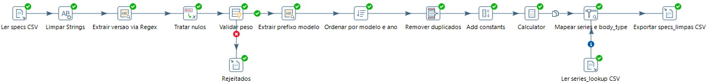

Filter Rows exige peso preenchido e positivo, potência e cilindrada positivas e ano entre 1886 e 2100. O M3 E92 GTS de 2010 não tem peso e é enviado para data/staging/rejeitados_specs.csv. Não se preenche esse valor por estimativa. Sort Rows e Unique Rows usam a chave make, model e year. A fonte atual não contém duplicados; o operador permanece como controlo preventivo, sem se alegar que removeu registos nesta execução.

Stream Lookup acrescenta series e body_type pelo prefixo. Um segundo filtro exige ambos os campos preenchidos; falhas seguem para rejeitados_lookup_series.csv. O ficheiro atual não contém linhas rejeitadas por lookup.

Os cálculos usam uma constante 1000 para converter unidades:

```text
peso_ton = weight_kg / 1000
litros = engine_cc / 1000
hp_por_tonelada = engine_hp / peso_ton
hp_por_litro = engine_hp / litros
```

O resultado é data/processed/specs_limpas.csv, com 28 veículos. Estes indicadores descrevem potência relativa ao peso e à cilindrada. Não medem durabilidade ou probabilidade de avaria. A aceleração permanece em segundos de 0–60 mph, sem conversão para 0–100 km/h.

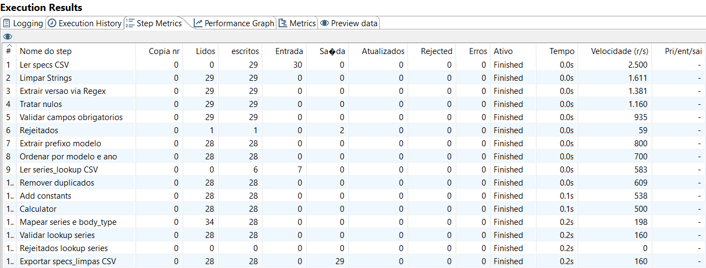

<!-- PAGE -->

### 4.2 T2 Consultar e validar a NHTSA

T2 seleciona marca, prefixo e ano, renomeia model_prefix para model, ordena e elimina combinações repetidas antes da consulta. O JavaScript constrói o URL com codificação dos valores de marca e modelo. REST Client realiza o pedido GET e devolve o corpo JSON e o estado HTTP.

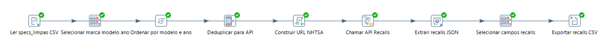

O endpoint utilizado é https://api.nhtsa.gov/recalls/recallsByVehicle, com os parâmetros make, model e modelYear. Por exemplo: make=BMW, model=M3 e modelYear=2003. O campo Count da resposta é aceite apenas quando o estado HTTP é 2xx, o corpo é JSON válido e Count é um número inteiro, finito e não negativo.

| Situação | Estado guardado | Contagem |
|---|---|---|
| HTTP 2xx, JSON válido e Count maior que zero | OK | Valor devolvido |
| HTTP 2xx, JSON válido e Count igual a zero | OK | 0 |
| HTTP inválido, JSON inválido ou Count inválido/ausente | ERRO | NULL |

O KTR atual usa apenas OK e ERRO. Não existe a classificação detalhada de estados descrita em versões antigas da documentação. Um HTTP 400 com Count igual a zero continua a ser erro: esse zero não é evidência de ausência de campanhas. Falhas de transporte ou timeout que façam o REST Client falhar interrompem a transformação; não se demonstra recuperação automática desses casos.

O CSV intermédio data/processed/nhtsa_recalls.csv contém make, model, year, nhtsa_recalls_count, nhtsa_query_status e nhtsa_http_status. Nos ficheiros verificados há 28 linhas: 15 OK com HTTP 200 e 13 ERRO com HTTP 400. Esta distribuição descreve os resultados guardados, não garante a repetição dos mesmos valores numa consulta futura.

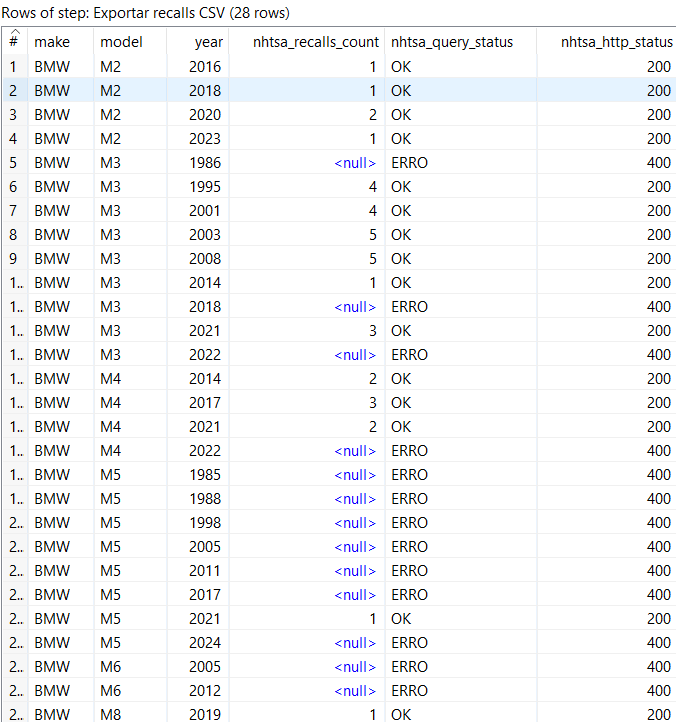

<!-- PAGE -->

### 4.3 T3 Consolidar os dados e calcular o rácio

T3 lê as especificações limpas e os resultados NHTSA. Ordena ambos os fluxos e aplica Merge Join com LEFT OUTER JOIN. As chaves são make, model_prefix e year nas especificações, correspondentes a make, model e year nas consultas.

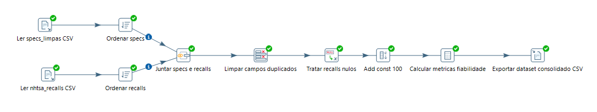

A junção à esquerda mantém os veículos válidos mesmo sem resposta NHTSA utilizável. Select Values remove campos duplicados e os metadados de estado HTTP da saída de negócio. Esses metadados continuam disponíveis no CSV intermédio de T2. O consolidado contém 28 linhas e 18 campos.

O Calculator calcula o indicador exploratório:

```text
recalls_por_100hp = nhtsa_recalls_count / engine_hp * 100
```

Quando a contagem é nula, o rácio também fica nulo. O preço omisso do M5 E34 é preservado, porque preço não é obrigatório para os cálculos definidos. O ficheiro final é data/processed/bmw_m_performance_fiabilidade.csv.

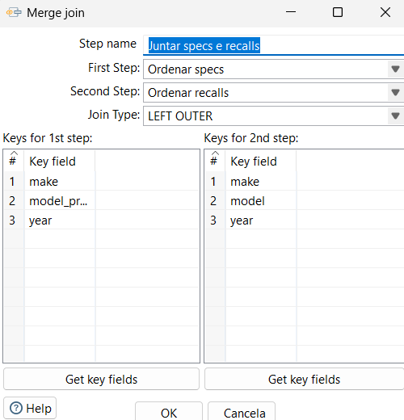

O rácio foi mantido para documentar a transformação implementada. Não possui justificação técnica forte como medida de fiabilidade: a potência não representa o número de veículos expostos, a quilometragem, a idade ou as oportunidades de avaria. A título puramente aritmético, uma campanha em 200 hp produz 0,50; a mesma campanha em 400 hp produz 0,25. O valor baixa apenas por aumentar a potência, sem demonstrar qualquer melhoria de fiabilidade.

Não se usa este rácio para recomendar modelos, criar um ranking ou inferir uma relação causal entre potência e falhas. A dashboard privilegia a cobertura dos dados e as características de desempenho.

<!-- PAGE -->

### 4.4 T4 Carregar o PostgreSQL

T4 lê o CSV consolidado e escreve os 18 campos de negócio na tabela public.bmw_m_performance_fiabilidade da base carros_etl. A transformação atual usa Table Output, com Truncate table ativo, escrita em batch e commit configurado para 1000 linhas. Não usa Insert/Update.

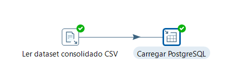

O DDL de referência encontra-se em sql/01_schema.sql. Acrescenta id e loaded_at aos campos de negócio, define chave única em make, model e year e contém restrições para ano e valores mecânicos positivos. Os campos NHTSA admitem NULL e, quando preenchidos, não podem ser negativos. As métricas usam NUMERIC. O DDL foi inspecionado; a captura antiga de criação da tabela não demonstra que todas as suas restrições estejam aplicadas na base existente.

| Grupo | Campos de negócio |
|---|---|
| Identificação | make, model, year, versao, model_prefix |
| Especificações | engine_hp, weight_kg, zero_to_sixty_mph, engine_cc, price_usd |
| Conversões e indicadores | peso_ton, litros, hp_por_tonelada, hp_por_litro |
| Classificação | series, body_type |
| NHTSA | nhtsa_recalls_count, recalls_por_100hp |

A ligação Postgres_Carros está configurada diretamente para localhost:5432, base carros_etl e utilizador postgres em T4, T5 e T6. As propriedades PGHOST/PGPASSWORD do exemplo histórico não são a configuração usada pelos ficheiros atuais.

TRUNCATE substitui os dados anteriores antes da carga. Esta estratégia é simples para a pequena amostra, mas não garante uma substituição integral segura perante falhas. Não existe demonstração de rollback global ou de reexecução em cenário de erro. CREATE TABLE IF NOT EXISTS também não migra automaticamente uma tabela antiga [5].

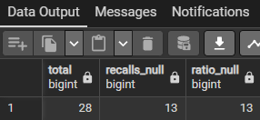

A figura 8 mostra os resultados, mas não o texto da consulta. É uma prova dos totais apresentados, não uma auditoria completa do esquema físico.

<!-- PAGE -->

### 4.5 T5 Exportar JSON e XML

T5 consulta PostgreSQL, ordena por série e ano e copia o fluxo para dois ramos. O primeiro escreve um catálogo JSON detalhado. O segundo aplica Group By por série e produz um resumo XML. A cópia para dois ramos explica as 56 emissões observadas na leitura, apesar de existirem apenas 28 veículos.

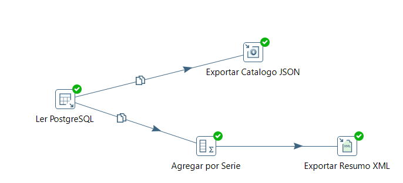

O ficheiro data/output/bmw_m_catalogo_completo.json contém a lista catalogo_bmw_m, com 28 objetos e os 18 campos de negócio. Preserva null no preço omisso e nas contagens e rácios sem dados válidos. É a fonte da dashboard.

O ficheiro data/output/bmw_m_resumo_series.xml contém a raiz relatorio_series_bmw_m e seis elementos serie_analise. Para cada série, exporta total_modelos, modelos_com_resposta_nhtsa, media_hp, media_hp_ton, media_hp_litro, total_recalls_serie e media_recalls_100hp.

A consulta converte engine_hp para NUMERIC(10,2), no campo auxiliar engine_hp_agregacao, para preservar médias decimais. Também cria nhtsa_consulta_valida, com 1 quando existe contagem e 0 quando é NULL. A soma deste campo permite mostrar a cobertura NHTSA de cada série, incluindo respostas válidas com zero campanhas.

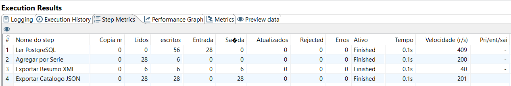

As médias e somas NHTSA baseiam-se apenas nos registos com contagem válida. Para a Série 6 M, sem respostas válidas, os elementos de soma e média de recalls estão vazios no XML. Isso significa informação indisponível, não zero campanhas.

As saídas estão configuradas para não abrir um novo ficheiro na inicialização. Esta opção reduz o risco de substituir uma exportação antes de chegar a primeira linha, mas não torna a escrita transacional. Os resultados devem continuar a ser verificados após cada execução.

<!-- PAGE -->

### 4.6 T6 Preparar o resumo por email

T6 consulta a tabela PostgreSQL e calcula quatro valores: COUNT(*) para veículos, COUNT(nhtsa_recalls_count) para respostas válidas, a diferença entre ambos para registos sem dados e COUNT(DISTINCT series) para séries. COUNT(campo) ignora NULL e inclui zero, mantendo a distinção entre ausência de dados e zero válido.

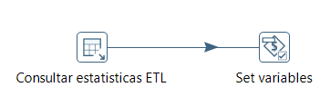

Set variables publica no parent job ETL_TOTAL_VEICULOS, ETL_NHTSA_OK, ETL_NHTSA_SEM_DADOS e ETL_TOTAL_SERIES. A entrada Mail de J_main usa estes valores no corpo do resumo. O envio ocorre depois das transformações, quando o percurso de sucesso chega a Mail.

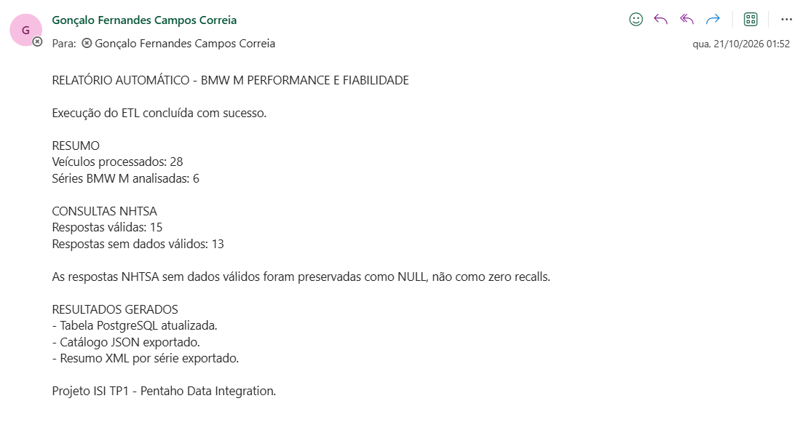

A captura confirma a receção de uma mensagem com esses totais e explicita que os valores sem dados foram preservados como NULL. A configuração registada usa smtp.office365.com, porta 587, autenticação e TLS. O envio foi conseguido com introdução manual da password no Spoon; a substituição por SMTP_PASSWORD não ficou validada e apresentou erro 535 no registo anterior. O job guardado tem a password Mail vazia.

Assim, o resumo é preparado e enviado pelo job após configuração da autenticação, mas não se afirma que o envio sem intervenção esteja operacional em qualquer computador. Não foi enviado um novo email durante a preparação deste relatório.

<!-- PAGE -->

## 5 Job e demonstração dos resultados

### 5.1 Orquestração com J_main

J_main executa T1, T2, T3, T4, T5 e T6 por ordem, seguindo-se Mail e Sucesso ETL. Cada transformação possui uma ligação de falha para Abortar por Erro. As ligações de sucesso impedem que a etapa seguinte prossiga normalmente quando a anterior falha.

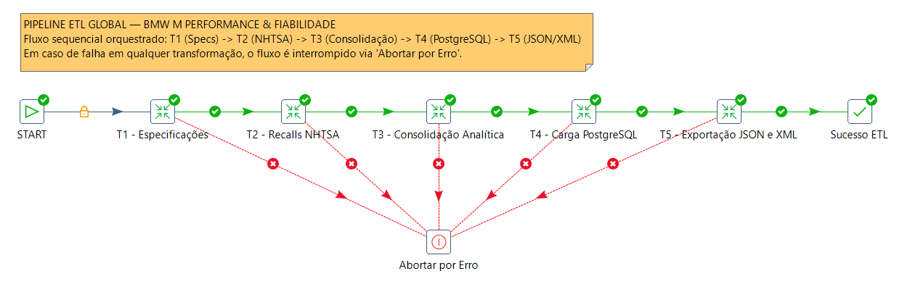

Mail não tem ligação explícita para Abortar por Erro; o seu tratamento de falhas não deve ser apresentado como equivalente ao das seis transformações. O job coordena o processo, mas não fornece uma transação distribuída entre API, ficheiros, base de dados e email.

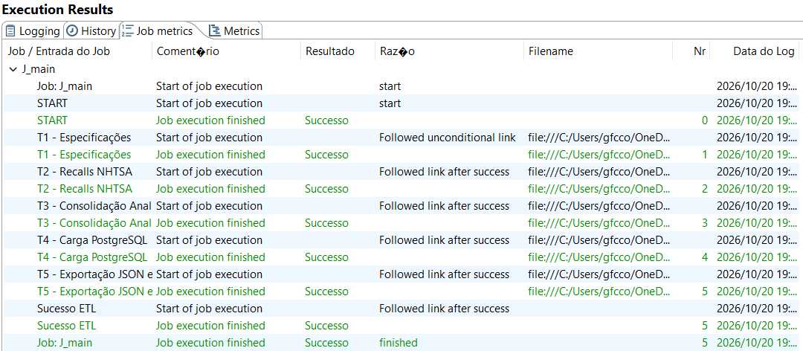

A figura 14 demonstra uma execução bem-sucedida registada. A hora está truncada; não se associa esta execução ao email da figura 12 apenas por partilharem a data. As capturas de configuração e métricas podem pertencer a momentos distintos. O número de erros de execução não substitui a análise dos estados HTTP: T2 pode terminar e preservar respostas inválidas como NULL.

<!-- PAGE -->

### 5.2 Resultados e provas de consistência

Os ficheiros existentes, revistos em 22/10/2026, contêm 29 entradas, um rejeitado por peso omisso e 28 veículos no consolidado e no JSON. Os 28 resultados NHTSA repartem-se por 15 respostas válidas e 13 sem dados válidos. A cobertura é 15/28, aproximadamente 53,6%. As seis séries do XML correspondem às séries distintas do catálogo.

| Série | Veículos | NHTSA válida | Sem dados | Potência média hp |
|---|---:|---:|---:|---:|
| Série 2 M | 4 | 4 | 0 | 422,50 |
| Série 3 M | 9 | 6 | 3 | 395,00 |
| Série 4 M | 4 | 3 | 1 | 487,75 |
| Série 5 M | 8 | 1 | 7 | 503,75 |
| Série 6 M | 2 | 0 | 2 | 533,50 |
| Série 8 M | 1 | 1 | 0 | 600,00 |
| Total | 28 | 15 | 13 | — |

As somas das contagens válidas por série são 5, 22, 7, 1, indisponível e 1, respetivamente. As médias exportadas de recalls_por_100hp são 0,2925, 0,9700, 0,5000, 0,1600, indisponível e 0,1700. São valores descritivos do exercício, não uma classificação de fiabilidade. Uma campanha pode aparecer em consultas de anos diferentes; a soma não equivale necessariamente a campanhas únicas.

| Verificação | Resultado e alcance |
|---|---|
| CSV consolidado e JSON | 28 chaves únicas e igualdade dos 18 campos por veículo |
| Informação ausente | 13 contagens e 13 rácios NULL; preço do M5 E34 também NULL |
| Respostas NHTSA | 15 OK/200 e 13 ERRO/400 no CSV guardado |
| XML | 6 séries; totais, cobertura e médias de potência coerentes com JSON |
| Capturas PostgreSQL e Spoon | Comprovam os totais mostrados e uma execução anterior bem-sucedida |
| QR fornecido | Conteúdo descodificado corresponde ao URL do vídeo |

As verificações dos artefactos não executaram novamente a API, o Pentaho ou a base de dados. Os 23 testes Python citados em registos anteriores são históricos; essa infraestrutura foi retirada e não é apresentada como teste atual. Também não se demonstraram ensaios de falha SMTP, rollback, carga concorrente ou medições de desempenho nesta revisão.

<!-- PAGE -->

### 5.3 Dashboard local

A dashboard usa HTML, CSS e JavaScript nativo. Lê o catálogo JSON através de um servidor HTTP local e apresenta os totais de veículos, séries, respostas válidas e registos sem dados. Mostra gráficos de distribuição por série e cobertura NHTSA, além de uma tabela com filtro de série e pesquisa por modelo, versão ou ano.

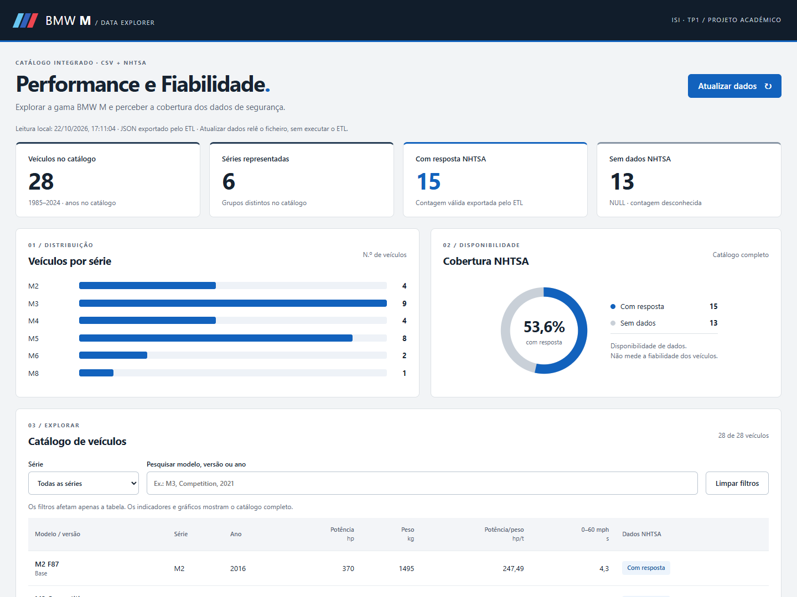

Os filtros afetam apenas a tabela; os indicadores e gráficos continuam a descrever o catálogo completo. A verificação local confirmou 28 veículos, 6 séries, 15 respostas válidas, 13 sem dados e 53,6% de cobertura. O filtro M3 combinado com a pesquisa CSL devolveu um veículo.

O botão Atualizar dados volta a ler o JSON. Não executa o ETL, não consulta a API e não atualiza PostgreSQL. A hora exibida corresponde à leitura local. O XML está disponível para consulta, mas não é a fonte dos indicadores. A página mantém NULL como «Sem dados» e não apresenta rankings de fiabilidade ou de recalls por potência.

### 5.4 Reprodução da demonstração

No computador preparado, abrir J_main.kjb no Spoon, testar a ligação Postgres_Carros e configurar a autenticação SMTP antes de executar. Confirmar os resultados de T1–T6 e Mail, as métricas e os estados NHTSA. T4 substitui os dados da tabela, pelo que a demonstração deve usar a base destinada ao exercício.

Para consultar a dashboard, iniciar um servidor na raiz do repositório:

```text
python -m http.server 8000 --bind 127.0.0.1
```

Abrir http://localhost:8000/dashboard/. Python serve apenas os ficheiros; não participa na execução ETL. Não é necessário instalar bibliotecas da dashboard.

<!-- PAGE -->

## 6 Vídeo de demonstração

O vídeo de demonstração do projeto está associado ao endereço fornecido pelo autor:

[https://youtu.be/GiM3ijfJCtM](https://youtu.be/GiM3ijfJCtM)


O QR code incluído é o ficheiro existente em docs/diagramas/QR_Video_Projeto_ISI_BMW_M_CORRIGIDO.png. A descodificação confirmou exatamente o endereço acima. O link textual permite aceder ao mesmo destino sem leitor de QR.

Para acompanhar a demonstração, as secções 4 e 5 explicam a preparação dos dados, a consulta à NHTSA, a junção, a carga PostgreSQL, as exportações, o resumo por email e a dashboard. As figuras 1 a 14 documentam as transformações e as provas de execução; a figura 15 apresenta a visualização dos resultados.

### 6.1 Pontos essenciais para a defesa

- O CSV contém 29 entradas; o registo sem peso é rejeitado e restam 28 veículos.
- Os 13 registos sem dados NHTSA válidos permanecem NULL. Não representam zero campanhas.
- O LEFT OUTER JOIN preserva todos os veículos válidos de T1.
- PostgreSQL centraliza os dados que alimentam JSON, XML e as estatísticas do email.
- T6 prepara as variáveis; Mail envia a mensagem dentro do job, após autenticação.
- A dashboard apresenta os ficheiros exportados e distingue cobertura de dados de fiabilidade.
- O objetivo atingido é demonstrar integração ETL. Não é possível identificar os BMW M mais fiáveis com estes dados.

<!-- PAGE -->

## 7 Conclusão e trabalhos futuros

### 7.1 Conclusão

O projeto atingiu o principal objetivo do TP1: construir e demonstrar um processo ETL que interliga fontes e formatos distintos. As seis transformações e o job realizam limpeza, validação, extração por API REST, enriquecimento, junção, cálculos, persistência PostgreSQL, exportação JSON/XML e preparação de uma notificação por email. A dashboard torna os resultados consultáveis.

Os resultados verificados são 28 veículos, 15 respostas NHTSA válidas, 13 sem dados válidos e 6 séries. A rejeição do registo sem peso e a preservação de NULL impedem que a ausência de informação seja apresentada como um valor confirmado. A coerência entre os artefactos reforça o resultado técnico da integração.

Contudo, não é possível concluir quais os BMW M mais fiáveis. As contagens de recalls representam campanhas de segurança e não são uma medida comprovada de fiabilidade mecânica. A amostra não contém um histórico de avarias, quilometragem, utilização, manutenção ou tempo de exposição que permita estimar essa fiabilidade. A pesquisa por modelo genérico e ano também não demonstra a aplicabilidade a cada variante.

A métrica recalls_por_100hp não possui justificação técnica forte como indicador de fiabilidade. Dividir campanhas pela potência não corrige diferenças de produção, idade ou uso, nem transforma campanhas em probabilidade de falha. Por isso, o rácio permanece documentado como cálculo exploratório, sem sustentar recomendações, rankings ou conclusões causais.

A cobertura é ainda desigual: a Série 6 M não tem respostas válidas e a Série 5 M tem apenas uma em oito registos. Ausência de dados não prova ausência de problemas; mesmo uma resposta válida com zero campanhas não comprova fiabilidade mecânica. A conclusão positiva e defensável é o funcionamento da integração ETL, acompanhado de uma interpretação crítica dos seus limites.

### 7.2 Limitações operacionais e evolução

A implementação depende da configuração local PostgreSQL e SMTP. T6 mantém um caminho absoluto no job, as ligações PostgreSQL contêm campos de password ofuscados e o envio Mail requer a configuração manual validada. Estes aspetos limitam a portabilidade; não se apresenta o repositório como livre de credenciais. As provas existentes também não demonstram transação global ou recuperação integral de falhas.

Como trabalho futuro, propõe-se documentar a origem de cada especificação, guardar data e parâmetros de cada consulta, analisar campanhas por identificador e testar a aplicabilidade por variante. Para estudar fiabilidade seriam necessários dados próprios de avarias e exposição. Na vertente técnica, interessa externalizar credenciais com validação, tornar T6 relativo, completar o tratamento de falhas Mail e testar uma carga transacional com publicação consistente das exportações.

<!-- PAGE -->

## 8 Referências bibliográficas

[1] Ferreira, Luís; Ribeiro, Óscar. Integração de Sistemas de Informação — Trabalho Prático I. Licenciatura em Engenharia de Sistemas Informáticos, IPCA, 2026/2027. Enunciado fornecido: ESI-ISI 2026-27 - TP1 - enunciado.pdf, 5 páginas.

[2] National Highway Traffic Safety Administration. NHTSA Datasets and APIs. Documentação da fonte de campanhas e do acesso por API. Consultado em 22/10/2026. [https://www.nhtsa.gov/nhtsa-datasets-and-apis](https://www.nhtsa.gov/nhtsa-datasets-and-apis)

[3] National Highway Traffic Safety Administration. Check for Recalls. Informação sobre campanhas de segurança e distinção entre pesquisa geral por modelo e pesquisa por VIN. Consultado em 22/10/2026. [https://www.nhtsa.gov/recalls](https://www.nhtsa.gov/recalls)

[4] Hitachi Vantara. Pentaho Data Integration 10.2. Documentação da ferramenta ETL utilizada. Consultado em 22/10/2026. [https://docs.pentaho.com/pdia-data-integration/10.2-data-integration](https://docs.pentaho.com/pdia-data-integration/10.2-data-integration)

[5] PostgreSQL Global Development Group. PostgreSQL 18 — CREATE TABLE. Referência sobre definição de tabelas e restrições; a versão da documentação não identifica a versão instalada. Consultado em 22/10/2026. [https://www.postgresql.org/docs/18/sql-createtable.html](https://www.postgresql.org/docs/18/sql-createtable.html)

[6] Correia, Gonçalo. Repositório isi-tp1-performance-fiabilidade. Código, dados, capturas e documentação do projeto. Inspeção da cópia local em 22/10/2026. [https://github.com/goncaloalo/isi-tp1-performance-fiabilidade](https://github.com/goncaloalo/isi-tp1-performance-fiabilidade)

[7] Correia, Gonçalo. Vídeo de demonstração do projeto ISI TP1. Endereço fornecido pelo autor e incorporado no QR code. [https://youtu.be/GiM3ijfJCtM](https://youtu.be/GiM3ijfJCtM)

### Documentação interna de suporte

As fontes técnicas são kettle/transformations/T1–T6, kettle/jobs/J_main.kjb, sql/01_schema.sql, os ficheiros em data/raw, data/staging, data/processed e data/output e o código de dashboard. A estratégia de ETL utiliza as capacidades de extração, limpeza e armazenamento descritas na documentação PDI [4].

Foram também consultados docs/decisoes_etl.md e docs/diagramas/README.md. Os registos históricos foram confrontados com os ficheiros atuais. As descrições anteriores de Insert/Update, estados NHTSA detalhados e ligação PostgreSQL por variáveis não representam a implementação aqui documentada.

As imagens são capturas reais do projeto. A captura da dashboard foi obtida durante esta revisão a partir de uma cópia dos ficheiros atuais. O QR fornecido foi reutilizado sem alteração. As capturas históricas de JSON input em T2 e do DDL antigo não são usadas como prova da configuração atual.
