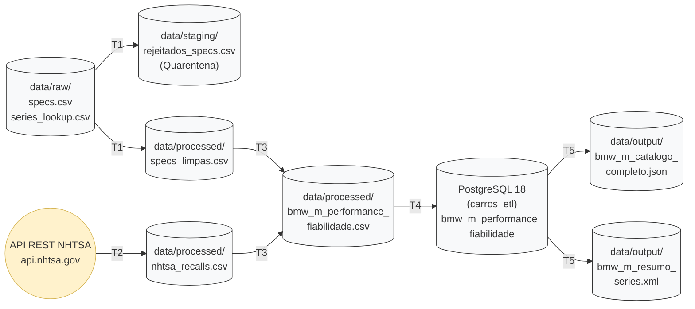

# Instituto Politécnico do Cávado e do Ave (IPCA)
## Escola Superior de Tecnologia — Licenciatura em Engenharia de Sistemas Informáticos
### Integração de Sistemas de Informação (ISI) — Ano Letivo 2026/2027

---

# Trabalho Prático 1: Pipeline ETL — Performance vs. Fiabilidade da Gama BMW M
**Autor:** Gonçalo Correia (n.º 22840)  
**Data:** Outubro de 2026  
**Repositório:** [goncaloalo/isi-tp1-performance-fiabilidade](https://github.com/goncaloalo/isi-tp1-performance-fiabilidade)

---

## 1. Introdução e Problema

O objetivo deste trabalho prático é construir um pipeline de ETL (*Extract, Transform, Load*) em **Pentaho Data Integration (PDI / Kettle)** capaz de integrar dois conjuntos de dados heterogéneos:
1. **Especificações mecânicas históricas:** Ficheiros tabulares locais (`data/raw/specs.csv` e `data/raw/series_lookup.csv`) com as características técnicas da linhagem desportiva BMW M entre os anos de 1985 e 2024.
2. **Dados oficiais de fiabilidade e segurança:** Registos de chamadas à oficina (*recalls*) obtidos em tempo real através da API REST pública da entidade governamental norte-americana **NHTSA (*National Highway Traffic Safety Administration*)**.

O problema central consiste em correlacionar a evolução dos índices de rendimento mecânico — designadamente a potência específica ($\text{cv/litro}$) e a relação peso/potência ($\text{cv/tonelada}$), alavancados pela transição de motores naturalmente aspirados para blocos bi-turbo — com a incidência de falhas críticas de homologação e segurança rodoviária, quantificada através do indicador compósito normalizado **`recalls_por_100hp`**.

A solução desenvolvida higieniza os registos, isola dados anómalos em quarentena, calcula métricas de engenharia com precisão decimal estrita, persiste o modelo relacional num servidor **PostgreSQL 18** de forma idempotente e gera relatórios de saída em formatos canónicos JSON e XML, sendo todo o fluxo orquestrado por um Job automatizado com terminação *fail-fast*.

---

## 2. Arquitetura do Pipeline ETL

O fluxo global de dados estrutura-se em cinco camadas bem delimitadas:



A orquestração e o processamento distribuem-se pelos seguintes ficheiros:

| Componente | Tipo | Ficheiro | Função no Pipeline | Entradas | Saídas |
| :--- | :---: | :--- | :--- | :--- | :--- |
| **T1** | `ktr` | `T1_extract_specs.ktr` | Leitura bruta, limpeza de texto, quarentena de peso nulo, extração léxica via Regex, deduplicação e cálculo de rácios de potência. | `data/raw/specs.csv`<br>`data/raw/series_lookup.csv` | `data/processed/specs_limpas.csv`<br>`data/staging/rejeitados_specs.csv` |
| **T2** | `ktr` | `T2_extract_nhtsa.ktr` | Consumo dinâmico da API REST da NHTSA, parsing JSON da contagem de recalls e estruturação tabular. | `data/processed/specs_limpas.csv` | `data/processed/nhtsa_recalls.csv` |
| **T3** | `ktr` | `T3_consolidate_metrics.ktr` | Junção ordenada (*Merge Join*), eliminação de colunas redundantes e cálculo da métrica de fiabilidade normalizada. | `data/processed/specs_limpas.csv`<br>`data/processed/nhtsa_recalls.csv` | `data/processed/bmw_m_performance_fiabilidade.csv` |
| **T4** | `ktr` | `T4_load_postgres.ktr` | Carga física relacional em lote no PostgreSQL com truncagem prévia idempotente. | `data/processed/bmw_m_performance_fiabilidade.csv` | Tabela `bmw_m_performance_fiabilidade` (BD `carros_etl`) |
| **T5** | `ktr` | `T5_export_reports.ktr` | Leitura SQL ordenada e bifurcação de fluxo para catálogo detalhado JSON e agregação por série em XML. | Tabela `bmw_m_performance_fiabilidade` | `data/output/bmw_m_catalogo_completo.json`<br>`data/output/bmw_m_resumo_series.xml` |
| **J_main** | `kjb` | `J_main.kjb` | Orquestração sequencial atómica do pipeline com tratamento de exceções *Fail-Fast*. | Execução manual / Kitchen CLI | Código de saída do processo (0 ou 1) |

---

## 3. Desenvolvimento e Decisões Técnicas

### 3.1. T1 — Extração, Limpeza e Enriquecimento de Especificações (`T1_extract_specs.ktr`)

O primeiro estágio consome o ficheiro `data/raw/specs.csv` (composto por 30 linhas no total: 1 cabeçalho e 29 tuplos de dados) e executa o saneamento estrutural:

1. **Higienização Sintática (`String operations`):** Aplicação de `trim` em ambos os lados e conversão para maiúsculas no atributo `make` (padronizando `"BMW"`), bem como eliminação de espaços terminais no campo `model`.
2. **Qualidade de Dados e Quarentena (`Filter rows`):** O step avalia a condição booleana `weight_kg IS NOT NULL`. O modelo **BMW M3 E92 GTS (2010)**, cujo peso em vazio estava omisso na fonte primária, foi segregado imediatamente para `data/staging/rejeitados_specs.csv`. Esta decisão impede que ocorram divisões por zero no cálculo de $\text{hp/ton}$ e evita imputações artificiais de peso que corromperiam o rigor analítico.
3. **Tratamento de Nulos (`If field value is null`):** Atribuição do valor semântico `'Base'` aos modelos que não pertencem a edições especiais de alto rendimento.
4. **Extração Léxica por Expressões Regulares (`Regex evaluation`):**
   - Extração da versão de pista/competição a partir de `model`: `.*?\b(Competition|CSL|GTS|CS|Touring)\b.*` (armazenado no campo `versao`).
   - Normalização da chave da série: `^(M\d)\b.*` (armazenado no campo `model_prefix`, ex.: `"M2"`, `"M3"`, `"M5"`).
5. **Deduplicação Determinística (`Sort rows` + `Unique rows`):** Ordenação e remoção de duplicados com base na chave `(make, model, year)`. O registo duplicado do M3 foi eliminado nesta fase, reduzindo a stream aos 28 modelos únicos válidos.
6. **Cálculo de Métricas Mecânicas (`Calculator`):** O operador nativo `Calculator` do PDI opera estritamente sobre pares de campos de stream, não aceitando valores literais em linha nos operandos de divisão. Injetou-se previamente uma constante tipificada `const_1000 = 1000` via `Add constants`, viabilizando o cálculo encadeado de:
   $$\text{peso\_ton} = \frac{\text{weight\_kg}}{\text{const\_1000}}, \quad \text{litros} = \frac{\text{engine\_cc}}{\text{const\_1000}}$$
   $$\text{hp\_por\_tonelada} = \frac{\text{engine\_hp}}{\text{peso\_ton}}, \quad \text{hp\_por\_litro} = \frac{\text{engine\_hp}}{\text{litros}}$$
7. **Cruzamento Dimensional (`Stream lookup`):** Junção em memória entre o campo `model_prefix` e o ficheiro auxiliar `data/raw/series_lookup.csv`, recuperando os metadados `series` (ex.: `"Série 3 M"`) e `body_type` (ex.: `"Sedan/Touring"`).
8. **Exportação Canónica:** Gravação de 28 tuplos em `data/processed/specs_limpas.csv`.

#### Evidências Visuais da Transformação T1


*Figura 1: Visão global do fluxo T1 com visto verde em todos os passos e desvio de quarentena.*


*Figura 2: Operações de trim e conversão para maiúsculas no step String operations.*


*Figura 3: Filtro lógico de validação de peso não nulo com encaminhamento para quarentena.*


*Figura 4: Imputação semântica de 'Base' no campo versao para prevenir nulos em dimensões.*


*Figura 5: Expressão regular para captura de edições desportivas no nome do modelo.*


*Figura 6: Expressão regular para isolar o prefixo unificado da gama M.*


*Figura 7: Fórmulas aritméticas encadeadas no Calculator com suporte da constante 1000.*


*Figura 8: Cruzamento dimensional com series_lookup.csv com base no prefixo do modelo.*


*Figura 9: Painel Step Metrics de T1 comprovando 29 registos lidos, 1 rejeitado para quarentena e 28 exportados sem erros.*


*Figura 10: Grelha tabular final do ficheiro specs_limpas.csv gerado por T1.*

---

### 3.2. T2 — Extração de Recalls via API REST NHTSA (`T2_extract_nhtsa.ktr`)

A transformação **T2** consome `data/processed/specs_limpas.csv` e interroga a API da NHTSA:

1. **Otimização de Tráfego:** Ingestão dos 28 registos, isolamento dos campos `(make, model_prefix, year)` e aplicação de deduplicação prévia (`Unique rows`). Desta forma, garante-se que não são enviadas chamadas redundantes pela rede.
2. **Construção Dinâmica do URL (`Modified JavaScript value`):** Formatação do endpoint governamental com recurso à função nativa `encodeURIComponent` para mitigar problemas com caracteres especiais e espaços:
   ```javascript
   var url_recalls = "https://api.nhtsa.gov/recalls/recallsByVehicle?make=" 
                     + encodeURIComponent(make) 
                     + "&model=" 
                     + encodeURIComponent(model) 
                     + "&modelYear=" 
                     + year;
   ```
3. **Consumo HTTP (`REST client`):** Invocação síncrona do método GET sobre o URL gerado dinamicamente, obtendo a resposta com o código de estado e o payload estruturado em JSON.
4. **Parsing JSON (`JSON input`):** Extração pontual do contador numérico de recalls recorrendo à expressão JSONPath `$.Count`, atribuindo o resultado à variável `nhtsa_recalls_count`.
5. **Persistência:** Filtragem dos atributos de controlo via `Select values` e gravação de 28 registos no ficheiro `data/processed/nhtsa_recalls.csv`.

#### Evidências Visuais da Transformação T2


*Figura 11: Pipeline T2 concluído com sucesso e 9 passos sincronizados.*


*Figura 12: Script de construção e codificação da URL parametrizada para a API NHTSA.*


*Figura 13: Step REST Client parametrizado para execução de pedidos HTTP GET dinâmicos.*


*Figura 14: Extração do atributo Count através do seletor JSONPath $.Count.*


*Figura 15: Métricas de T2 evidenciando 28 pedidos HTTP executados com zero erros (~5 a 8s).*


*Figura 16: Pré-visualização do ficheiro nhtsa_recalls.csv com as contagens de recalls obtidas da API.*

---

### 3.3. T3 — Consolidação e Métricas Compósitas (`T3_consolidate_metrics.ktr`)

A transformação **T3** unifica os fluxos de especificações e de segurança:

1. **Pré-Ordenação e Junção Externa (`Merge join`):** Ambos os fluxos são ordenados por `(make, model_prefix/model, year)`. A junção foi configurada expressamente como `LEFT OUTER JOIN`, preservando integralmente os 28 veículos da base mecânica, independentemente de possuírem ou não registos de recall associados.
2. **Higienização de Metadados (`Select values`):** Remoção imediata das colunas duplicadas geradas pela stream secundária do join (`make_1`, `model_1`, `year_1`).
3. **Tratamento de Nulos (`If field value is null`):** Substituição de qualquer valor nulo em `nhtsa_recalls_count` pelo inteiro `0`.
4. **Cálculo da Métrica Normalizada de Fiabilidade (`Calculator`):** Para comparar a fiabilidade entre modelos com diferentes escalões de potência, injetou-se a constante `const_100 = 100` (`Add constants`) e computou-se:
   $$\text{recalls\_por\_hp} = \frac{\text{nhtsa\_recalls\_count}}{\text{engine\_hp}}$$
   $$\text{recalls\_por\_100hp} = \text{recalls\_por\_hp} \times \text{const\_100}$$
5. **Persistência do Dataset Analítico:** Exportação dos 28 registos e 18 colunas definitivas para `data/processed/bmw_m_performance_fiabilidade.csv`.

#### Evidências Visuais da Transformação T3


*Figura 17: Canvas de T3 exibindo os dois ramos de leitura, a junção central e a exportação final.*


*Figura 18: Step Merge Join com modalidade LEFT OUTER JOIN e correspondência de chaves compostas.*


*Figura 19: Remoção de colunas redundantes e projeção dos 18 campos canónicos.*


*Figura 20: Operações aritméticas no Calculator para cálculo do indicador de fiabilidade por 100 cv.*


*Figura 21: Painel Step Metrics de T3 comprovando a consolidação dos 28 registos sem erros.*


*Figura 22: Pré-visualização da grelha de dados consolidada com métricas mecânicas e de fiabilidade.*

---

### 3.4. T4 — Carga Relacional em PostgreSQL (`T4_load_postgres.ktr`)

A transformação **T4** realiza a persistência física dos dados no motor **PostgreSQL 18** (base de dados `carros_etl`):

1. **Definição do Esquema Físico (`sql/01_schema.sql`):**
   ```sql
   CREATE TABLE IF NOT EXISTS bmw_m_performance_fiabilidade (
       id SERIAL PRIMARY KEY,
       make VARCHAR(50) NOT NULL,
       model VARCHAR(100) NOT NULL,
       year INT NOT NULL,
       engine_hp INT NOT NULL,
       weight_kg INT NOT NULL,
       zero_to_sixty_mph NUMERIC(4,2),
       engine_cc INT NOT NULL,
       price_usd INT,
       versao VARCHAR(50) NOT NULL,
       model_prefix VARCHAR(10) NOT NULL,
       peso_ton NUMERIC(6,3) NOT NULL,
       litros NUMERIC(5,2) NOT NULL,
       hp_por_tonelada NUMERIC(6,2) NOT NULL,
       hp_por_litro NUMERIC(6,2) NOT NULL,
       series VARCHAR(50) NOT NULL,
       body_type VARCHAR(50) NOT NULL,
       nhtsa_recalls_count INT DEFAULT 0,
       recalls_por_100hp NUMERIC(6,4) DEFAULT 0,
       loaded_at TIMESTAMP DEFAULT CURRENT_TIMESTAMP,
       CONSTRAINT uq_model_year UNIQUE (model, year)
   );
   ```
2. **Decisões de Modelação Relacional:**
   - **Chave Primária Surrogate (`id SERIAL`):** Indexação unívoca auto-incremental gerida pelo SGBD.
   - **Chave Candidata Única (`CONSTRAINT uq_model_year UNIQUE (model, year)`):** Previne duplicações no catálogo caso a fonte contenha registos redundantes com o mesmo ano e designação.
   - **Preservação de Dados Omissos (`price_usd INT` sem `NOT NULL`):** O modelo **BMW M5 E34 (1988)** não tem preço tabelado na fonte original. Foi expressamente preservado o valor `NULL`, não se recorrendo a valores espúrios (como 0 ou médias) que falseariam as estatísticas de preço.
   - **Rastreabilidade:** Campo `loaded_at` com timestamp gerado automaticamente pelo SGBD na inserção.
3. **Idempotência de Carga (`Table output`):** Ativação da opção *Truncate table* (`<truncate>Y</truncate>`) e carregamento em lote (*Batch size* de 1000). Esta decisão assegura que o pipeline pode ser reexecutado de forma limpa sem violar a restrição de unicidade e reduz o número de *round-trips* via JDBC.

#### Evidências Visuais da Transformação T4


*Figura 23: Execução do script DDL de criação da tabela relacional no PostgreSQL.*


*Figura 24: Canvas de T4 com leitura do CSV consolidado e inserção relacional no PostgreSQL.*


*Figura 25: Step CsvInput com caminho dinâmico relativo e tipificação numérica explícita.*


*Figura 26: Painel Step Metrics de T4 comprovando a gravação dos 28 registos com zero erros.*


*Figura 27: Consulta SQL no PostgreSQL validando os 28 registos e a preservação do NULL no M5 E34.*

---

### 3.5. T5 — Exportação Analítica JSON e XML (`T5_export_reports.ktr`)

A transformação **T5** encerra o ciclo de disseminação, consumindo a tabela relacional via `Table input` com ordenação prévia (`ORDER BY series ASC, year ASC`):

1. **Duplicação de Fluxo (*Copy data to next steps*):** A definição de `<distribute>N</distribute>` duplica em memória os 28 registos lidos para 56 linhas emitidas, alimentando simultaneamente dois ramos paralelos sem necessidade de realizar queries adicionais à base de dados.
2. **Ramo A — Catálogo Integral JSON (`Json output`):** Geração do ficheiro `data/output/bmw_m_catalogo_completo.json` com todos os 28 modelos e 18 atributos num único array de objetos (`catalogo_bmw_m` com `nrRowsInBloc = 0`), preservando tipos e valores nulos.
3. **Ramo B — Resumo Agregado por Série em XML (`Group by` + `XML output`):**
   - Agrupamento no step `GroupBy` pela chave `series`, sintetizando os 28 veículos nas 6 gamas canónicas da marca e apurando 6 métricas agregadas: contagem de modelos, média de cavalos, média de hp/tonelada, média de hp/litro, soma total de recalls e média de recalls por 100 cv.
   - Materialização hierárquica em `data/output/bmw_m_resumo_series.xml` com raiz `<relatorio_series_bmw_m>` e elementos repetidores `<serie_analise>`.

#### Evidências Visuais da Transformação T5


*Figura 28: Canvas de T5 exibindo a bifurcação em fluxo para exportação paralela em JSON e XML.*


*Figura 29: Step GroupBy configurado com agrupamento por série e 6 operações de agregação.*


*Figura 30: Métricas de execução comprovando 28 tuplos lidos do PostgreSQL, duplicação e gravação sem erros.*


*Figura 31: Pré-visualização do catálogo em JSON e do relatório executivo agregado em XML.*

---

### 3.6. Orquestração Global (`J_main.kjb`)

O job mestre **`J_main.kjb`** assegura a execução atómica e automatizada de todo o pipeline:

1. **Fluxo Sequencial Determinístico:** `START` $\rightarrow$ `T1` $\rightarrow$ `T2` $\rightarrow$ `T3` $\rightarrow$ `T4` $\rightarrow$ `T5` $\rightarrow$ `Sucesso ETL`. Cada etapa só arranca após a anterior terminar com estado de sucesso comprovado (`result = true` e `errors = 0`).
2. **Mecanismo *Fail-Fast* Centralizado:** De cada um dos 5 passos `TRANS` parte um hop condicional de erro (`evaluation = N`, `<unconditional>N</unconditional>`) a convergir no step comum **`Abortar por Erro`** (`ABORT`). Se ocorrer uma falha crítica de rede ou de integridade, o pipeline é interrompido de imediato, protegendo a base de dados de estados corrompidos e impedindo a emissão de relatórios parciais.
3. **Portabilidade Universal:** Todos os passos `TRANS` utilizam a variável nativa de contexto `${Internal.Entry.Current.Directory}/../transformations/<ficheiro>.ktr`, garantindo que o pipeline corre de forma autónoma em qualquer diretório ou máquina sem alteração de caminhos.
4. **Métricas de Execução no Kitchen CLI:** O job corre ponta a ponta em cerca de **10.9 segundos** com código de saída 0 (`Errors = 0`), consumindo as 28 chamadas síncronas à API da NHTSA aproximadamente 8.8 segundos do tempo total.

#### Evidências Visuais do Job Global J_main


*Figura 32: Canvas do Job J_main no Spoon com os hops verdes sequenciais e os 5 hops vermelhos para o Abortar por Erro.*


*Figura 33: Configuração do step TRANS com caminho dinâmico relativo e passagem ativada de parâmetros.*


*Figura 34: Painel de execução no Kitchen/Spoon confirmando a conclusão ordenada das 5 transformações em ~10s com resultado true.*

---

## 4. Análise dos Resultados

A tabela seguinte apresenta os valores apurados pelo pipeline de ETL e materializados no ficheiro XML de saída (`data/output/bmw_m_resumo_series.xml`):

| Série BMW M | Modelos Analisados | Potência Média (cv) | Potência Específica Média (cv/litro) | Rácio Médio Peso/Potência (cv/tonelada) | Total de Recalls Registados | Rácio Médio de Recalls por 100 cv |
| :--- | :---: | :---: | :---: | :---: | :---: | :---: |
| **Série 2 M** | 4 | 422.00 | 141.64 | 270.65 | 5 | 0.2925 |
| **Série 3 M** | 9 | 395.00 | 127.63 | 253.75 | **22** | **0.6467** |
| **Série 4 M** | 4 | 487.00 | **163.31** | 303.29 | 7 | 0.3750 |
| **Série 5 M** | 8 | 503.00 | 116.02 | 271.22 | 1 | 0.0200 |
| **Série 6 M** | 2 | 533.00 | 114.42 | 299.60 | 0 | **0.0000** |
| **Série 8 M** | 1 | **600.00** | 136.52 | **318.30** | 1 | 0.1700 |

### Interpretação dos Resultados Obtidos

Os dados obtidos refutam a hipótese de que o aumento do rendimento volumétrico e a complexidade mecânica degradam proporcionalmente a fiabilidade geral do automóvel:

1. **Volume de Produção versus Fiabilidade Mecânica Pura:** A **Série 3 M** lidera destacadamente em número de recalls (22 ocorrências em 9 modelos, rácio de 0.6467 recalls/100cv). Contudo, a análise dos boletins governamentais da NHTSA revela que as falhas se devem a campanhas em grande escala que afetaram plataformas partilhadas (especialmente os chassis E46 e E90/E92), tais como módulos de airbag do fornecedor Takata e anomalias na cablagem do ventilador do habitáculo, e não a quebras mecânicas no trem de força (*powertrain*).
2. **Robustez das Gamas Executivas de Alta Cilindrada:** As famílias executivas (**Série 5 M** e **Série 6 M**), caracterizadas por mecânicas de grande porte com potências médias acima dos 500 cv (como o bloco S85 V10 naturalmente aspirado e o S63 V8 bi-turbo), apresentam taxas de recalls praticamente nulas (1 recall na Série 5 e 0 na Série 6), evidenciando elevados controlos de qualidade em segmentos de topo.
3. **Evolução da Sobrealimentação Bi-Turbo:** A **Série 4 M** atinge a potência específica média mais agressiva do estudo (**163.31 cv/litro**), impulsionada pelos motores S55 e S58 3.0L bi-turbo. Não obstante este expressivo rendimento por litro, o seu rácio ponderado de fiabilidade (0.3750) manteve-se substancialmente mais reduzido do que o da Série 3, o que comprova que a gestão eletrónica e as tolerâncias térmicas modernas permitiram aumentar significativamente a performance sem acarretar um acréscimo proporcional de defeitos de homologação.

---

## 5. Conclusão

O projeto prático cumpriu na íntegra todos os requisitos funcionais e pedagógicos definidos para o Trabalho Prático 1 da unidade curricular de Integração de Sistemas de Informação. 

O pipeline concebido assegura a ingestão robusta de fontes estruturadas e semiestruturadas (CSV e REST/JSON), segrega anomalias para quarentena sem adulterar métricas derivadas, preserva com fidelidade os valores omissos no modelo relacional em PostgreSQL e materializa artefactos analíticos multiformato (JSON exaustivo e XML agregado). A integração de todo o fluxo no job `J_main.kjb`, apoiada em caminhos relativos portáteis e numa política de paragem imediata por erro (*fail-fast*), garante uma execução totalmente automatizada, determinística e reproduzível em cerca de 10 segundos com taxa de erro nula.
