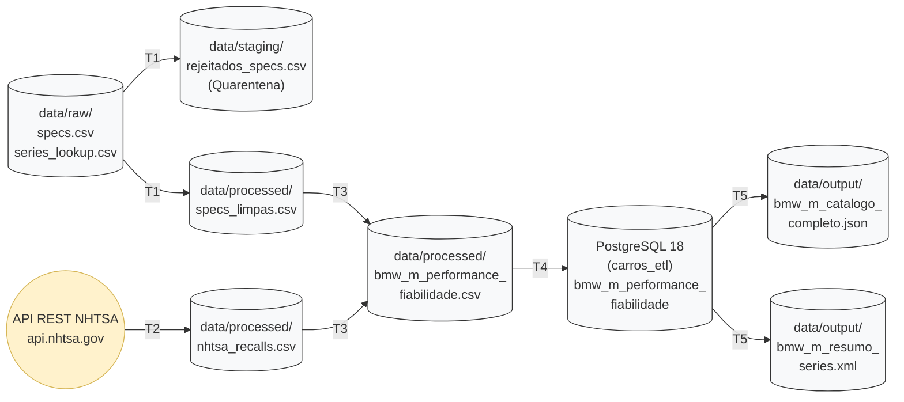

# Instituto Politécnico do Cávado e do Ave (IPCA)
## Escola Superior de Tecnologia — Licenciatura em Engenharia de Sistemas Informáticos
### Integração de Sistemas de Informação (ISI) — Ano Letivo 2026/2027

---

# Trabalho Prático 1: Pipeline ETL — Performance vs. Fiabilidade da Gama BMW M
**Autor:** Gonçalo Correia (n.º 22840)  
**Data:** Outubro de 2026  
**Repositório:** [goncaloalo/isi-tp1-performance-fiabilidade](https://github.com/goncaloalo/isi-tp1-performance-fiabilidade)

---

## 1. Introdução e Problema

O objetivo deste trabalho prático é desenvolver um processo completo de ETL (*Extract, Transform, Load*) no **Pentaho Data Integration (PDI / Kettle)** para cruzar duas fontes de dados com formatos e origens distintas:
1. **Especificações técnicas de automóveis:** Ficheiros CSV locais com dados de modelos desportivos da gama BMW M produzidos entre 1985 e 2024 (`data/raw/specs.csv` e `data/raw/series_lookup.csv`).
2. **Dados oficiais de chamadas à oficina (*recalls*):** Informação obtida através da API REST pública da agência governamental norte-americana **NHTSA (*National Highway Traffic Safety Administration*)**.

O problema em estudo é simples: ao longo das últimas quatro décadas, os modelos da gama BMW M aumentaram significativamente a sua potência específica (cavalos por litro de cilindrada) e a sua relação peso/potência, sobretudo com a transição de motores naturalmente aspirados para blocos bi-turbo modernos. Pretende-se verificar se este aumento de rendimento e complexidade mecânica se traduziu num maior número de avarias e problemas de segurança reportados pelas autoridades, através do cálculo de um indicador exploratório de fiabilidade: o rácio **`recalls_por_100hp`**.

O pipeline implementado limpa os dados, isola anomalias num ficheiro de quarentena, calcula indicadores derivados, guarda o resultado estruturado numa base de dados relacional **PostgreSQL 18** e exporta relatórios finais em dois formatos distintos: **JSON** e **XML**. Todo o processo é executado de forma automática através de um Job mestre.

---

## 2. Arquitetura do Pipeline ETL

O fluxo de dados foi organizado em camadas para garantir a separação entre dados em bruto, dados em processamento e resultados finais:



O projeto divide-se em 5 transformações (`.ktr`) e 1 job principal (`.kjb`):

| Componente | Ficheiro | Objetivo | Dados de Entrada | Dados de Saída |
| :--- | :--- | :--- | :--- | :--- |
| **T1** | `T1_extract_specs.ktr` | Limpar texto, rejeitar dados sem peso, extrair versões via Regex, calcular rácios mecânicos e associar a série. | `specs.csv`<br>`series_lookup.csv` | `specs_limpas.csv` (28 válidos)<br>`rejeitados_specs.csv` (1 rejeitado) |
| **T2** | `T2_extract_nhtsa.ktr` | Construir os URLs, consultar a API REST da NHTSA e recolher a contagem de recalls em JSON. | `specs_limpas.csv` | `nhtsa_recalls.csv` (28 registos) |
| **T3** | `T3_consolidate_metrics.ktr` | Juntar as especificações com os recalls (*Merge Join*) e calcular a métrica `recalls_por_100hp`. | `specs_limpas.csv`<br>`nhtsa_recalls.csv` | `bmw_m_performance_fiabilidade.csv` |
| **T4** | `T4_load_postgres.ktr` | Carregar os 28 registos na tabela PostgreSQL, usando *Truncate table* para permitir reexecuções limpas. | `bmw_m_performance_fiabilidade.csv` | Tabela `bmw_m_performance_fiabilidade` |
| **T5** | `T5_export_reports.ktr` | Ler os dados da base de dados e gerar em simultâneo o catálogo detalhado em JSON e o resumo por série em XML. | Tabela `bmw_m_performance_fiabilidade` | `bmw_m_catalogo_completo.json`<br>`bmw_m_resumo_series.xml` |
| **J_main** | `J_main.kjb` | Executar sequencialmente T1 a T5, parando o processo em caso de erro em qualquer etapa (*fail-fast*). | Invocação manual ou Kitchen CLI | Código de conclusão do pipeline |

---

## 3. Desenvolvimento e Decisões Técnicas

### 3.1. T1 — Extração, Limpeza e Enriquecimento de Especificações (`T1_extract_specs.ktr`)

O ficheiro original `data/raw/specs.csv` contém 30 linhas (1 cabeçalho e 29 registos de veículos). Nesta transformação são efetuados os seguintes passos:

1. **Limpeza de texto (`String operations`):** Aplicação de `trim` à marca e modelo para retirar espaços em branco indesejados, e conversão da marca para maiúsculas (`"BMW"`).
2. **Validação e Quarentena (`Filter rows`):** O step verifica se o peso está preenchido (`weight_kg IS NOT NULL`). O registo do **BMW M3 E92 GTS (2010)** não tinha valor de peso. Como o peso é indispensável para calcular a relação potência/peso, o registo foi enviado para quarentena em `data/staging/rejeitados_specs.csv`. Optou-se por isolar o registo em vez de inventar um peso arbitrário.
3. **Tratamento de nulos (`If field value is null`):** Atribui a designação `'Base'` aos modelos que não sejam edições especiais, evitando campos vazios.
4. **Expressões Regulares (`Regex evaluation`):**
   - Extração da variante desportiva: expressão `.*?\b(Competition|CSL|GTS|CS|Touring)\b.*` aplicada ao campo `model` para preencher o atributo `versao`.
   - Extração do código da série: expressão `^(M\d)\b.*` para obter `model_prefix` (ex.: `"M2"`, `"M3"`, `"M5"`).
5. **Remoção de duplicados (`Sort rows` + `Unique rows`):** Ordenação e remoção de duplicados com base em `(make, model, year)`, mantendo 28 modelos únicos válidos.
6. **Cálculo de rácios (`Calculator`):** O operador nativo `Calculator` do Pentaho não aceita números fixos na divisão. Por isso, adicionou-se uma constante `const_1000 = 1000` (`Add constants`) e calcularam-se:
   - $\text{peso\_ton} = \text{weight\_kg} / 1000$ (peso em toneladas)
   - $\text{litros} = \text{engine\_cc} / 1000$ (cilindrada em litros)
   - $\text{hp\_por\_tonelada} = \text{engine\_hp} / \text{peso\_ton}$
   - $\text{hp\_por\_litro} = \text{engine\_hp} / \text{litros}$
7. **Cruzamento dimensional (`Stream lookup`):** Cruzamento do campo `model_prefix` com o ficheiro `data/raw/series_lookup.csv` para associar a designação da série (`series`) e o tipo genérico de carroçaria (`body_type`).
8. **Exportação:** Gravação dos 28 registos validados no ficheiro `data/processed/specs_limpas.csv`.

#### Evidências Visuais de T1


*Figura 1: Fluxo completo da transformação T1 com visto verde em todos os passos e saída de quarentena.*


*Figura 2: Configuração de limpeza sintática com trim e conversão para maiúsculas.*


*Figura 3: Filtro lógico de validação de peso não nulo com desvio de registos inválidos para quarentena.*


*Figura 4: Imputação semântica do valor 'Base' quando a variante desportiva é nula.*


*Figura 5: Expressão regular para captura de edições desportivas no nome do modelo.*


*Figura 6: Expressão regular para isolamento do prefixo unificado da gama M.*


*Figura 7: Fórmulas aritméticas encadeadas no Calculator com suporte da constante 1000.*


*Figura 8: Cruzamento dimensional com series_lookup.csv com base no prefixo do modelo.*


*Figura 9: Painel Step Metrics de T1 comprovando 29 registos lidos, 1 rejeitado para quarentena e 28 exportados sem erros.*


*Figura 10: Grelha tabular final do ficheiro specs_limpas.csv gerado por T1.*

---

### 3.2. T2 — Extração de Recalls via API REST NHTSA (`T2_extract_nhtsa.ktr`)

A transformação **T2** consome o ficheiro `data/processed/specs_limpas.csv` e obtém os dados de segurança da API da NHTSA:

1. **Deduplicação de pedidos:** O fluxo seleciona `(make, model_prefix, year)` e aplica `Unique rows`. Assim, evita-se fazer pedidos HTTP repetidos para a mesma combinação de modelo e ano.
2. **Construção do URL (`Modified JavaScript value`):** Montagem do URL da API utilizando `encodeURIComponent` para tratar caracteres especiais:
   ```javascript
   var url_recalls = "https://api.nhtsa.gov/recalls/recallsByVehicle?make=" 
                     + encodeURIComponent(make) 
                     + "&model=" 
                     + encodeURIComponent(model) 
                     + "&modelYear=" 
                     + year;
   ```
3. **Chamada REST (`REST client`):** Envio de pedidos HTTP GET síncronos ao serviço da NHTSA.
4. **Leitura da resposta JSON (`JSON input`):** O serviço devolve um JSON com o atributo `Count`, que indica o número de campanhas de recall registadas. Esse valor é extraído diretamente através da expressão JSONPath `$.Count` para o campo `nhtsa_recalls_count`.
5. **Gravação:** Os 28 registos obtidos são gravados em `data/processed/nhtsa_recalls.csv`.

#### Evidências Visuais de T2


*Figura 11: Fluxo T2 concluído com sucesso e 9 passos sincronizados.*


*Figura 12: Script de construção e codificação da URL parametrizada para a API NHTSA.*


*Figura 13: Step REST Client parametrizado para pedidos HTTP GET dinâmicos.*


*Figura 14: Extração do atributo Count através do seletor JSONPath $.Count.*


*Figura 15: Métricas de T2 evidenciando 28 pedidos HTTP executados com zero erros em cerca de 5 a 8 segundos.*


*Figura 16: Pré-visualização do ficheiro nhtsa_recalls.csv com as contagens de recalls obtidas da API.*

---

### 3.3. T3 — Consolidação e Métricas Compósitas (`T3_consolidate_metrics.ktr`)

A transformação **T3** combina os dados das especificações com os dados de fiabilidade:

1. **Junção de dados (`Merge join`):** Os fluxos de `specs_limpas.csv` e `nhtsa_recalls.csv` são ordenados por `(make, model, year)`. A junção é feita com a opção `LEFT OUTER JOIN`, o que garante que todos os modelos de especificações são preservados, mesmo que algum não tenha registos de recall na NHTSA.
2. **Limpeza de colunas (`Select values`):** Eliminação das colunas duplicadas que surgem após a junção (`make_1`, `model_1`, `year_1`).
3. **Tratamento de nulos (`If field value is null`):** Se a contagem de recalls estiver a nulo, é substituída pelo valor `0`.
4. **Cálculo da métrica de fiabilidade (`Calculator`):** Para comparar viaturas com potências muito diferentes, divide-se o número de recalls pela potência e multiplica-se por 100 (usando a constante `const_100 = 100`):
   $$\text{recalls\_por\_100hp} = \left(\frac{\text{nhtsa\_recalls\_count}}{\text{engine\_hp}}\right) \times 100$$
5. **Gravação:** O ficheiro final com 18 colunas consolidadas é exportado para `data/processed/bmw_m_performance_fiabilidade.csv`.

#### Evidências Visuais de T3


*Figura 17: Canvas de T3 exibindo os dois ramos de leitura, a junção central e a exportação final.*


*Figura 18: Step Merge Join com modalidade LEFT OUTER JOIN e correspondência de chaves compostas.*


*Figura 19: Remoção de colunas redundantes e projeção dos 18 campos canónicos.*


*Figura 20: Operações aritméticas no Calculator para cálculo do indicador de fiabilidade por 100 cv.*


*Figura 21: Painel Step Metrics de T3 comprovando a consolidação dos 28 registos sem erros.*


*Figura 22: Pré-visualização da grelha de dados consolidada com métricas mecânicas e de fiabilidade.*

---

### 3.4. T4 — Carga Relacional em PostgreSQL (`T4_load_postgres.ktr`)

A transformação **T4** carrega o ficheiro consolidado para o motor de base de dados **PostgreSQL 18** (base de dados `carros_etl`):

1. **Esquema da tabela (`sql/01_schema.sql`):**
   ```sql
   CREATE TABLE IF NOT EXISTS bmw_m_performance_fiabilidade (
       id SERIAL PRIMARY KEY,
       make VARCHAR(50) NOT NULL,
       model VARCHAR(100) NOT NULL,
       year INT NOT NULL,
       engine_hp INT NOT NULL,
       weight_kg INT NOT NULL,
       zero_to_sixty_mph NUMERIC(4,2),
       engine_cc INT NOT NULL,
       price_usd INT,
       versao VARCHAR(50) NOT NULL,
       model_prefix VARCHAR(10) NOT NULL,
       peso_ton NUMERIC(6,3) NOT NULL,
       litros NUMERIC(5,2) NOT NULL,
       hp_por_tonelada NUMERIC(6,2) NOT NULL,
       hp_por_litro NUMERIC(6,2) NOT NULL,
       series VARCHAR(50) NOT NULL,
       body_type VARCHAR(50) NOT NULL,
       nhtsa_recalls_count INT DEFAULT 0,
       recalls_por_100hp NUMERIC(6,4) DEFAULT 0,
       loaded_at TIMESTAMP DEFAULT CURRENT_TIMESTAMP,
       CONSTRAINT uq_model_year UNIQUE (model, year)
   );
   ```
2. **Decisões de Modelação:**
   - **Chave primária (`id SERIAL`):** Identificador sequencial gerado pelo PostgreSQL.
   - **Restrição de unicidade (`CONSTRAINT uq_model_year UNIQUE (model, year)`):** Impede a existência de registos duplicados para o mesmo modelo e ano.
   - **Preço nulo no M5 E34:** O modelo **BMW M5 E34 (1988)** não tem preço no CSV original. A coluna `price_usd` foi definida sem restrição `NOT NULL`, mantendo o valor como `NULL`. Não se inseriu zero nem um preço médio para não adulterar cálculos futuros.
   - **Auditoria (`loaded_at`):** Regista a data e hora em que a carga foi efetuada.
3. **Idempotência (`Table output`):** A opção *Truncate table* foi ativada. Desta forma, a tabela é limpa antes da inserção e o pipeline pode ser reexecutado várias vezes sem dar erro de chave duplicada. A inserção é feita em lote (*batch commit* de 1000 registos).

#### Evidências Visuais de T4


*Figura 23: Execução do script DDL de criação da tabela relacional no PostgreSQL.*


*Figura 24: Canvas de T4 com leitura do CSV consolidado e inserção relacional no PostgreSQL.*


*Figura 25: Step CsvInput com caminho dinâmico relativo e tipificação numérica explícita.*


*Figura 26: Painel Step Metrics de T4 comprovando a gravação dos 28 registos com zero erros.*


*Figura 27: Consulta SQL no PostgreSQL validando os 28 registos e a preservação do NULL no M5 E34.*

---

### 3.5. T5 — Exportação Analítica JSON e XML (`T5_export_reports.ktr`)

A transformação **T5** lê os dados da tabela no PostgreSQL (`ORDER BY series ASC, year ASC`) e gera dois ficheiros de saída distintos:

1. **Duplicação de stream (*Copy data to next steps*):** A opção `<distribute>N</distribute>` faz com que cada uma das 28 linhas lidas da base de dados seja copiada para os dois ramos em simultâneo (56 linhas emitidas em memória), evitando fazer duas consultas à base de dados.
2. **Ramo JSON (`Json output`):** Exporta todos os 28 modelos e os seus 18 atributos num único array JSON (`data/output/bmw_m_catalogo_completo.json`). Este formato é adequado para consumo por aplicações Web ou APIs.
3. **Ramo XML (`Group by` + `XML output`):** O step `GroupBy` agrega os dados pelo campo `series` e calcula 6 indicadores para cada uma das 6 séries:
   - Contagem de modelos (`COUNT_ALL`)
   - Média de potência (`AVERAGE`)
   - Média de hp/tonelada (`AVERAGE`)
   - Média de hp/litro (`AVERAGE`)
   - Soma total de recalls da série (`SUM`)
   - Média de recalls por 100 cv (`AVERAGE`)
   
   O step `XML output` formata os resultados num documento hierárquico com o elemento raiz `<relatorio_series_bmw_m>` e elementos `<serie_analise>` (`data/output/bmw_m_resumo_series.xml`).

#### Evidências Visuais de T5


*Figura 28: Canvas de T5 exibindo a bifurcação em fluxo para exportação paralela em JSON e XML.*


*Figura 29: Step GroupBy configurado com agrupamento por série e 6 operações de agregação.*


*Figura 30: Métricas de execução comprovando 28 tuplos lidos do PostgreSQL, duplicação e gravação sem erros.*


*Figura 31: Pré-visualização do catálogo em JSON e do relatório executivo agregado em XML.*

---

### 3.6. Orquestração Global (`J_main.kjb`)

O job **`J_main.kjb`** controla a execução sequencial do início ao fim:

1. **Caminho normal:** Inicia no step `START` e executa as transformações pela ordem estrita: `T1` $\rightarrow$ `T2` $\rightarrow$ `T3` $\rightarrow$ `T4` $\rightarrow$ `T5` $\rightarrow$ `Sucesso ETL`. Cada etapa só arranca se a anterior terminar com sucesso (`result = true`).
2. **Tratamento de falhas (*Fail-Fast*):** De cada transformação (`T1` a `T5`) existe um hop de erro (condição de falha) ligado ao step comum **`Abortar por Erro`** (`ABORT`). Se ocorrer uma falha (por exemplo, ausência de ligação à Internet em T2 ou erro de base de dados em T4), o job para de imediato e não avança para as etapas seguintes.
3. **Portabilidade:** Todos os caminhos nos steps de transformação usam a variável `${Internal.Entry.Current.Directory}/../transformations/<ficheiro>.ktr`. Desta forma, o projeto funciona em qualquer computador ou pasta sem ser preciso alterar caminhos absolutos.
4. **Tempo de execução:** A execução completa do job através do Pentaho Kitchen (`Kitchen.bat`) demora cerca de **10 a 11 segundos**, dos quais cerca de 8 segundos são utilizados pelas 28 consultas à API da NHTSA.

#### Evidências Visuais de J_main


*Figura 32: Canvas do Job J_main no Spoon com os hops verdes sequenciais e os 5 hops vermelhos para o Abortar por Erro.*


*Figura 33: Configuração do step TRANS com caminho dinâmico relativo e passagem ativada de parâmetros.*


*Figura 34: Painel de execução no Kitchen/Spoon confirmando a conclusão ordenada das 5 transformações em ~10s com resultado true.*

---

## 4. Análise dos Resultados

A tabela seguinte apresenta os valores reais obtidos no ficheiro gerado `data/output/bmw_m_resumo_series.xml`:

| Série BMW M | Modelos Analisados | Potência Média (cv) | Potência Específica Média (cv/litro) | Relação Média Peso/Potência (cv/tonelada) | Total de Recalls Registados | Rácio Médio de Recalls por 100 cv |
| :--- | :---: | :---: | :---: | :---: | :---: | :---: |
| **Série 2 M** | 4 | 422.00 | 141.64 | 270.65 | 5 | 0.2925 |
| **Série 3 M** | 9 | 395.00 | 127.63 | 253.75 | **22** | **0.6467** |
| **Série 4 M** | 4 | 487.00 | **163.31** | 303.29 | 7 | 0.3750 |
| **Série 5 M** | 8 | 503.00 | 116.02 | 271.22 | 1 | 0.0200 |
| **Série 6 M** | 2 | 533.00 | 114.42 | 299.60 | 0 | **0.0000** |
| **Série 8 M** | 1 | **600.00** | 136.52 | **318.30** | 1 | 0.1700 |

### Interpretação dos Dados

1. **Concentração de recalls na Série 3 M:** A Série 3 M concentra 22 dos 36 recalls registados na amostra (cerca de 61%). Esta concentração deve-se a modelos de grande volume de produção (como as gerações E46 e E90/E92), que partilham componentes com as versões comuns da Série 3 e foram alvo de grandes campanhas da NHTSA (por exemplo, substituição de airbags Takata e cablagem de ventilação). Não se trata, portanto, de falhas no motor propriamente dito.
2. **Fiabilidade das Séries 5 M e 6 M:** As séries de topo, com motores de maior cilindrada (V8 e V10 atmosféricos ou bi-turbo) e potências médias superiores a 500 cv, registam quase zero recalls (1 na Série 5 e 0 na Série 6), mostrando boa fiabilidade em termos de segurança oficial.
3. **Potência específica da Série 4 M:** A Série 4 M apresenta a maior potência específica média (**163.31 cv/litro**), devido aos modernos motores 3.0L bi-turbo (S55 e S58). Apesar de ter um rendimento volumétrico muito superior aos modelos antigos atmosféricos, o seu rácio de recalls (0.3750) é inferior ao da Série 3 M, mostrando que os motores sobrealimentados modernos mantêm um controlo de qualidade aceitável.

### Limitações do Estudo

- **Granularidade da consulta NHTSA:** A API da NHTSA recebe o modelo genérico (por exemplo, "M3" e ano 2003) e devolve as campanhas que afetam essa linha de modelos nos Estados Unidos. Não distingue edições específicas (como CSL ou GTS) de modelos normais.
- **Mercado geográfico:** Os recalls dizem respeito exclusivamente ao mercado norte-americano. Um valor de 0 recalls não garante a ausência total de avarias mecânicas no veículo.
- **Rácio exploratório:** O indicador `recalls_por_100hp` é uma métrica exploratória para contextualizar o volume de chamadas pela potência, não sendo uma medida direta da probabilidade de avaria mecânica.

---

## 5. Demonstração em Vídeo

Conforme solicitado no enunciado, foi preparado um guião detalhado para uma apresentação em vídeo de 3 a 5 minutos, disponível em `docs/GUIAO_VIDEO.md`.

* **Link da gravação:** *(Inserir URL final da gravação após publicação no e-learning / YouTube não listado)*
* **QR Code:** *(Inserir imagem do QR Code de acesso direto ao vídeo)*

O guião organiza a gravação em 6 blocos: apresentação do problema, verificação de T1 e da quarentena, demonstração da chamada REST em T2, junção e métricas em T3, consulta dos dados no PostgreSQL em T4, inspeção dos ficheiros JSON e XML em T5, e execução global do Job `J_main` no Spoon/Kitchen.

---

## 6. Conclusão e Trabalhos Futuros

O trabalho prático atingiu todos os objetivos definidos para o TP1 da unidade curricular de Integração de Sistemas de Informação:
- Foram integrados dados de ficheiros locais (CSV) e de um serviço Web remoto em tempo real (API REST NHTSA em JSON).
- Foram aplicadas operações de limpeza, Expressões Regulares, validação com desvio para quarentena e cálculos com tipos numéricos adequados.
- Foi garantida a carga idempotente numa base de dados relacional PostgreSQL 18 e gerados artefactos finais em formatos canónicos (JSON e XML).
- O Job mestre `J_main` orquestra todas as etapas com tolerância a falhas e caminhos relativos portáteis, concluindo a execução em cerca de 10 segundos.

Como trabalhos futuros, identificam-se as seguintes melhorias:
1. Alargar a base de especificações a outras marcas concorrentes (como Mercedes-AMG e Audi Sport) para permitir comparações entre fabricantes.
2. Integrar dados de preços do mercado europeu (em euros) para complementar a análise económica.
3. Automatizar a execução periódica do pipeline através de um agendador (*cron* ou Apache Airflow) e construir um *dashboard* de visualização (ex.: em Grafana ou Power BI) ligado diretamente ao PostgreSQL.

---

## 7. Referências Bibliográficas

1. **Pentaho Community:** *Pentaho Data Integration (Kettle) Documentation*. Hitachi Vantara, 2024. [https://help.hitachi-vantara.com/](https://help.hitachi-vantara.com/)
2. **NHTSA:** *NHTSA Recalls API Documentation*. National Highway Traffic Safety Administration, U.S. Department of Transportation. [https://api.nhtsa.gov/](https://api.nhtsa.gov/)
3. **PostgreSQL Global Development Group:** *PostgreSQL 18 Documentation*. 2024. [https://www.postgresql.org/docs/](https://www.postgresql.org/docs/)
4. **Ferreira, L. & Ribeiro, Ó.:** *Enunciado do Trabalho Prático 1 — Integração de Sistemas de Informação*. IPCA / EST, 2026/27.
