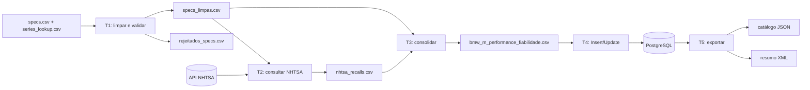
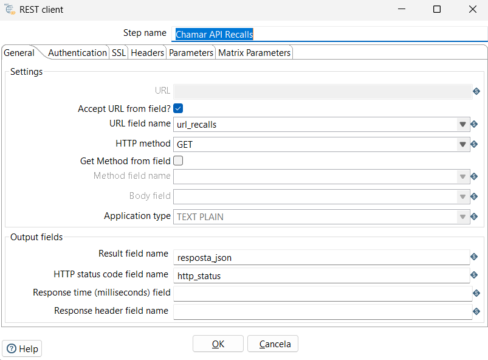
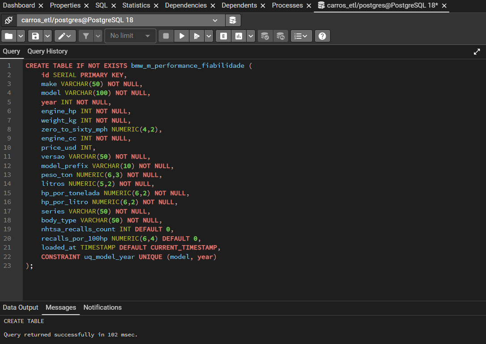

# Instituto Politécnico do Cávado e do Ave

## Escola Superior de Tecnologia

### Licenciatura em Engenharia de Sistemas Informáticos

### Integração de Sistemas de Informação — Ano letivo 2026/2027

---

# Trabalho Prático 1

## Pipeline ETL para análise de performance e campanhas de segurança da gama BMW M

**Autor:** Gonçalo Correia, n.º 22840

**Unidade curricular:** Integração de Sistemas de Informação

**Curso:** Licenciatura em Engenharia de Sistemas Informáticos

**Instituição:** IPCA — Escola Superior de Tecnologia

**Data:** outubro de 2026
**Repositório:** <https://github.com/goncaloalo/isi-tp1-performance-fiabilidade>

---

## Resumo

Este trabalho apresenta uma pipeline ETL desenvolvida em Pentaho Data Integration 10.2 para integrar um ficheiro local de especificações de veículos BMW M com contagens de campanhas de segurança consultadas na API REST da National Highway Traffic Safety Administration (NHTSA). A solução inclui validação e quarentena de dados, cálculo de indicadores mecânicos, rastreabilidade das consultas HTTP, consolidação em 18 campos, persistência em PostgreSQL e exportação em JSON e XML.

A revisão final confirmou 29 registos na fonte, um registo com peso omisso e 28 veículos mecanicamente válidos. Não existem duplicados na fonte atual segundo a chave `(make, model, year)`. A execução revista de T2 obteve 15 respostas HTTP 200 válidas e 13 respostas HTTP 400; estas últimas são representadas por contagens nulas, evitando que ausência de resposta válida seja confundida com zero campanhas.

**Palavras-chave:** ETL, Pentaho PDI, Kettle, PostgreSQL, REST, NHTSA, qualidade de dados.

## 1. Enquadramento

O trabalho foi realizado no âmbito da unidade curricular de Integração de Sistemas de Informação. O objetivo pedagógico consiste em demonstrar recolha, transformação, integração, persistência, orquestração e exportação de dados heterogéneos através de um fluxo reproduzível.

O domínio escolhido é a gama BMW M. O projeto cruza atributos técnicos — potência, peso, cilindrada e aceleração — com o número de campanhas devolvido pela NHTSA para uma combinação de marca, modelo genérico e ano.

## 2. Problema e objetivos

As duas fontes têm natureza e granularidade diferentes:

1. `data/raw/specs.csv` contém especificações por variante, por exemplo `M3 E46 CSL`.
2. A API NHTSA é consultada com `make`, prefixo genérico do modelo e `modelYear`, por exemplo `BMW`, `M3`, `2003`.

O problema de integração consiste em limpar a fonte local, impedir cálculos sobre valores inválidos, reduzir a designação da variante à chave aceite pela consulta, distinguir respostas válidas de falhas HTTP e produzir saídas coerentes sem atribuir à variante uma especificidade que a API não demonstra.

Os objetivos técnicos são:

- preservar a arquitetura T1 → T2 → T3 → T4 → T5;
- manter os dados rejeitados numa área de quarentena;
- calcular indicadores mecânicos verificáveis;
- conservar nulos relevantes, como o preço do M5 E34;
- impedir que erros HTTP ou JSON sejam convertidos silenciosamente em zero;
- evitar credenciais reutilizáveis nos ficheiros versionados;
- produzir CSV, PostgreSQL, JSON e XML;
- disponibilizar testes automáticos reproduzíveis.

## 3. Metodologia e proveniência dos dados

### 3.1. Especificações locais

O ficheiro `data/raw/specs.csv` é uma fonte fornecida no próprio projeto. Contém 29 registos entre 1985 e 2024. Não existe, no repositório, documentação que associe cada valor histórico a uma fonte BMW ou publicação independente. Assim, estes valores são tratados como dados de entrada do exercício e não como especificações oficialmente verificadas.

O ficheiro `data/raw/series_lookup.csv` é uma tabela de correspondência criada para a transformação. Mapeia `M2`, `M3`, `M4`, `M5`, `M6` e `M8` para uma designação de série e um tipo de carroçaria agregado.

### 3.2. Dados NHTSA

A NHTSA disponibiliza informação oficial sobre campanhas de segurança nos Estados Unidos. T2 usa o endpoint:

```text
https://api.nhtsa.gov/recalls/recallsByVehicle
    ?make=<make>
    &model=<model_prefix>
    &modelYear=<year>
```

Os três parâmetros enviados são:

- `make`: marca normalizada, neste caso `BMW`;
- `model`: prefixo genérico extraído por `^(M\d)\b.*`, como `M3`;
- `modelYear`: ano presente na fonte local.

Esta granularidade é marca/modelo genérico/ano. Uma resposta para `BMW M3 2003` pode abranger a família identificada pela NHTSA, mas não prova que todas as campanhas se aplicam especificamente ao `M3 E46 CSL`. Também não representa uma avaliação global de fiabilidade mecânica.

### 3.3. Critério de validade da resposta

Uma contagem só é aceite quando:

- o estado HTTP pertence ao intervalo 200–299;
- o corpo é JSON válido;
- existe a propriedade `Count`;
- `Count` é um inteiro não negativo.

`Count = 0` é guardado como zero apenas quando satisfaz estas condições. Erros HTTP, JSON inválido e `Count` ausente ou inválido originam contagem nula e um estado explícito em `nhtsa_recalls.csv`. Um timeout ou erro de transporte no REST Client continua a produzir falha da transformação e é propagado pelo job.

## 4. Arquitetura da solução



Os caminhos dos ficheiros Kettle são relativos a `${Internal.Entry.Current.Directory}`, reduzindo dependências da localização absoluta do repositório.

## 5. Transformações

### 5.1. T1 — extração, limpeza e enriquecimento

T1 executa os seguintes passos:

1. leitura dos dois CSV de entrada;
2. `trim` e normalização de `make`;
3. extração de `versao` por expressão regular e preenchimento com `Base` quando não existe edição identificada;
4. validação de peso, potência, cilindrada e ano;
5. encaminhamento de inválidos para quarentena;
6. extração de `model_prefix`;
7. ordenação e deduplicação pela chave `(make, model, year)`;
8. cálculo dos indicadores mecânicos;
9. `Stream Lookup` para série e carroçaria;
10. validação da correspondência no lookup e exportação.

As fórmulas são:

```text
peso_ton          = weight_kg / 1000
litros            = engine_cc / 1000
hp_por_tonelada   = engine_hp / peso_ton
hp_por_litro      = engine_hp / litros
```

O M3 E92 GTS (2010) permanece em `data/staging/rejeitados_specs.csv` por ter `weight_kg` omisso. Não foi estimado um peso.

Não foi removido qualquer duplicado da fonte atual: os 29 registos de `specs.csv` já são únicos. `Sort Rows` e `Unique Rows` foram mantidos para demonstrar e garantir a regra caso surjam duplicados futuros.


*Figura 1 — Captura existente do fluxo T1. A versão final acrescenta validações ao filtro e ao resultado do lookup; a configuração versionada no `.ktr` é a referência atual.*


*Figura 2 — Evidência anterior de 29 registos lidos, um rejeitado e 28 exportados; as mesmas contagens foram reproduzidas na revisão.*

### 5.2. T2 — extração NHTSA e controlo de erros

T2 reduz os 28 veículos às combinações únicas `(make, model_prefix, year)`, constrói o URL com `encodeURIComponent` e executa pedidos GET através do `REST Client`.

Após cada resposta, `Validar resposta NHTSA` analisa `http_status` e o corpo JSON. O fluxo distingue `OK`, `OK_ZERO`, `ERRO_HTTP_<código>`, `JSON_INVALIDO`, `COUNT_AUSENTE` e `COUNT_INVALIDO`. As situações inválidas são registadas com marca, modelo, ano, URL, estado HTTP e categoria, sem utilizadores ou passwords.

O ficheiro intermédio inclui seis campos:

```text
make, model, year, nhtsa_recalls_count, nhtsa_query_status, nhtsa_http_status
```



*Figura 3 — Configuração do REST Client. A validação explícita introduzida depois deste step é descrita pela configuração XML atual e deve receber uma captura nova antes da entrega.*

### 5.3. T3 — consolidação e indicador exploratório

T3 ordena as especificações e os resultados NHTSA e executa um `LEFT OUTER JOIN` por marca, prefixo/modelo e ano. Os campos de rastreabilidade de T2 são usados antes da consolidação e removidos para preservar o esquema final de 18 campos.

A versão revista não contém o antigo step que substituía `nhtsa_recalls_count = NULL` por zero. Consequentemente, uma consulta inválida produz `nhtsa_recalls_count` e `recalls_por_100hp` nulos.

O indicador é calculado apenas quando existe contagem válida:

```text
recalls_por_100hp = nhtsa_recalls_count / engine_hp × 100
```

Este rácio normaliza uma contagem de campanhas por potência. É útil para demonstrar transformação e agregação, mas não tem validação científica como medida de fiabilidade, não controla volume de produção, quilometragem, mercado, gravidade, duração de exposição ou componentes afetados.


*Figura 4 — Configuração do `LEFT OUTER JOIN` de T3.*

### 5.4. T4 — carga PostgreSQL

O DDL cria a tabela `bmw_m_performance_fiabilidade` com chave primária técnica, chave única `(make, model, year)`, tipos `NUMERIC` para valores decimais e restrições para ano, peso, potência, cilindrada e contagens não negativas.

`price_usd`, `nhtsa_recalls_count` e `recalls_por_100hp` aceitam nulo. Esta opção preserva, respetivamente, o preço omisso do M5 E34 e a ausência de resposta NHTSA válida.

A carga usa o step `Insert/Update`, com procura pela chave `(make, model, year)` e atualização dos restantes 15 campos. Esta solução evita o `TRUNCATE` anteriormente configurado. Contudo, não equivale a uma substituição transacional integral: uma interrupção pode deixar apenas parte das linhas atualizada e uma linha removida da fonte não é eliminada automaticamente.

As propriedades da ligação são resolvidas através de `PGHOST`, `PGPORT`, `PGDATABASE`, `PGUSER` e `PGPASSWORD`. Nenhuma password reutilizável permanece nos `.ktr`.



*Figura 5 — Evidência existente da preparação do esquema. A revisão acrescentou restrições ao DDL; deve ser capturada novamente após instalação limpa.*

### 5.5. T5 — exportação JSON e XML

T5 lê a tabela ordenada por série e ano e copia o fluxo para dois ramos:

- `JsonOutput`: catálogo de 28 objetos e 18 atributos;
- `GroupBy` + `XMLOutput`: resumo das seis séries.

A perda de casas decimais em `media_hp` foi corrigida sem alterar o tipo de `engine_hp` no catálogo. A consulta cria o campo auxiliar decimal:

```sql
CAST(engine_hp AS NUMERIC(10,2)) AS engine_hp_agregacao
```

O `GroupBy` calcula `AVERAGE(engine_hp_agregacao)` e o XML usa o formato `0.00`. O resumo inclui ainda `modelos_com_resposta_nhtsa`, calculado a partir da presença de uma contagem válida. Os dois steps de saída estão configurados para não abrir um ficheiro novo durante a inicialização: se a leitura PostgreSQL falhar antes de emitir linhas, os relatórios existentes não são substituídos por ficheiros vazios.


*Figura 6 — Captura anterior do fluxo T5. A versão final mantém a topologia e acrescenta campos auxiliares; é necessária uma nova captura da configuração final.*

## 6. Job de orquestração

`kettle/jobs/J_main.kjb` executa sequencialmente:

```text
START → T1 → T2 → T3 → T4 → T5 → Sucesso ETL
```

Cada transformação tem um hop de falha para `Abortar por Erro`. Assim, um timeout do REST Client, erro de leitura, falha de cálculo ou erro de base de dados impede a continuação normal.

O job não deve ser descrito como uma transação atómica entre ficheiros, API e PostgreSQL: estes sistemas não partilham uma transação distribuída. O mecanismo implementado é controlo sequencial e paragem perante erro.


*Figura 7 — Job de orquestração T1 a T5 e caminhos de erro.*

## 7. Resultados verificados

### 7.1. Qualidade e volume

| Verificação | Resultado |
|---|---:|
| Registos em `specs.csv` | 29 |
| Duplicados na chave `(make, model, year)` | 0 |
| Registos rejeitados por T1 | 1 |
| Veículos válidos | 28 |
| Séries | 6 |
| Respostas NHTSA HTTP 200 válidas na execução revista | 15 |
| Respostas NHTSA HTTP 400 na execução revista | 13 |

Os estados da API são mutáveis. Estes números descrevem a execução de revisão efetuada em 20 de outubro de 2026 e não devem ser assumidos como permanentes.

### 7.2. Resumo por série

| Série | Modelos | Respostas NHTSA válidas | Potência média (hp) | Total de campanhas nas respostas válidas | Média exploratória de recalls/100 hp |
|---|---:|---:|---:|---:|---:|
| Série 2 M | 4 | 4 | 422.50 | 5 | 0.2925 |
| Série 3 M | 9 | 6 | 395.00 | 22 | 0.9700 |
| Série 4 M | 4 | 3 | 487.75 | 7 | 0.5000 |
| Série 5 M | 8 | 1 | 503.75 | 1 | 0.1600 |
| Série 6 M | 2 | 0 | 533.50 | n/d | n/d |
| Série 8 M | 1 | 1 | 600.00 | 1 | 0.1700 |

As médias NHTSA usam apenas linhas com resposta válida. Por isso, não são diretamente comparáveis quando a cobertura é muito diferente. Em particular, não existe base para concluir que a Série 6 tem zero campanhas ou maior fiabilidade: nesta execução não houve resposta HTTP válida para os dois anos consultados.

### 7.3. Interpretação prudente

Os resultados demonstram a integração técnica e o cálculo dos indicadores. Não sustentam conclusões causais sobre sobrealimentação, qualidade de construção, robustez de motores ou fiabilidade geral. Uma campanha de segurança pode incidir num componente partilhado e a consulta por prefixo não identifica automaticamente a variante concreta.

## 8. Testes e validação

Foi criada uma suite com Python `unittest`, sem dependências externas. Os 23 testes cobrem:

- leitura, estrutura e contagens dos CSV;
- presença dos 28 veículos e preservação do rejeitado;
- ausência de duplicados e teste com duplicado artificial;
- campos obrigatórios e intervalos;
- fórmulas mecânicas e de recalls;
- preço nulo do M5 E34;
- coerência CSV/JSON;
- agregações e precisão do XML;
- XML bem formado e hops Kettle existentes;
- configuração das validações T1/T2/T3/T4/T5;
- fixtures para zero válido, erro HTTP, timeout, JSON inválido e `Count` ausente/inválido.

T1, T2 e T3 foram executadas nesta revisão com PDI 10.2. T4, T5 e J_main ficaram pendentes por falta de uma instância PostgreSQL configurada e salvaguardada. O XML e JSON versionados foram alinhados deterministicamente com o CSV consolidado e validados pelos testes; não são apresentados como resultado de uma nova execução de T5.

## 9. Limitações

- Falta de proveniência externa das especificações do CSV.
- Cobertura da NHTSA centrada no mercado dos EUA.
- Consulta por modelo genérico, sem confirmação por VIN ou variante.
- Estados e contagens da API sujeitos a alteração.
- Ausência de controlo por parque circulante, produção, quilometragem, gravidade ou tempo de exposição.
- Indicador `recalls_por_100hp` exploratório e não validado.
- Carga `Insert/Update` idempotente por chave, mas não atómica para todo o dataset.
- T4/T5/job final ainda por validar numa base preparada.
- Algumas capturas existentes antecedem as correções finais.
- Vídeo e QR Code ainda pendentes.

## 10. Vídeo demonstrativo e QR Code

> **AÇÃO MANUAL NECESSÁRIA:** gravar e publicar o vídeo demonstrativo com base em `docs/GUIAO_VIDEO.md`, confirmar acesso através de uma janela privada e só depois inserir nesta secção o URL real e o respetivo QR Code. Não existe atualmente um endereço de vídeo validado.

O ficheiro `docs/CHECKLIST_DEMONSTRACAO.md` contém os passos de preparação e validação.

## 11. Conclusão e trabalhos futuros

A pipeline implementa as operações essenciais de um processo ETL: ingestão de CSV, chamada REST, controlo de qualidade, quarentena, expressões regulares, deduplicação, lookup, junção, cálculo, carga relacional, exportação e orquestração. A revisão corrigiu a precisão da potência média, removeu a conversão indevida de respostas NHTSA inválidas em zero, reforçou as regras de T1 e retirou credenciais versionadas.

O projeto está tecnicamente mais próximo da entrega, mas a conclusão deve permanecer condicionada: ainda é necessário executar T4, T5 e o job completo numa base salvaguardada, atualizar as capturas afetadas e acrescentar o vídeo com QR Code real ao PDF técnico já gerado e revisto.

Como trabalhos futuros propõem-se:

- validar campanhas por VIN quando exista um identificador real e autorização para o usar;
- guardar data/hora, URL e categoria de cada consulta numa tabela de auditoria;
- introduzir repetição controlada com *backoff* para falhas transitórias;
- carregar primeiro para uma tabela temporária e efetuar uma troca transacional validada;
- documentar fontes primárias para cada especificação automóvel;
- executar testes de integração com PostgreSQL num ambiente descartável.

## 12. Referências

1. National Highway Traffic Safety Administration. “NHTSA Datasets and APIs — Recalls”. Disponível em: <https://www.nhtsa.gov/nhtsa-datasets-and-apis>. Consultado em 20/10/2026.
2. National Highway Traffic Safety Administration. “Resources Related to Investigations and Recalls”. Disponível em: <https://www.nhtsa.gov/resources-investigations-recalls>. Consultado em 20/10/2026.
3. Hitachi Vantara. “Pentaho Data Integration 10.2”. Disponível em: <https://docs.pentaho.com/pdia-data-integration/10.2-data-integration>. Consultado em 20/10/2026.
4. Hitachi Vantara. “REST Client — General tab”. Disponível em: <https://docs.pentaho.com/pdia-data-integration/10.2-data-integration/pdi-transformation-steps-reference-overview/rest-client-step/options-rest-client/general-tab>. Consultado em 20/10/2026.
5. Hitachi Vantara. “Group By”. Disponível em: <https://docs.pentaho.com/pdia-data-integration/10.2-data-integration/pdi-transformation-steps-reference-overview/group-by-landing-page-article>. Consultado em 20/10/2026.
6. Hitachi Vantara. “Use Command Line Tools to Run Transformations and Jobs”. Disponível em: <https://docs.pentaho.com/pdia-data-integration/10.2-data-integration/advanced-topics-pentaho-data-integration-overview/use-command-line-tools-to-run-transformations-and-jobs>. Consultado em 20/10/2026.
7. PostgreSQL Global Development Group. “PostgreSQL 18 — CREATE TABLE”. Disponível em: <https://www.postgresql.org/docs/current/sql-createtable.html>. Consultado em 20/10/2026.
